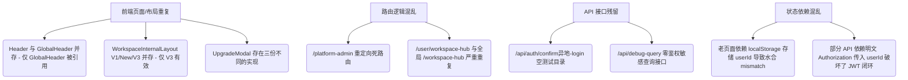

# 项目全量功能盘点与现状审计

本报告对“知阁·舟坊 (ZhiGe Dockyard) - 全栈软件研发效能操作系统”进行深度的全量功能梳理、现状审计与安全隐患分析，旨在揭示现有代码中的架构冗余、技术负债及高危越权漏洞，为下一步重构和版本迭代提供精确的参考依据。

---

## 1. 项目基础信息

### 1.1 项目技术栈
*   **前端框架**：Next.js v16.2.4 (App Router) + React v19.2.5 + React DOM v19.2.5
*   **后端/API 方式**：Next.js App Router 约定路由处理器 (`src/app/api/.../route.ts`)
*   **数据库/ORM**：MySQL 8.x + Prisma ORM v5.22.0
*   **鉴权与会话机制**：
    *   JWT (使用 `jose` v6.2.2 进行 Token 签发与强校验，加密盐来自 `JWT_SECRET`)
    *   全局中间件拦截 (`src/app/middleware.ts`)，结合 Cookie 中的 `auth_token`/`token` 与请求头 `Authorization: Bearer <token>`
    *   部分老旧模块依赖 `localStorage` 中的 `userId` 进行前端辅助渲染，这会导致 Next.js SSR 发生水合不匹配 (Hydration Mismatch)
*   **样式方案**：Tailwind CSS v4.2.2 + PostCSS + Autoprefixer，并内置了统一样式体系 (`public/zhige-design-system.html`)，页面底色固定为 `--zhige-bg-page` (#f0f8ff)，主色锁定为知性蓝 (#3182ce)
*   **主要第三方依赖**：`lucide-react` (图标库), `bcryptjs` (密码哈希加密), `uuid` (UUID 生成), `jose` (JWT 处理库)

### 1.2 项目目录结构概览
```
d:/Project Development/ZhiGe-Dockyard/zhige-dockyard-web
├── prisma/                    # Prisma 架构定义与数据库迁移脚本
│   └── schema.prisma          # 核心数据库模型定义 (MySQL 数据源)
├── docs/                      # 文档归档目录
│   ├── 工作空间执行控制台重构...   # 局部需求文档
│   └── 账号会话权限全场景详细...   # 权限场景文档
├── src/
│   ├── app/                   # App Router 路由与 API 终点
│   │   ├── admin/             # 平台全局管理后台页面 (users, workspaces, logs 等)
│   │   ├── api/               # 服务端 API 接口目录
│   │   ├── auth/              # 认证体系页面 (login, register, forgot-password 等)
│   │   ├── user/              # 用户中心页面 (profile, security, membership 等)
│   │   ├── workspace/         # 空间内部子页面 ([id]/studio, [id]/members, stats 等)
│   │   ├── workspace-hub/     # 空间中枢页面 (主 Bento 页面、create、settings)
│   │   ├── middleware.ts      # 核心全局路由与 API 鉴权/限频中间件
│   │   └── page.tsx           # 官网首页门户
│   ├── components/            # 全局 UI 组件库
│   │   ├── common/            # 通用基础 UI 组件 (AutoGrid, DataTableFilter 等)
│   │   ├── studio/            # 组件大厅与执行专属组件 (ComponentBrowser, DispatcherPanel)
│   │   └── workspace-hub/     # 空间中枢 Bento 区块组件及配套 Modal 弹窗
│   ├── constants/             # 全局静态常量 (如组件分类目录定义)
│   ├── contexts/              # 全局 React Context 上下文 (AppContext, ResponsiveContext)
│   ├── hooks/                 # 自定义 React Hooks (用以从大页面中解耦出状态逻辑)
│   ├── lib/                   # 核心公共类库
│   │   ├── prisma.ts          # Prisma 客户端单例初始化
│   │   ├── security.ts        # 全站角色、动态权限、越权防护与高危审计模块
│   │   └── auth.ts            # 密码加密校验、用户明文校验函数
│   └── types/                 # 全局 TypeScript 声明定义
└── package.json               # 依赖配置与项目启动 Scripts
```

### 1.3 当前项目启动方式
*   **Package.json Scripts 脚本**：
    *   `npm run dev`：启动 Next.js 本地热更新开发服务器 (`next dev`)。
    *   `npm run build`：执行生产环境静态优化构建 (`next build`)。
    *   `npm run start`：启动构建完成的 Next.js 生产环境 Node服务 (`next start`)。
    *   `npm run lint`：运行静态语法及规范检查 (`next lint`)。
*   **环境变量依赖 (.env)**：
    *   `DATABASE_URL`：MySQL 数据库主库连接字符串 (Prisma 依赖)。
    *   `JWT_SECRET`：JWT 签发及验证的密钥盐值。
    *   `API_RATE_LIMIT`：API 单分钟频控上限阈值（在中间件中被读取，默认 1000）。

---

## 2. 页面功能盘点

### 2.1 官网与公开页面

#### 官网首页
*   **路由**：`/`
*   **文件路径**：`src/app/page.tsx`
*   **用户状态**：未登录与登录用户皆可见。
*   **页面定位**：产品宣传门户，展示效能操作系统的核心卖点。
*   **当前主要功能**：介绍标书解析、系统设计、项目验收三大提效链路。
*   **页面上的主要操作**：点击“立即体验”跳转至 `/workspace-hub`（新版空间中枢），点击“申请 Demo”弹出联系表单，点击“查看价格”跳转至 `/pricing`。
*   **调用的 API**：无。
*   **使用的核心组件**：`HeroSection`, `CoreFeatures`, `EnterpriseSecurity`, `CTA`, `Footer`, `DemoRequestModal`。
*   **是否存在权限控制**：否，完全公开。
*   **当前问题或疑似风险**：无明显安全风险，但包含大量静态文本，部分营销功能未完成闭环。
*   **是否疑似重复页面**：否。

#### 价格方案页
*   **路由**：`/pricing`
*   **文件路径**：`src/app/pricing/page.tsx`
*   **用户状态**：未登录/登录皆可见。
*   **当前主要功能**：展示免费版、黄金版、白金版套餐的功能额度及定价。
*   **使用的核心组件**：`GlobalHeader`, `Footer`。
*   **当前问题或疑似风险**：价格支付购买流程仅能发起升级申请表单，缺乏真实在线收银台支付闭环。

#### 开发者文档与文档中心
*   **路由**：`/docs` 与 `/developers`
*   **文件路径**：`src/app/docs/page.tsx` 与 `src/app/developers/page.tsx`
*   **用户状态**：未登录/登录皆可见。
*   **当前主要功能**：展示平台使用指南与 API 开发者集成手册。
*   **调用的 API**：`/api/system-documents` (获取发布的手册列表)。
*   **当前问题或疑似风险**：页面排版较为简陋，存在极高重复性（`/docs` 和 `/developers` 呈现的内容及布局几乎完全一致）。

#### 认证中心 (登录/注册/找回密码)
*   **路由**：`/auth/login` | `/auth/register` | `/auth/forgot-password`
*   **文件路径**：`src/app/auth/.../page.tsx`
*   **用户状态**：未登录可见，已登录用户访问会被中间件重定向至空间中枢。
*   **页面定位**：全站统一通行证，支持手机号/邮箱/第三方 OAuth。
*   **调用的 API**：`/api/auth/login`, `/api/auth/register`, `/api/auth/send-sms`, `/api/auth/verify-sms` 等。
*   **使用核心组件**：`EmailInput`, `Toast`。
*   **安全校验**：密码强度在前端和后端进行双重校验 (`validatePasswordStrength`)，重置密码支持短信验证码二次认证。

#### 账号注销冷静期与撤销中枢 (Cancel Deletion Hub)
*   **路由**：`/auth/cancel-deletion`
*   **文件路径**：`src/app/auth/cancel-deletion/page.tsx`
*   **用户状态**：当用户状态处于 `status === "deleting"` 冷静期时进入；未登录重定向至登录页，状态已恢复正常则自动重定向至工作台或首页。
*   **页面定位与布局**：采用知阁大厂极简、高信息密度的自适应紧凑卡片（`max-w-2xl`），通过水平双栏对比网格大幅压缩垂直高度（控制在 450px 左右无滚动全屏居中呈现），提供：
    1. **账号身份标识区**：脱敏展示当前处于注销冷静期的用户名、邮箱/手机号及用户角色标签。
    2. **冷静期时间与进度看板**：大号字体展示剩余冷静期天数、预计彻底注销截止时间戳，以及可视化进度刻度条。
    3. **双栏规则与权益对比**：左栏展示冷静期安全保留规则，右栏展示撤销恢复保障承诺。
    4. **快捷主次操作栏**：知性蓝主按钮（撤销注销申请并恢复账号）与次级按钮（安全退出登录，冷静期持续计时）。
    5. **安全二次确认模态框**：基于系统统一规范 `.zg-modal` 构建二次确认弹窗，说明恢复后的权益保障并提供即时 loading 状态，杜绝误触。
    6. **状态实时同步**：提供轻量级刷新按钮，调用 `/api/auth/me` 同步多端最新状态。
*   **调用的 API**：
    *   `GET /api/auth/me`：读取当前账号信息、`deletionDaysRemaining` 与 `deletionCooldownDays`。
    *   `POST /api/user/cancel-deletion`：撤销注销申请，重置状态为 `active`，更新会话并自动写入最新 `auth_token` Cookie 保持免密登录态。
    *   `POST /api/auth/logout`：退出登录并清理本地客户端 Storage，冷静期在服务端独立维持计时。
*   **交互规范**：坚决摒弃原生 `alert/confirm`，完全对接知阁统一 `Toast` 与 `.zg-modal`。


---

### 2.2 用户中心页面

#### 用户个人设置与账号生命周期中心 (Profile & Account Lifecycle)
*   **路由**：`/user/profile`
*   **文件路径**：`src/app/user/profile/page.tsx`
*   **用户状态**：登录后可见。
*   **当前主要功能**：
    *   **核心资产与档案看板**：头像上传与动态渲染、会员等级徽章、系统身份角色及账号注册时间展示。
    *   **资料完成度实时指示**：实时计算昵称、邮箱、手机与头像完善进度，带条目完成度明细。
    *   **团队协同名片实时预览**：模拟真实工作空间内代码评审与协作时公开展示的名片卡。
    *   **基本资料动态修改与校验**：包含用户昵称严格校验、邮箱后缀智能感知自动补全 (`getEmailSuggestions`)、以及更换手机号时触发的动态短信验证码验证逻辑。
    *   **账号生命周期与注销闭环（顶级防截断规范重塑）**：
        1. **注销须知弹窗 (`showNoticeModal`)**：采用知阁统一规范 `.zg-modal`，明确冷静期时长与数据清空警告，必须勾选知晓后方可开启检测。
        2. **安全检测进度与确认弹窗 (`showCheckModal`)**：彻底重构原有双重重叠 Header 缺陷，引入单一规范头部与精致合规 Banner；弹窗 Body 强制开启自适应局部滚动保护 (`overflow-y-auto`)，底部固定锁定操作按钮，**彻底根除低分辨率视口下内容与确认按钮被截断遮挡的严重体验 Bug**。
        3. **撤销注销受控模态框 (`showCancelConfirmModal`)**：全面废弃浏览器原生 `window.confirm`，改用系统级 `.zg-modal` 确认弹窗，实现优雅防误触并提供实时反馈。
*   **调用的 API**：
    *   `GET /api/user/profile`：拉取个人基本资料与账号生命周期状态。
    *   `POST /api/user/profile`：保存昵称、邮箱、手机号（附带短信验证码）、签名等信息。
    *   `GET /api/user/delete-account/check`：检测工作空间、组件、未结算工单等 5 项注销依赖。
    *   `POST /api/user/delete-account`：经由二次身份验证（`StepUpAuthModal`）后进入冷静期。
    *   `POST /api/user/cancel-deletion`：撤销注销申请并恢复账号。
*   **安全与体验保障**：严禁原生弹窗，所有反馈统一对接 `useToast`；支持管理员自主保护机制（管理员账号禁止在前端自主注销）。


---

### 2.3 空间中枢页面 (Workspace Hub)

#### 空间中枢页面 (新版 Bento 布局)
*   **路由**：`/workspace-hub`
*   **文件路径**：`src/app/workspace-hub/page.tsx`
*   **用户状态**：登录后可见。
*   **页面定位**：用户管理多个个人和企业空间的仪表盘中枢。
*   **当前主要功能**：
    *   展示当前用户的基本配额信息（算力、存储、团队名额）。
    *   列出其作为所有者或成员的“个人空间”及“企业空间”。
    *   处理待处理的协作申请和审批通知。
    *   展示常用功能组件与快速通道。
*   **调用的 API**：`/api/user/workspace-hub/quota` (获取配额)、`/api/workspace/list` (拉取空间列表)、`/api/workspace/invitation/verify` 等。
*   **使用的核心组件**：大量 Bento 子组件：`UserGreeting`, `PersonalWorkspaceCard`, `EnterpriseWorkspaceList`, `ResourceOverview`, `QuickActions`, `FeaturedComponents`, `PendingSection`, 以及 Modals 中的 `CreateEnterpriseModal`, `JoinEnterpriseModal`, `UpgradeModal` 等。
*   **当前问题与风险**：与老版 `/user/workspace-hub` 高度重复。

#### 空间中枢创建空间页
*   **路由**：`/workspace-hub/create`
*   **文件路径**：`src/app/workspace-hub/create/page.tsx`
*   **当前主要功能**：向导式新建个人/企业空间。
*   **调用的 API**：`/api/workspace/create`。
*   **疑似重复**：该向导页面和中枢 Bento 主页的 `CreateEnterpriseModal` 弹窗创建逻辑完全重合。

---

### 2.4 空间内部页面

#### 空间主页 / 组件工坊 (Studio)
*   **路由**：`/workspace/[id]` (自动重定向至 `/workspace/[id]/studio`)
*   **文件路径**：`src/app/workspace/[id]/page.tsx` 与 `src/app/workspace/[id]/studio/page.tsx`
*   **用户状态**：空间成员/空间 Owner 可见。
*   **页面定位**：特定工作空间内的组件调度、装配与执行平台。
*   **页面上的主要操作**：装配组件、配置运行参数、在线 simulate 运行、查看任务运行记录、上传所需输入资料。
*   **调用的 API**：`/api/studio?action=bound`, `/api/studio?action=tasks` (拉取任务), `/api/studio?action=documents` (拉取文档), `POST /api/studio` (执行 simulate 算力扣减)。
*   **使用的核心组件**：`WorkspaceInternalLayoutV3`, `ComponentBrowser`, `ComponentDispatcherPanelNew`, `ConfirmDialog`。
*   **当前问题或疑似风险**：
    *   **高危越权风险**：`GET /api/studio?action=tasks&workspaceId=xxx` 和 `action=documents&workspaceId=xxx` 在后端接口中**完全没有检验**当前登录用户是否为该工作空间的成员，任何登录用户均可越权拉取其他空间的文档和任务日志。

#### 空间成员管理 / 空间设置 / 空间使用分析
*   **路由**：`/workspace/[id]/members` | `/workspace/[id]/settings` | `/workspace/[id]/stats` | `/workspace/[id]/components`
*   **文件路径**：`src/app/workspace/[id]/.../page.tsx`
*   **用户状态**：仅空间 Owner/Admin 可管理，Member 仅可见只读统计。
*   **当前主要功能**：
    *   邀请新成员，并为其分配空间物理角色 (ADMIN/MEMBER) 与企业岗位 (POST)。
    *   修改空间基本属性（名称、Logo、简介）。
    *   分配各岗位可操作的组件黑白名单。
    *   统计算力 Token 的消耗趋势（Barto 图表展示）。
*   **调用的 API**：`/api/workspace/kickout` (移除成员), `/api/workspace/invitation` (生成邀请码), `/api/user/workspace-hub/posts` (配置岗位) 等。
*   **使用的核心组件**：`WorkspaceInternalLayoutV3`（统领布局）。

---

### 2.5 管理后台页面 (Admin Pages)

#### 平台管理后台
*   **路由**：`/admin` (包含 `/admin/users` | `/admin/workspaces` | `/admin/components` | `/admin/membership` | `/admin/orders` | `/admin/operation-logs` | `/admin/settings` | `/admin/administrators` | `/admin/permissions` | `/admin/maintenance`)
*   **文件路径**：`src/app/admin/.../page.tsx`
*   **用户状态**：平台管理员 (PLATFORM_ADMIN) / 全局超级管理员 (SUPER_ADMIN) 可见。
*   **当前主要功能**：
    *   用户注册列表检索、一键封禁与强行清退。
    *   查看企业空间的算力配额，手动审批“升级企业空间”的申请。
    *   在商城中上架/下架组件，配置组件的价格权重。
    *   设置平台会员套餐的价格与权益。
    *   管理管理员账户，并对其分配细粒度模块权限（如 `user:read`, `workspace:read`）。
    *   一键开关“系统停机维护模式”。
    *   **操作审计与流水追踪 (`/admin/operation-logs`)**：
        *   **自然业务语言收敛**：杜绝底层机器计数器堆叠。针对批量操作（如批量封禁、批量解封、批量强制下线），将分散的 `totalSelected/processedCount/skippedCount/failedCount/skippedSample` 智能收敛为【批量处理结果】（如“共勾选 3 项：成功处理 1 项，跳过 2 项”）、【跳过处理说明】（自动提取 skippedSample 中去重后的具体业务案由）、【执行范围模式】（手动勾选/全选范围）以及【操作原因】等 2~3 个大白话业务卡片。
        *   **状态变更精准定性**：将单一状态修改（如 `status: inactive`）精准定性为“停用用户账号”，并以“变更后账号状态：已停用 (未激活)”展示，消灭“业务变更内容：业务状态：未激活”的生硬套娃，禁止误标为笼统的“修改用户资料”。
        *   **彻底消除机器乱码代号**：禁止截取 cuid 字符串生成如 `用户 (lxoy)`、`用户 (s1i7)` 这类无意义机器代号；优先关联数据库实体真实姓名与邮箱，查不到时统一优雅降级为“目标用户账号”。
        *   **全量中文词根映射与非硬编码双引擎**：拒绝简单写死字典的硬编码做法。建立底层通用动态转译架构：
            1. 键名动态分词引擎 (`translateFieldKeyToChinese`)：支持对任意未知驼峰/下划线键名（如 `paymentMethod`, `sourceTaskId`, `reviewComment` 等）进行拆解与通用词根匹配，确保未来新增任意业务字段均 100% 自动翻译为标准中文业务标签；
            2. 数据值智能转译引擎 (`translateValueToChinese`)：将真实数据根据业务类型进行人性化数据呈现，包括 ISO 时间自动格式化为标准年月日时分秒、数字自动补全“算力点/项/¥”计量单位、布尔值按业务语境转为“已公开上架/已启用/是/否”、复杂嵌套对象及数组提炼自然语言（彻底消灭 `[object Object]`）、长机器 ID 结合数据库实体自动降级脱敏。整个详情弹窗 100% 纯中文、零硬编码、真实数据化呈现。
*   **调用的 API**：`/api/admin/users`, `/api/admin/workspaces`, `/api/admin/components`, `/api/admin/permissions`, `/api/admin/maintenance`, `/api/admin/operation-logs` 等。
*   **使用的核心组件**：`AdminLayout` (内置路由拦截), `RoleMatrix`, `RoleCapabilities`, `Pagination`, `useToast` 等。
*   **是否存在权限控制**：是，服务端对每个 API 都通过 `requirePlatformPermission` 进行了极其严密的校验，如果非管理员将直接返回 403 Forbidden。
*   **重复路由风险**：`/platform-admin` 路由在 Layout 中直接重定向到 `/admin`，是一个彻底死掉的无用冗余路由。

---

## 3. 组件功能盘点

### 3.1 全局布局与状态组件

| 组件名 | 文件路径 | 用途 | 关键 Props | 业务逻辑 / 是否可能需要拆分 / 重复情况 |
| :--- | :--- | :--- | :--- | :--- |
| `GlobalHeader` | `src/components/GlobalHeader.tsx` | 全局主导航栏，驱动登录态、消息轮询 | 无 | 包含消息通知列表获取逻辑。**是目前项目的主力 Header**。 |
| `Header` | `src/components/Header.tsx` | 旧版全局导航栏 | 无 | **高危冗余**：使用 localStorage 读取 userId，已被 `GlobalHeader` 取代。项目内没有任何文件引用它，可直接物理删除。 |
| `AppLayout` | `src/components/AppLayout.tsx` | 根级全局布局包装器，整合路由守卫与顶部进度条 | `children` | 决定哪些路由（如 admin、workspace、auth）需要隐藏全局 Header。 |
| `Sidebar` | `src/components/Sidebar.tsx` | 极简工作空间小边栏 | 无 | 仅包含简单的几个图标，几乎无业务逻辑。 |
| `AvatarDropdown`| `src/components/AvatarDropdown.tsx` | 头像悬浮菜单，提供个人设置/退出登录入口 | 无 | 处理登出与 AppContext 状态同步。 |
| `WorkspaceSwitcher`| `src/components/WorkspaceSwitcher.tsx` | 顶部导航内的空间一键切换组件 | 无 | 包含拉取用户空间列表、更新 lastWorkspaceId 的核心逻辑。被 `GlobalHeader` 和 `Header` 引用。 |

### 3.2 认证与权限阻断组件

| 组件名 | 文件路径 | 用途 | 被哪些页面使用 | 是否包含业务逻辑 / 重复判定 |
| :--- | :--- | :--- | :--- | :--- |
| `AuthCheck` | `src/components/AuthCheck.tsx` | 全局首屏身份核验守卫 | `AppLayout.tsx` | **核心逻辑**：拦截未登录请求并触发身份核验，重置或加载 Context 状态。 |
| `PermissionGuard`| `src/components/PermissionGuard.tsx`| 空间按钮级权限细粒度隐藏控制 | 空间内部子组件 | **纯前端控制**：基于 Props 中的权限 Key 检查当前用户的权限，若不符合则不渲染 `children`。 |
| `RouterGuards` | `src/components/RouterGuards.tsx` | 路由跳转前的强制前置规则过滤 | `AppLayout.tsx` | 用于在路由切换时拦截冷静期注销用户、踢出黑名单等。 |
| `StepUpAuthModal`| `src/components/StepUpAuthModal.tsx` | 敏感高危操作前的密码升阶验证弹窗 | 空间及后台管理 | **核心闭环**：向后端获取升阶凭证，通过后允许执行删除或重大修改。 |

### 3.3 三代 WorkspaceInternalLayout 冗余分析

| 组件名 | 用途与状态 | 文件路径 | 冗余判定 |
| :--- | :--- | :--- | :--- |
| `WorkspaceInternalLayoutV3` | **当前空间内页面唯一主力布局**。多栏自适应，集成了骨架屏、成员加入审核、岗位配置等大量 UI 交互。 | `src/components/WorkspaceInternalLayoutV3.tsx` | **有效**，目前 `/workspace/[id]/*` 路由下的 5 个功能页均统一调用此 V3 布局。 |
| `WorkspaceInternalLayoutNew` | 第二代空间布局，内含老版套餐升级弹窗。 | `src/components/WorkspaceInternalLayoutNew.tsx` | **废弃**，项目内无任何文件引用。 |
| `WorkspaceInternalLayout` | 第一代空间布局，最初的简易实现。 | `src/components/WorkspaceInternalLayout.tsx` | **废弃**，项目内无任何文件引用。 |

### 3.4 升级/申诉/协作等弹窗的重叠情况
1.  **空间升级弹窗的重叠**：
    *   `src/components/UpgradeModal.tsx`：老旧升级弹窗，被旧页面 `/user/workspace-hub` 引用。
    *   `src/components/workspace-hub/modals/UpgradeModal.tsx`：新版升级弹窗，被 Bento 空间中枢 `/workspace-hub` 引用。
    *   `src/components/WorkspaceUpgradeModal.tsx`：老版布局配套的升级弹窗（死代码，无引用）。
    *   *注：当前主力的 `WorkspaceInternalLayoutV3.tsx` 在处理空间升级时，并未引入上述任何组件，而是手写了一套 Inline Div 弹出块（代码 2035 行起）。这属于组件重构未闭环、缺乏设计系统复用的典型混乱。*
2.  **空间删除弹窗的重叠**：
    *   `src/components/DeleteWorkspaceDialog.tsx`：独立的文件，被旧版布局引用。
    *   `src/components/workspace-hub/modals/DeleteConfirmModal.tsx`：Bento 中枢配套的确认弹窗。
3.  **分享/邀请弹窗的重叠**：
    *   `src/components/ShareWorkspaceModal.tsx`：独立文件，老版逻辑。
    *   `src/components/workspace-hub/modals/ShareWorkspaceModal.tsx`：中枢配套弹窗。

### 3.5 组件工坊核心执行组件
*   `ComponentBrowser` (`src/components/studio/ComponentBrowser.tsx`)：渲染组件列表、运行态参数绑定、结果输出及操作记录展示（111k 大文件，承担了组件工坊前端的绝大部分业务）。
*   `ComponentDispatcherPanelNew` (`src/components/studio/ComponentDispatcherPanelNew.tsx`)：新版组件配置交互面板。
*   `ComponentDispatcherPanel` (`src/components/studio/ComponentDispatcherPanel.tsx`)：**老旧面板，已被 New 取代，项目内无引用。**

---

## 4. API 功能盘点

### 4.1 用户与认证相关 API

#### 个人资料接口
*   **路由**：`/api/user/profile`
*   **文件路径**：`src/app/api/user/profile/route.ts`
*   **方法**：GET / PUT
*   **是否需要登录**：是。
*   **高危安全风险**：
    *   接口使用 `request.headers.get("Authorization")?.replace("Bearer ", "")` 获取明文 `userId` 并直接作为 SQL 查询的 ID。
    *   虽然中间件拦截了该请求，但由于中间件优先支持 Cookie 中的 `auth_token` 验证（攻击者只需使用自己合法的账号登录即可生成此 Cookie），如果攻击者在发送请求时将 `Authorization` 头部手动修改为目标用户的明文 `userId`，服务端接口将会直接信任该 `userId` 并返回/修改该目标用户的敏感个人信息。
    *   **判定为高危水平越权漏洞 (BOLA)**。

#### 会员额度与配额查询接口
*   **路由**：`/api/user/workspace-hub/quota`
*   **文件路径**：`src/app/api/user/workspace-hub/quota/route.ts`
*   **方法**：GET
*   **高危安全风险**：同样使用明文 `replace("Bearer ", "")` 来确定 `userId`，存在上述相同的水平越权身份假冒风险。

---

### 4.2 工作空间相关 API

#### 工作空间列表/切换/创建
*   **路由**：`/api/workspace/list` | `/api/workspace/create` | `/api/workspace/switch`
*   **文件路径**：`src/app/api/workspace/.../route.ts`
*   **方法**：GET / POST
*   **高危安全风险**：
    *   这三个核心接口中存在相同的“双保险”退化逻辑：
        ```typescript
        // 双保险：若 Header 鉴权失败，则尝试从 Cookie 中直接读取未加密的 userId (前端在登录成功后已写入该 Cookie)
        const cookieUserId = request.cookies.get("userId")?.value;
        if (cookieUserId) {
          userId = cookieUserId;
        }
        ```
    *   `userId` Cookie 是一个完全未签名、未加密的明文 Cookie（仅由前端在登录时写入本地）。
    *   攻击者登录后，只需手动篡改本地的 `userId` Cookie（例如改成目标用户的 ID），这三个接口就会完全信任该 Cookie 中的身份，导致攻击者能够以目标用户的身份越权拉取其工作空间列表、创建新空间或任意切换空间。
    *   **判定为特大安全隐患漏洞**。

#### 空间资产统计接口
*   **路由**：`/api/workspace/assets`
*   **文件路径**：`src/app/api/workspace/assets/route.ts`
*   **方法**：GET
*   **功能**：返回用户名下所有空间的任务、文档、架构图数量。
*   **高危安全风险**：
    *   完全从 query 参数读取 `userId = searchParams.get("userId")` 并执行联表统计。
    *   接口内部没有进行任何登录态与所请求 `userId` 之间的一致性比对，任何已登录的用户都可以通过传入他人的 `userId` 来窃取他人的工作空间资产统计数据。
    *   **判定为水平越权漏洞**。

---

### 4.3 组件工坊 API

#### 组件状态及任务资料接口
*   **路由**：`/api/studio`
*   **文件路径**：`src/app/api/studio/route.ts`
*   **方法**：GET / POST
*   **高危安全风险**：
    1.  **特权调试后门**：在 `getUserId` 辅助函数中（代码 13 行）：
        ```typescript
        const testUserId = request.headers.get("X-Test-UserId");
        if (testUserId) {
          return testUserId;
        }
        ```
        如果在请求头里加入了 `X-Test-UserId: <target_userId>`，该接口就会完全跳过所有的 JWT 校验，直接判定当前登录人为该 `target_userId`。在生产环境下，这等同于给全站组件执行和任务数据拉取开了一个致命后门。
    2.  **水平越权**：当 `action=tasks` 或 `action=documents` 时，接口拉取特定工作空间下的任务日志和文档，但是**完全没有校验**当前登录用户是否为该工作空间的成员。任意登录用户只需拼接 `workspaceId`，即可拉取到该空间的所有审计记录和保密文档。

---

### 4.4 调试与临时 API

#### 模糊空间查询测试接口
*   **路由**：`/api/debug-query`
*   **文件路径**：`src/app/api/debug-query/route.ts`
*   **方法**：GET
*   **高危安全风险**：
    *   此接口属于典型的**调试残留接口**，在生产环境中没有被中间件拦截，且没有任何登录拦截。
    *   任何匿名访客访问 `/api/debug-query`，接口都会去模糊查询名称包含 "Gao" 的所有工作空间，联表返回该空间下所有的任务列表、成员数量和详情，并在出错时直接抛出包含系统路径的完整错误堆栈。
    *   **判定为高危安全隐患，应立即删除。**

---

## 5. 数据库模型盘点 (Based on schema.prisma)

基于 `prisma/schema.prisma` 定义，全站核心数据模型盘点如下：

### 5.1 用户与认证模型
*   `user`：存储全站用户的核心表。包含 role (默认 user)、membershipLevel (免费/黄金等)、status (UserStatus 枚举，活跃/封禁/注销中)、lastWorkspaceId、lastLoginIp、lastLoginDevice 等安全指标。
*   `userdevice`：设备登录记录表，限制单个账户最大登录设备数 (`deviceLimit`)，用于防范多端账号共享。
*   `loginhistory`：用户的登录日志历史。
*   `accountappeal`：用户被系统自动判定或人工封禁后的申诉记录表。
*   `apikey`：用户分发的独立 API 密钥表，用于第三方工具集成。

### 5.2 工作空间与协作模型
*   `workspace`：工作空间核心实体表。包含类型 `workspace_type` (PERSONAL 个人 / ENTERPRISE 企业)、ownerId (空间所有者)、quota (Json，旧配额配置) 以及关联套餐。
*   `workspacemember`：工作空间物理成员关联表。通过 `userId` 和 `workspaceId` 建立联合唯一约束。定义成员在空间内部的物理角色 `workspacemember_role` (OWNER / ADMIN / MEMBER)。
*   `workspaceinvitation`：协作邀请码表。包含唯一邀请 Code、过期时间、被使用状态等。
*   `workspacekickhistory`：成员被从空间内踢出的历史存根，用于管理审计。

### 5.3 岗位、动态组件及知识库模型
*   `workspacepost` (岗位表) & `postmember` (成员岗位关联表)：
    *   在企业空间协作中，为空间成员分配特定的岗位（例如系统架构师、前端开发等）。
    *   逻辑角色（如组件管理员）便是基于成员是否在 `postmember` 表中被赋予了特定的岗位来动态计算的。
*   `componentpermission`：岗位对特定组件的细粒度操作权限配置表（canView, canEdit, canDelete, canExecute），控制什么岗位可以运行什么组件。
*   `componenttask`：组件运行任务实例表。存储当前任务的执行进度 (progress)、状态 (status：pending/running/success/failed)、配置参数 (config Json) 以及最终执行结果 (result Json)。
*   `componentstats` | `componentfavorite` | `componentrating` | `componentreview`：围绕组件大厅构建的浏览、评分、评论、热度分析、收藏系统模型。
*   `document`：工作空间内部沉淀的知识文档表，支持父子层级关系，构成空间的“知识库”。
*   `asset`：工作空间中上传的文件、静态图片资源。

### 5.4 会员与算力额度模型
*   `membershiplevel`：全站会员等级及配额大纲表（定义了最大个人空间数、最大团队人数、最大存储 limit 等）。
*   `workspacequota`：每一个具体工作空间绑定的话费/算力余额配额表。存储当前空间的 Token 算力余额 (`tokenBalance`)、存储已使用量 (`storageUsed`) 以及 API 剩余调用次数。
*   `membershiporder`：会员充值/套餐购买订单表。
*   `membershipchangelog`：会员升级或降级的变更日志，用于财务核算。

---

## 6. 角色与权限现状

### 6.1 角色分层体系

#### 1. 平台级角色 (normalizePlatformRole 归一化)
*   `SUPER_ADMIN`：全局超级管理员。拥有对后台所有子模块的完全控制权（包括系统设置、管理员赋权、开关停机维护）。
*   `PLATFORM_ADMIN`：平台普通管理员。菜单和 API 的可访问性由 `src/lib/admin-permissions.json` 中配置的权限包 (如 `user:read`, `audit:read`) 进行动态限制。
*   `USER`：普通注册用户，无法访问任何管理员后台。

#### 2. 空间级物理角色 (workspacemember.role)
*   `OWNER`：空间拥有者。有权删除空间、转让空间，且不受任何组件运行限制。
*   `ADMIN`：空间管理员。有权配置空间、邀请/踢出成员、分配岗位，但无法执行 `workspace:delete`。
*   `MEMBER`：普通空间协作成员。权限受岗位限制。

#### 3. 空间级动态岗位逻辑角色 (getLogicalWorkspaceRole 计算)
*   `COMPONENT_MANAGER`：组件管理员。自动具备空间内组件安装、配置、执行与授权的所有组件权限。
*   `KNOWLEDGE_MANAGER`：知识库管理员。具备空间知识文档的增删改查及审核发布权限。
*   `VIEWER`：只读访客。对空间内的组件、文档、资源及任务仅具备 Read 只读权限。

---

### 6.2 当前角色权限表

| 角色名称 | 作用范围 | 能访问的页面路由 | 核心操作功能权限 | 存在的问题/越权隐患 |
| :--- | :--- | :--- | :--- | :--- |
| **SUPER_ADMIN** | 平台全局 | 平台后台全量路由 (`/admin/*`)前台所有页面 | 审核申诉、全局系统设置、管理员权限指派、开关维护模式 | 无明显隐患，具有最高特权。 |
| **PLATFORM_ADMIN** | 平台局部 | 根据 `admin-permissions.json` 分配的页面，其余重定向回 `/admin` | 用户管理、订单查看、组件上架下架、查看审计日志 | 后台的权限配置文件 `admin-permissions.json` 存放在本地磁盘而非数据库中，高并发下存在文件读写锁与状态不一致风险。 |
| **USER** | 个人与所加入的空间 | 官网、中枢、个人资料、所加空间内部 (`/workspace/[id]/*`) | 新建空间、在被授权岗位下执行 simulate 组件并扣减 Token | **高危越权**：可利用 API 鉴权不一致的空子，以明文 userId 冒充任意目标用户进行信息查询、删除或修改。 |
| **OWNER** (空间级) | 特定工作空间 | 空间首页、成员分配、设置页面、stats 页面 | 移除成员、分配岗位、申请升级空间套餐、删除工作空间 | 无明显隐患，只在空间内生效。 |
| **MEMBER** (空间级) | 特定工作空间 | 空间 studio 执行台、文档列表、stats 只读 | 在限制岗位外运行组件、上传资料、创建文档 | **高危越权**：可调用 API 直接拉取不属于自己的工作空间下的任务日志和所有机密文档。 |

---

## 7. 业务流程盘点

### 7.1 用户注册登录流程
1.  **步骤**：注册（校验邮箱/手机） -> 密码哈希哈希加密写入 -> 登录（生成 Session JWT，写入 Cookie `auth_token` 并同步将明文 userId 写入 `userId` Cookie）。
2.  **冷静期注销机制**：当用户在资料中提交“注销账号申请”后，账号状态变更为 `deleting` 并记录 `deletionRequestedAt`。系统提供 7 天冷静期。冷静期内登录会被中间件拦截，仅允许访问首页，并可在页面中点击“撤销注销申请”。超过 7 天后，后台在下次交互时可根据时间判定执行物理/逻辑删除。
3.  **缺失/风险**：前端往本地 Cookie 写入明文 `userId` 的操作，导致后文提及的服务端退化信任该明文 Cookie，产生了水平越权。

### 7.2 空间中枢流程
1.  **新建个人空间**：当用户首次登录并访问空间列表 API 时，系统如判定其名下尚无“个人空间”，会自动为其创建一个默认个人空间，并初始化绑定配额 `workspacequota`（自动匹配当前会员等级赋予的 Token 余额，如 FREE 等级初始化 10000 算力 Token）。
2.  **切换空间**：更新数据库中 User 的 `lastWorkspaceId` 字段，以便在下次登录或回到工作台时，自动定位到上次操作的活跃空间。

### 7.3 组件执行流程
1.  **浏览/装配**：用户在 `/workspace/[id]/studio` 下浏览已被当前空间绑定的组件大厅组件。
2.  **权限卡关**：前端组件基于 `PermissionGuard` 判定，后端在收到运行指令时，通过 `getLogicalWorkspaceRole` 综合判定成员岗位是否属于被封禁或被限制组件名单，如果不通过则阻断运行。
3.  **算力校验与扣减**：查询空间的 `workspacequota.tokenBalance` 算力余额。如余额充足，则调用 `prisma.workspacequota.update` 进行扣减（默认扣减 5 Token），并异步向 `componenttask` 中插入一条 pending 任务，随后更新进度直至成功。

---

## 8. 重复和混乱点识别

经过系统级代码扫描，梳理出以下九大重复和混乱点：



### 重复与混乱清单

| 重复/混乱类型 | 文件路径 / 路由 | 核心问题 | 安全或维护风险 | 重构改进建议 |
| :--- | :--- | :--- | :--- | :--- |
| **导航头部重复** | `src/components/Header.tsx` | 与 `GlobalHeader.tsx` 高度重复，目前已无任何文件引用。 | 混淆开发人员，且该文件内包含过时的 localStorage 鉴权逻辑。 | **物理删除** 该文件。 |
| **空间布局重复** | `src/components/WorkspaceInternalLayout.tsx` <br>`src/components/WorkspaceInternalLayoutNew.tsx` | 空间内主力布局共有三代，目前仅 V3 处于激活被引用状态。 | 产生大量废弃的死代码 (Dead Code)，使工程体积虚大。 | **物理删除** V1 和 New 版本，仅保留 V3。 |
| **升级 Modal 重叠** | `src/components/UpgradeModal.tsx` <br>`src/components/WorkspaceUpgradeModal.tsx` | 同一空间升级功能，存在新版、老板和未引用三套 Modal 实现。 | 破坏了全站设计系统的一致性，且维护困难。 | 合并为统一的 UpgradeModal 并收纳在 `src/components/common` 中，在 V3 布局中复用。 |
| **无效重定向路由** | `src/app/platform-admin` | 整个平台管理路由在 Layout 下直接重定向到 `/admin`。 | 该目录下编写的所有页面逻辑（如 workspaces）变成了永远无法被渲染的“僵尸页面”。 | 判定是否需保留该路由。若不保留，直接物理删除该目录。 |
| **空间中枢页面重复**| `src/app/user/workspace-hub/page.tsx` | 与全局的 `/workspace-hub/page.tsx` 高度重复。 | 包含陈旧的代码编写规范，在 API 调用中硬编码了本地 Token。 | **下线并删除** `/user/workspace-hub` 路由，统一导向主 `/workspace-hub`。 |
| **参数面板重复** | `src/components/studio/ComponentDispatcherPanel.tsx` | 与 New 面板高度重复，目前已无任何引用。 | 冗余文件。 | **物理删除**。 |
| **空调试目录残留** | `src/app/api/auth/confirm异地-login` | 拼写包含中英文，且为空目录。 | 命名极度不规范，破坏目录整洁度。 | **物理删除**。 |
| **未鉴权敏感接口** | `src/app/api/debug-query/route.ts` | 没有任何鉴权拦截的测试查询接口，且泄露数据。 | 任何人访问此接口皆可越权查到系统的空间、任务和成员配置。 | **立即物理删除**。 |

---

## 9. 模块完整度评分

| 业务模块名称 | 当前评分 | 已有核心功能 | 缺失的核心功能 / 缺陷 / 改进方向 | 优先级 |
| :--- | :---: | :--- | :--- | :---: |
| **未登录官网** | **4** | 首页介绍、解决方案、安全声明及价格方案静态展示。 | 解决方案和价格套餐无对应的在线交易或模拟订购流。 | 低 |
| **登录与注册** | **5** | 手机验证码登录、常规邮箱登录、冷静期账号注销、以及注册页面原生条款与政策弹窗（Modal）及全栈数据交互。 | 注册时缺乏图形验证码或滑块验证，存在被短信轰炸的风险。 | 中 |
| **新版空间中枢**| **4** | Bento 风格布局，列出空间、套餐配额概览、处理成员申请。 | 暂无。 | - |
| **个人空间管理**| **4** | 首次登录自动创建个人空间、初始化 quota 配额。 | 个人空间的资源额度隔离机制尚不够彻底。 | 中 |
| **企业空间协作**| **3** | 生成唯一邀请码、绑定岗位与物理角色、限制岗位组件。 | 服务端在分配岗位成员时，缺乏对所分配岗位是否存在的一致性校验。 | 高 |
| **组件大厅** | **4** | 浏览组件、收藏、打分、添加评论。 | 评分和打分缺乏频次控制，用户可以无限制重复刷分。 | 低 |
| **组件模拟执行**| **4** | 校验空间逻辑权限、岗位白名单，成功执行后扣减 Token。 | **存在测试特权后门 `X-Test-UserId`**，需予以剔除。 | 高 |
| **任务与日志** | **3** | 异步生成 componenttask 记录，更新进度。 | **接口 `/api/studio?action=tasks` 缺少空间归属越权校验。** | 高 |
| **知识库文档** | **3** | 在空间下创建文档、构成目录结构。 | **接口 `/api/studio?action=documents` 缺少空间归属越权校验。** | 高 |
| **平台管理后台**| **4** | 用户列表检索与封禁、空间配额审批、管理员细粒度权限指派。 | 权限配置文件直接保存在磁盘 JSON，高并发读写存隐患。 | 中 |
| **安全与审计** | **3** | 统一在 `/api` 记录 apiusage 历史、写入高危 operationlog。 | 部分关键 API 写入操作（如修改密码）未记录在审计日志中。 | 中 |

---

## 10. 高风险问题清单

### 🚨 1. 未签名明文 Cookie 信任导致的严重水平越权 (BOLA)
*   **影响接口**：`/api/workspace/list` | `/api/workspace/create` | `/api/workspace/switch`
*   **漏洞成因**：在鉴权失败的兜底分支中，接口直接读取了名为 `userId` 的 Cookie。该 Cookie 是一个完全由前端明文写入的字符串，未经过任何加密或签名。
*   **危害后果**：攻击者只需正常登录自己的账号，然后将浏览器的 `userId` Cookie 手动修改为目标受害者的 ID，发送请求即可越权查看、新建或切换属于该目标受害者的工作空间。

### 🚨 2. API 直接读取 Authorization 明文导致身份假冒
*   **影响接口**：`/api/user/profile` | `/api/user/workspace-hub/quota`
*   **漏洞成因**：接口使用 `Authorization: Bearer <token>` 头部，但是却不用 JWT 解析它，而是直接把 Bearer 后面的部分作为明文 `userId` 直接带入 Prisma SQL 查询。
*   **危害后果**：由于中间件优先从 Cookie `auth_token` 读取合法 JWT 放行，攻击者登录后，可将 `Authorization` 头部手动修改为任意目标用户的明文 `userId`，即可完美通过中间件，并在 API 层面假冒目标用户身份读取或篡改其敏感个人信息。

### 🚨 3. 组件执行接口 `/api/studio` 的测试特权后门
*   **影响接口**：`/api/studio` (GET / POST)
*   **漏洞成因**：在获取当前用户 ID 的辅助函数中，优先读取了请求头中的 `X-Test-UserId` 字段，且没有进行任何环境判断或签名校验。
*   **危害后果**：攻击者在发送请求时，只需在请求头中附加 `X-Test-UserId: <target_userId>`，系统便会完全绕过 JWT 身份核验，直接将当前会话等同于该目标用户，具有灾难性的越权漏洞隐患。

### 🚨 4. 空间任务及文档拉取缺少空间成员校验
*   **影响接口**：`/api/studio?action=tasks` | `/api/studio?action=documents`
*   **漏洞成因**：接口在拉取特定空间下的任务日志 and 文档时，仅验证了全局登录态 (是否有合法的 JWT)，但完全没有检验这个 `userId` 是否为该 `workspaceId` 的成员或 Owner。
*   **危害后果**：任意登录的用户，只需猜测或获取到他人的 `workspaceId`，即可越权拉取该空间下的所有机密文档和任务审计日志。

### 🚨 5. 调试残留接口 `/api/debug-query` 敏感数据泄露
*   **影响接口**：`/api/debug-query`
*   **漏洞成因**：该接口在开发测试完成后被遗漏在生产目录中，没有任何鉴权和访问限制。
*   **危害后果**：任何匿名用户访问此接口，均能直接模糊匹配到全网包含特定关键字的工作空间，并联表拖走其任务列表、成员详情，泄露全站敏感架构设计数据。

---

## 11. 下一步重构建议

> [!IMPORTANT]
> 以下重构措施仅作为产品规划与架构设计建议，当前未修改任何业务代码。

1.  **废弃并剔除死代码 (Dead Code)**：
    *   物理删除老旧导航 `src/components/Header.tsx`。
    *   物理删除废弃的空间布局 `WorkspaceInternalLayout.tsx` and `WorkspaceInternalLayoutNew.tsx`。
    *   物理删除废弃的 `ComponentDispatcherPanel.tsx`。
    *   物理删除废弃路由 `/user/workspace-hub`（包含 `posts` and `role-matrix` 子目录，统一迁往新版），以及停用死路由 `/platform-admin`。
2.  **统一 API 鉴权上下文，根除越权隐患**：
    *   **彻底禁用明文 Cookie 降级**：禁止在 API 接口中直接读取未签名的 `userId` Cookie。身份判定必须强制通过中间件解析 JWT payload 得到的 `x-user-id` 请求头。
    *   **规范化 Authorization 解析**：改写底层的 `validateUser` 校验逻辑，不再允许直接 replace "Bearer" 拿到明文 userId，必须对其进行 JWT 解密验证，或者统一使用中间件注入的 `x-user-id` 头作为唯一可信的当前用户身份。
    *   **下线测试后门**：立即从 `/api/studio` 中移除对 `X-Test-UserId` 头部字段的隐式信任，本地开发测试应使用专门的 Mock 文件或严格限制在 `process.env.NODE_ENV === 'development'` 且校验回环 IP 才能开启。
    *   **增补垂直与水平越权防护**：在 `/api/studio?action=tasks` 检索、`/api/workspace/assets` 统计等所有涉及空间资源的接口中，必须引入空间归属校验（即在 SQL 查询时关联 `workspacemember` 表，强校验 `userId` 是否为该 `workspaceId` 的成员）。
    *   **清理调试接口**：物理删除 `src/app/api/debug-query`，防止敏感数据泄露。
3.  **整合弹窗组件，推行组件化设计**：
    *   将散落在项目各处的 `UpgradeModal` and `DeleteWorkspaceDialog` 统一重构为单例共享组件，收纳于 `src/components/common`，并在主力 `WorkspaceInternalLayoutV3` and 中枢页面中复用，消除 Inline Modal 手写块。

---

## 12. 工作空间分级停用期限管控与风控申诉闭环系统（2026-09-06 增补）

### 12.1 业务背景
解决平台此前对违规或欠费工作空间“一刀切”永久停用导致的负面体验，实现停用期限阶梯化（1天、3天、7天、1个月、1年、永久）、前台中枢截止节点与剩余天数显性化提示、无人值守到期自动解封自愈、以及严格限制 1 次机会的空间所有者解封申诉风控闭环。

### 12.2 核心机制与无损持久化
*   **零破坏性 ALTER 数据库架构**：利用 `workspace.quota` JSON 存储 `disabledUntil`、`disabledReason`、`disabledDuration`、`appealStatus`、`appealCount` 等，复用既有 `accountappeal` 表作为统一风控工单底座（`businessType: "空间解封申诉"`）。
*   **无人值守自愈解封引擎**：在中枢 Dashboard、空间成员身份校验、后台列表接口中嵌入自愈引擎，当 `now > disabledUntil` 时自动在数据库中恢复 `status = 'ACTIVE'` 并清除停用标记。
*   **严格单次申诉与风控中心联动**：空间所有者仅有 1 次解封申诉机会（通过 `appealCount >= 1` 强校验阻断二次提交），审核通过自动解除管控并向空间全员推送恢复通知；审核驳回向申诉人发送理由通知并锁定申诉按钮，明确告知等待到期自动恢复。
*   **详情归档**：完整技术方案与用例见 [docs/plans/2026-09-06-workspace-disable-duration-and-appeal-closure.md](file:///d:/Project%20Development/ZhiGe-Dockyard/zhige-dockyard-web/docs/plans/2026-09-06-workspace-disable-duration-and-appeal-closure.md)。

---

## 13. 操作审计全量中文转译与防硬编码动态语义引擎（2026-09-13 增补）

### 13.1 业务痛点与治理目标
彻底消灭管理后台操作审计流水中的英文代码裸露（如 `archived`、`appeal:deleted`、`businessTypes`）、复数属性缺失退化为机械的“业务属性明细”、纯技术机器代码裸露（如 25 位 CUID `cmtd04l...`）以及高危批量处理误判等问题。构建 100% 全中文呈现、零硬编码、自适应单复数分词归一化与数据库真实实体双向反查的审计呈现闭环。

### 13.2 核心架构与转译引擎实现
1. **动作识别与业务域意图智能解析**：
   - 补充申诉工单系列特权动作元数据映射（`appeal:deleted` -> “删除申诉工单”、`appeal:account_unban_approved` -> “审核通过解封申诉”、`appeal:workspace_unban_rejected` -> “审核驳回空间申诉”等）。
   - 针对未知动作提供按词根与业务意图（申诉工单、用户、工作空间、组件、文档等 × 创建、删除、审核、封禁等）智能重构中文标签，彻底消除顶栏误判为“系统删除”等失真现象。
2. **键名动态分词与复数归一化算法 (`translateFieldKeyToChinese`)**：
   - 自动针对驼峰和下划线分词（如 `targetUserIds`、`statuses`、`businessTypes`、`appealIds`），执行英语复数词尾剥离（`ies -> y`, `ses -> status`, `s -> 单数`, `ids -> id`）。
   - 结合业务词根库组合中文名（如 `appeal_id` -> “申诉工单编号”, `business_type` -> “申诉业务类型”, `target_user` -> “目标用户”, `status` -> “当前工单状态”），杜绝退化为“业务属性明细”。
3. **数据值递归转译与实体穿透引擎 (`translateValueToChinese`)**：
   - **标量数组递归**：对任意嵌套或标量数组（如 `["archived"]`）深度递归应用转译器，彻底消灭数组项漏译。
   - **数据库实体级双向关联**：后端接口 `/api/admin/operation-logs?id=...` 自动聚合解析 `details` 中的 `targetUserId` / `targetUserIds` 数组，并在数据库中批量反查真实用户画像；前端优先渲染真实名字与邮箱（如 `test-03 (未留邮箱)`）；若用户被物理销毁或处于未查到状态，自动执行友好脱敏（`目标用户 (52qn)`），严禁 18 位以上机器码裸露。
   - **枚举字典全生命周期覆盖**：补全 `STATUS_LABELS` 中的工单流转状态（`pending` -> “待处理审核”、`approved` -> “审核通过”、`rejected` -> “审核驳回”、`archived` -> “已归档”、`canceled` -> “用户已撤销”）。

---

## 14. 系统运行状态监控与真实健康巡检系统（2026-09-13 增补）

### 14.1 业务痛点与治理原则
解决此前监控页面存在的“弄虚作假”问题：包括使用 `setTimeout` 伪造假动画进度条、模板文本写死假状态、数据库及系统版本硬编码（写死 `MySQL 8.x`、`Next.js 16` 等）、以及各微服务探针仅查 `findFirst()` 挂羊头卖狗肉等缺陷。确立**“100% 真实数据库物理探测、零模拟、零硬编码”**的研发铁律。

### 14.2 核心架构与真实全栈闭环实现
1. **真实数据库物理指标探针**：
   - 动态执行 SQL `SELECT VERSION()` 获取真实的 MySQL 引擎版本；
   - 动态执行 `SHOW STATUS LIKE 'Threads_connected'` 采集 MySQL 当前实时并发活跃连接数；
   - 聚合检索 `information_schema.tables`，动态计算全站当前真实的物理存储总容量（MB）、数据段大小（MB）与索引段大小（MB）；
   - 执行读写双向往返微秒级计时，反映最真实的数据库直连网络与查询性能。
2. **7 大真实核心子系统全维度深度探测**：
   - **主数据库存储引擎 (`mysql_db`)**：真实连通性测试，输出版本、活跃线程数与物理库容；
   - **Web应用与运行时调度 (`nextjs_app`)**：真实读取 Node.js 内存堆使用率 (`heapUsageRate`)、常驻物理内存 (`rssMB`) 与无崩溃在线时长；
   - **用户认证与安全鉴权中枢 (`auth_center`)**：真实统计全站注册账号数、近 24 小时活跃用户数与当前风控封禁人数；
   - **工作空间与协同中枢 (`workspace_hub`)**：真实统计活跃空间与处于限期停用管控期的空间节点；
   - **全站操作审计与风控网关 (`audit_logger`)**：真实统计存证操作日志总量、今日产生操作流水以及异常高危拦截操作数；
   - **风控申诉与工单流转服务 (`appeal_hub`)**：实时统计待管理员审核的申诉单与历史累计受理量；
   - **系统配置与持久化中枢 (`system_config`)**：实时检测 `system_config` 表中已加载的参数条目数、全站维护模式开关及灾备快照记录。
3. **真实全量深度体检引擎与自适应智能建议算法**：
   - 前端点击「一键系统体检」时，向后端 POST `{ action: "full_inspection" }` 发起真实全量子系统体检，彻底移除了所有虚拟 `setTimeout` 假进度；
   - 体检结论（`conclusion`）与针对性运维建议（`recommendations`）**100% 依据数据库真实状态动态生成**（例如：若有待处理工单则动态提示及时审核，若近24小时有错误日志则动态提醒排查审计，若开启维护模式则提醒关闭，若未配置快照则提醒备份）；
   - 报表导出全面同步升级，将所有真实物理指标、并发线程数、各模块细分数据导出至 Excel 表格。

---

## 15. AI 算力计价与模型折算中枢全局业务闭环规范（2026-09-13 增补）

### 15.1 业务痛点与治理原则
1. **底层存储错配与静默降级假象**：原代码在持久化层将 Prisma 实体错写为 `systemsetting`（真实表名为 `systemconfig`），导致管理员在页面点击保存时报“系统配置表尚未迁移”，系统陷入静默回退内置静态常量的假运行状态。
2. **前端死数据脱节**：前端页面中的会员套餐体检、算力加油包参考等使用了硬编码的静态数组（`LEVEL_REFERENCE`），与数据库中的真实会员等级（`membershiplevel`）和工作空间套餐（`workspaceplan`）完全脱节，无法反映平台真实的套餐定价与盈利能力。
3. **治理原则**：**“100% 真实数据库持久化、100% 动态实体联查、零硬编码、严密经济学推演闭环”**。

### 15.2 核心架构与真实全栈闭环实现
1. **统一算力经济模型与汇率推演公式**：
   - **充值端基准**：固定 $\text{¥}1 = 100\text{ 算力点}$（即 $1\text{ 点} = 0.01\text{ 元}$ 人民币）；
   - **模型调用扣点**：$\text{pointsPerToken} = \frac{\text{厂商单价(元/百万token)}}{10000} \times \text{加价系数 } k$；
   - **平台运营毛利率**：$\text{Margin} = 1 - \frac{1}{k}$（当加价倍率 $k=1.5$ 时毛利率为 $33.3\%$，$k=2.0$ 时毛利率为 $50\%$）；
   - **典型会话折算**：默认单次标准交互按 1,500 输入 Token + 500 输出 Token 综合测算单次实耗算力点数。
2. **Prisma 真实持久化与多表动态联查 (`/api/admin/settings/pricing`)**：
   - **真实配置读写**：重构 `src/lib/pricing-config.ts`，精准映射 `prisma.systemconfig`，将统一加价倍率、单模型费率倍率、模型清单序列化存入 `key = "ai_pricing_config"`，并建立 60 秒极速内存缓存与自动失效刷新机制；
   - **多业务域实体动态聚合**：GET 接口不仅返回当前配置，同时动态执行：
     - `prisma.membershiplevel.findMany({ orderBy: { level: "asc" } })`：获取全站真实个人会员体系、月费及每月赠送算力；
     - `prisma.workspaceplan.findMany({ orderBy: { price: "asc" } })`：获取全站真实空间团队版本、月费及空间月度配额；
     - `prisma.tokenpack.findMany({ orderBy: { price: "asc" } })`：获取全站上架中的算力加油包规格；
   - **特权操作审计入库**：管理员调整加价倍率或模型单价时，后台统一调用 `prisma.operationlog.create` 写入安全审计日志。
3. **前端大盘全面真实重构 (`src/app/admin/ai-pricing/page.tsx`)**：
   - **彻底废除 `LEVEL_REFERENCE` 死数据**：页面「会员与空间套餐盈利能力体检」完全由接口返回的真实 `membershipLevels` 和 `workspacePlans` 驱动。动态测算 30%、60%、100% 配额耗尽场景下的平台官方采购成本与结余净利润，当成本超过套餐月费时自动触发“🚨 倒贴运营风险”警示，反之呈现“✓ 盈利健康”；
   - **动态模型扩展与生命周期管理**：提供「+ 扩充新模型」模态框，支持管理员在线新增模型标识、所属厂商（OpenAI、Anthropic、DeepSeek 等）、输入/输出成本单价与独立加价倍率，支持动态行内调价与删除，保存后即时写入数据库生效；
   - **算力与成本双向推演沙盘**：内置实时沙盘计算器，支持输入充值金额或算力点数，实时联动全量模型的折算规则，推演出各模型可兑换的最大 Token 规模、可支撑的典型调用问答轮次、平台采购总成本以及实际毛利空间；
   - **真实状态指示器**：持久化写入 `systemconfig` 表后，页面实时指示“✓ 已启用数据库真实配置 (systemconfig)”，彻底消除管理员心理顾虑；
   - **大厂级表格交互与固定操作列规范**：针对模型数据量大时操作困难的问题，升级表格滚动容器为 `max-h-[580px] overflow-auto` 自带吸顶吸边能力。操作列表头与内容单元格统一采用 `sticky right-0 bg-slate-50/95` 及 `group-hover:bg-slate-50/95 shadow-[-8px_0_12px_-4px_rgba(0,0,0,0.06)]` 悬停浮动吸附，无需横向滚动到底部即可直接操作；
   - **高亮鲜红图标移除按钮**：彻底替换原有灰暗纯文本，统一升级为知阁标准危险操作规范：集成 `Trash2` 垃圾桶图标与“移除”文字，赋予鲜红底色（`bg-red-50`）、鲜红文字（`text-red-600`）与鲜红边框（`border-red-200`），并在悬停时呈现纯鲜红高亮（`hover:bg-red-600 hover:text-white`），显著提升操作辨识度与安全防误触感知。

---

## 16. 系统全局设置中心 (System Settings) 数据库驱动与全流程业务闭环规范（2026-09-13 增补）

### 16.1 业务痛点与治理原则
1. **彻底拒绝硬编码与假数据**：站点基础参数、SMTP 发信凭据、短信网关密钥、第三方联合登录渠道、前台全站页脚导航、安全风控策略以及数据库运行状态，全部接入真实数据库（`systemconfig` 表与各核心业务表 `count()`），前端与后端零硬编码假数据。
2. **纯正中文化与去除 AI 黑话**：全面清理各模块中遗留的英文括号后缀（如 `(Site Name)`、`(Host)`、`(Port)`、`(Slogan)`、`(Rate Limit)` 等），将数据库健康状态统一转译为纯正的中文描述（“正常运行 (健康)”、“响应延迟偏高 (需关注)”），系统内绝不使用与运维职责无关的“AI黑话”或 AI 图标。
3. **严格输入校验与全流程业务闭环**：表单必填项显式添加红色星号 `<span className="text-rose-500 font-bold">*</span>`；增加前置防御性输入校验，杜绝非法 URL、超范围端口号、非整数风控值等写入数据库导致业务崩溃；所有模块（邮件测试、短信测试、Ping测速、灾备快照导出）均真实生效并入操作审计日志。

### 16.2 7 大核心子模块设计与执行规范
1. **站点基础信息设置 (`basic`)**：
   - 管理全站站点名称、主域名 URL、SEO 描述、Logo 图标、工信部 ICP 备案号以及版权所有声明；
   - 必填项：站点名称、主域名；
   - 前置业务校验：站点名称长度需在 2 ~ 50 字符之间，平台主域名必须以 `http://` 或 `https://` 开头；
   - Logo 上传：支持真实上传本地图片并保存至服务器，同时支持手动指定静态路径或外部 CDN；支持一键恢复系统默认 `logo.png`。
2. **SMTP 邮件服务 (`email`)**：
   - 管理系统事务邮件发信参数（验证码、安全预警、申诉通过通知等）；
   - 必填项：SMTP 服务器主机、通信端口、认证发信账号、发件人展示邮箱；
   - 前置业务校验：端口号必须为 1 ~ 65535 整数，发件人邮箱必须符合邮箱正则规范；
   - 闭环连通性测试：点击「发送测试邮件」调用真实 `/api/admin/settings/test-email`，使用 `nodemailer` 进行网络握手与真实发信测试，记录操作审计并展示毫秒级投递耗时。
3. **短信网关 (`sms`)**：
   - 管理国内主流运营商短信发送通道；
   - 必填项：短信服务商（阿里云、腾讯云、华为云等）、短信签名、AccessKey ID、AccessKey Secret、通用验证码模板编号；
   - 闭环通信测试：点击「测试短信网关」调用 `/api/admin/settings/test-sms`，校验 11 位合规手机号，执行通信握手模拟并写入审计日志。
4. **第三方联合登录通道 (`oauth`)**：
   - 集中编排全站支持的第三方登录渠道（微信、GitHub、企业微信、飞书、钉钉等），平台元数据完全由数据库平台目录驱动；
   - 视觉排版强约束：前台登录界面严格限制最多同时开启 2 个渠道，超过 2 个时保存自动阻断并提示用户；
   - 凭据管理：Client ID 与 Client Secret 动态保存与掩码防护，一键复制授权回调地址 (Redirect URI)；
   - 危险操作隔离：删除登录渠道通过自定义全屏模态框进行二次确认，防止误触。
5. **前台全站页脚与导航中枢 (`footer`)**：
   - 全局品牌副标题、全站品牌定位标语；
   - 社交平台二维码：官方微信公众号/客服、官方 QQ 交流群、官方微博，支持真实本地图片上传与外链填写；
   - 分类导航大盘：管理 4 大主分类及其子链接的增删改查与上下移动排序，提供常用站内路由推荐小胶囊，支持一键载入官方标准模板与全真实时渲染效果预览（所见即所得）。
6. **安全与访问风控策略 (`security`)**：
   - 账号注销冷静期天数：合规范围 1 ~ 90 天，调用 `/api/admin/account-deletion-config` 进行保存；
   - 登录密码连续试错上限：合规范围 3 ~ 20 次；
   - IP 每分钟请求速率阈值：合规范围 10 ~ 100,000 次/分钟；
   - 登录态免活有效期：合规范围 1 ~ 720 小时；
   - 管理员强密码轮换周期：合规范围 30 ~ 720 天。
7. **数据库指标与灾备中枢 (`database`)**：
   - 实时探测与 MySQL 数据库实例的网络往返延迟 (Ping)；
   - 动态聚合 6 大核心表（全网注册用户、空间项目、组件目录、充值流水、审计日志、安全申诉）真实记录总量；
   - 灾备快照归档：生成包含全量系统配置与业务统计的快照文件，自动触发 JSON 格式备份包下载，并将最新归档时间持久化存入 `systemconfig` 表中的 `last_db_backup_time`。

---

## 17. 管理员治理中心 (Administrators) 页头排版与视觉规范（2026-09-13 增补）

### 17.1 业务痛点与排版问题
原页头在标题后附带了较长的冗余英文标签 `(Administrators & Privileges)`，导致中大屏幕下标题区域横向占用过宽，不仅主标题容易产生不必要的换行，还将右侧的 `RBAC 特权管控` 胶囊徽章挤压为两行显示（`RBAC 特` / `权管控`），破坏了知阁控制台标头的整体平整度与美观度。

### 17.2 修复与标准规范
1. **纯正中文化与降噪**：彻底去除括号中的英文冗余后缀，将主标题精简为**「管理员治理中心」**，与系统全局语言纯净性保持统一；
2. **强制防换行与弹性适配**：
   - 标题与徽章容器添加 `flex items-center gap-2.5 flex-wrap sm:flex-nowrap`；
   - 主标题显式设置 `whitespace-nowrap`；
   - 徽章胶囊显式添加 `whitespace-nowrap shrink-0`，确保徽章内的「RBAC 特权管控」单行紧凑呈现，绝不被任何外部容器挤压换行；
   - 图标容器显式添加 `shrink-0`，杜绝任何视口下的挤压形变。

### 17.3 业务指标卡片去伪存真与全面清除 AI 黑话（2026-09-13 增补）
1. **坚决拒绝凑数指标，指标卡片必须具备真实业务价值**：
   - 彻底移除如“特权操作审计追踪 100%”等无实际统计意义、仅为凑 4 宫格的假大空卡片；
   - 锁定为真实数据驱动的 3 联对称卡片：
     - **管理员总数**：系统当前在册的管理员账号总数；
     - **运营管理员**：负责日常业务与内容运营的受托管理员总数；
     - **已分配功能权限**：所有运营管理员累计已开通的管理权限点总计。
2. **全面净化 AI 黑话与浮夸词汇，回归大厂朴实话术**：
   - 移除“特权管控”、“管理底座安全”、“特权席位”、“委派任命”、“指派提拔”、“调整配额”、“降级”等自嗨与夸大词汇；
   - 全面转译为通俗专业、直截了当的业务语言：“管理员管理”、“添加管理员”、“配置权限”、“撤销”、“角色类型”、“权限范围”。
3. **彻底清理凑数功能，上线企业级实质刚需功能**：
   - **剔除无意义的「返回后台」按钮**：管理员本身已身处管理后台，侧边栏随时导航，页头摆放返回后台按钮纯属冗余凑数；
   - **增设「一键导出安全台账 (CSV)」**：支持一键导出包含管理员 ID、姓名、邮箱、角色类型、状态、开通权限数及创建时间的加密审计名录，满足等保与安全年审刚需；
   - **增设「账号停用 / 启用」业务控制**：针对请假、交接或风险排查场景，支持一键临时停用管理员权限，免除破坏性降级带来的权限重配烦恼，恢复时一键启用；
   - **增设「权限明细免跳出预览弹窗」**：在表格行内点击“已分配 X 项权限”或“权限”按钮，直接在当前页面弹出权限清单大盘，按模块查看已被授予的具体功能点，彻底解决频繁跨页面跳跃的体验断层。
4. **操作列表降噪**：
   - 彻底删除超级管理员操作列尾部无实际交互意义的“受底层保护”字样，仅保留「日志」入口，视觉界面清爽统一。
5. **添加运营管理员弹窗防截断与弹性滚动**：
   - 采用 `max-h-[calc(100vh-2rem)] sm:max-h-[85vh] flex flex-col` 响应式结构；
   - 中部内容区设置 `overflow-y-auto flex-1 min-h-0`，使候选人列表在小屏幕设备或高缩放模式下内部自适应滚动；
   - 底部确认与取消按钮栏设置 `shrink-0` 锁定于弹窗底部，统一使用知阁标准 `rounded-[4px]`，彻底杜绝按钮被屏幕截断而无法点击的问题。

---

## 18. 管理员模块授权配置中心 (Permissions) 态势横幅去冗余与极简排版规范（2026-09-13 增补）

### 18.1 业务痛点与自言自语式冗余
原横幅区域包含过量研发视角的辩解性文案（如“拒绝前端硬编码：当前权限树 100% 由数据库动态查询...”、“(system_config)”、“最近校验 2026/9/13 16:30:50”等），不仅语言啰嗦自夸，而且由于上下分层及过长文本，在中低分辨率或分屏模式下极易造成横向挤压与难看的文字换行折叠，影响企业级管理后台的专业气质。

### 18.2 极简重构与视觉锁死规范
1. **彻底剔除研发技术辩解**：
   - 移除“拒绝前端硬编码”、“100% 由数据库动态查询”、“system_config”及冗长校验时间戳；
   - 将核心业务指标直接整合进单行胶囊徽章：「已接入 X 个功能模块 · Y 项标准权限」，搭配呼吸绿点，纯粹传达系统健康度与指标概览。
2. **单行无折叠布局与紧凑空间**：
   - 左侧容器改为 `flex items-center gap-2.5 min-w-0` 纯单行水平居中排布，彻底去除下方的换行段落 `<p>` 标签；
   - 标题锁定为 `text-xs font-bold text-slate-800 whitespace-nowrap shrink-0`（“系统权限实时监测中”）；
   - 徽章锁定为 `whitespace-nowrap shrink-0`；
   - 外层卡片内边距精调为 `px-4 py-3 rounded-xl border border-slate-200/80`，高度适中平整，与大厂现代控制台审美完全接轨。
3. **操作按钮规范统一**：
   - 右侧 4 大操作按钮（「灵活补充权限」、「补齐系统标准模块」、「恢复官方标准」、「重新查询数据库」）统一遵循 `rounded-[4px]` 与 `whitespace-nowrap shrink-0`，拒绝 AI 黑话（如“智能补齐”已规范化重构为“补齐系统标准模块”）。

---

## 19. 管理员管理中心 (Administrators) 功能降噪与前后台特权解耦规范（2026-09-13 增补）

### 19.1 业务背景与架构痛点反思
1. **剔除冗余凑数按钮**：
   - 页头原本设置的「导出名单」功能在实际运营场景中非核心刚需，反而导致页头右侧按钮过多，增加操作认知负担，已根据实际运营诉求彻底移除；
2. **前后台特权越界严重 Bug 修复（核心解耦）**：
   - **痛点**：原逻辑在停用管理员时，直接修改了全站用户表 `users.status = 'inactive'`，导致该人员整个系统的前台账号被全局冻结，甚至无法登录前台系统、无法创建/加入企业空间进行日常协作；
   - **架构解耦**：明确划分“**前台全站账号状态 (user.status)**”与“**后台管理特权生效状态 (adminStatus)**”。停用操作仅冻结其在后台的管理特权，其前台账号保持 `active`，创建空间、协作使用完全正常；
3. **“停用特权”与“撤销身份”概念彻底说明白**：
   - 在界面文案、提示栏、状态徽章、按钮悬浮提示及二次确认弹窗中全面消除歧义，彻底向用户展示清晰的业务定义。

### 19.2 “停用特权”与“撤销身份”核心业务边界矩阵
| 业务维度 | 【停用特权 / 启用特权】 (Toggle Admin Status) | 【撤销身份】 (Revoke Admin) |
| :--- | :--- | :--- |
| **业务定位** | **临时冻结后台特权（保留全部权限·前台正常）** | **彻底解除管理员角色（清空权限降级普通用户）** |
| **适用场景** | 管理员短期休假、轮岗交接、内部审计排查或临时离岗 | 员工彻底离岗离职、不再担任管理员、取消管理资格 |
| **前台账号状态** | **100% 保持正常 (`user.status = 'active'`)**，自由登录前台、创建企业空间与协作 | **100% 保持正常**，降级为普通注册用户，前台正常使用 |
| **后台权限数据** | **完整保留** 该用户在权限表中的所有已分配功能权限明细 | **彻底清空** 该用户在权限表中的所有授权映射 (`permissions: []`) |
| **后台特权存储** | 独立存储于 `systemconfig.platform_admin_status_map` (`'inactive' / 'active'`) | 将角色变更为 `role: 'user'`，清空特权映射 |
| **恢复方式** | 点击「启用特权」按钮，**即时一键恢复** 后台访问与所有已配权限，**无需重新授权** | 若需再次成为管理员，必须通过「添加管理员」重新任命，并 **从零重新配置每一项功能权限** |

### 19.3 界面与交互执行标准
1. **列表上方常驻操作释义提示条**：
   - 采用大厂控制台级提示条组件：
     > `💡 操作释义：【停用特权】仅暂停管理后台特权，保留全部已配权限，全站前台账号与空间协作正常使用不受影响，启用时一键恢复；【撤销身份】解除管理员角色（降级普通用户）并清空后台已配权限，前台账号依然正常保留，再次设为管理员需重新授权。`
2. **表格状态列显式呈现**：
   - 停用特权状态显示胶囊标签：`已停用特权 (保留权限·前台正常)`（琥珀色警示标签）；
   - 正常状态显示胶囊标签：`特权正常生效`（翡翠绿呼吸点标签）。
3. **操作按钮文案与 Tooltip 明确化**：
   - 停用/启用按钮更名为 **「停用特权」 / 「启用特权」**：鼠标悬浮清晰提示“【临时停用特权】：仅限制后台管理访问，完整保留已配权限，全站前台使用完全不受影响”；
   - 撤销按钮更名为 **「撤销身份」**：鼠标悬浮清晰提示“【撤销管理员身份】：解除管理员职务并清空已配置权限，保留前台普通账号（再次任命需从零配置）”；
   - 二次确认弹窗中，在用户点击撤销时强化对比提示：“提示：若您仅希望临时阻止其登录后台，请使用【停用】功能（停用会完整保留其已配置的权限）”。
4. **防御性自动修复补偿机制**：
   - 在超级管理员执行“停用/启用特权”时，接口自动检测目标用户的前台账号状态，若发现历史上曾被误修改为 `inactive`，自动无感将其修复补偿为 `active`，确保前台正常业务永不中断。

---

## 20. 账号自主注销冷静期全局阻断与状态闭环架构规范（2026-10-21 增补）

### 20.1 业务背景与问题根因分析
在用户自主申请账号注销后，合规安全流程要求进入 7 天冷静期缓冲。但在原工程实现中存在以下严重体验与状态断流缺陷：
1. **状态被误清除导致弹窗闪退/不显示**：
   - 用户在工作台（个人中心 `/user/profile`）点击确认注销并跳转至首页 `/?deletion_pending=true` 后，首页组件在首屏挂载时立即执行了 `localStorage.removeItem("deletion_pending_days")` 与 `window.history.replaceState`。当页面因依赖更新重新触发 Effect 时，所有本地判定依据丢失，遮罩弹窗直接消失；
   - `AppContext` 在感知会话失效时直接执行 `localStorage.removeItem("auth_token")` 和 `localStorage.removeItem("userId")`，将注销后签发的临时撤销令牌与本地凭证彻底抹空，导致用户直接被当作“普通已退出登录访客”对待，未能展现冷静期保护态；
2. **底层页面穿透与事件未阻断**：
   - 原遮罩层层级仅为 `z-[100]`，低于部分全局导航栏与浮窗组件，未实现 `pointer-events-auto` 与全屏事件捕获，用户依然可以穿透点击底层首页的 CTA 按钮与链接；
3. **鉴权中间件误判 401 触发踢出**：
   - 服务端 `validateUser` 对处于 `status === "deleting"` 的用户，原先仅通过 `(request as any)?.nextUrl?.pathname` 判断是否放行。当请求对象不是标准 NextRequest 时，路径提取为 `""`，误判为非法访问并返回 `ACCOUNT_DELETING` 401，进而连锁引发前端全量清除登录态。

### 20.2 核心全栈架构解决方案
#### 1. 临时撤销凭证与持久活跃锁 (`deletion_pending_active`)
- **专属临时 Token 签发**：用户申请注销时，后端 `/api/user/delete-account` 在销毁原有业务会话的同时，为该用户签发载荷包含 `{ deletionStatus: "cancelling", userId: user.id }` 的 24 小时有效临时撤销 Token，写入 `auth_token` Cookie 并返回前端；
- **状态持久锁定**：前端写入 `localStorage.setItem("deletion_pending_active", "true")`，该标记在首页加载时**严禁被提前清除**，只有在用户主动点击“撤销注销成功”或“安全退出登录”时才允许清空。

#### 2. 鉴权层与全局上下文防御性放行
- **`src/lib/auth.ts` (`validateUser`)**：
  - 增强 `requestPath` 的容错解析（兼容 `(request as any)?.nextUrl?.pathname` 与 `new URL(request.url).pathname`）；
  - 显式识别 JWT 载荷中的 `payload.deletionStatus === "cancelling"`；只要属于状态恢复路由或携带专属撤销令牌，一律安全放行，返回 `{ valid: true, user: { ... , status: "deleting" } }`，杜绝误报 401；
- **`src/contexts/AppContext.tsx` (`refreshUserState`)**：
  - 在会话失效处理分支中，若检测到 `localStorage.getItem("deletion_pending_active") === "true"`，禁止清空 `auth_token` 与 `userId`，确保冷静期撤销凭证在全站生命周期中持续可用。

#### 3. 首页全局锁定遮罩与居中弹窗规范
- **全屏事件绝对阻断与 Portal 根节点挂载**：
  - 采用 `createPortal(..., document.body)` 挂载到根节点，彻底脱离父级容器裁剪；
  - 遮罩层严格遵循系统统一规范：`fixed inset-0 z-[99990] bg-slate-900/50 backdrop-blur-sm flex items-center justify-center p-3 sm:p-4 overflow-y-auto select-none pointer-events-auto`，与全站 Modal 弹窗（`StepUpAuthModal`、`LogoutConfirmDialog`、`DemoRequestModal`）深度与透明度完全一致；
  - 挂载时通过 `document.body.style.overflow = "hidden"` 与 `document.documentElement.style.overflow = "hidden"` 彻底锁定全站底层滚动；
  - 遮罩层与弹窗绑定 `e.stopPropagation()`，彻底禁止任何鼠标点击穿透到底层；
- **规范 UI 与交互闭环**：
  - 采用知阁设计系统 `.zg-modal` 标准风格，内嵌琥珀金警示时钟与冷静期锁定徽章；
  - 精美倒计时刻度仪表盘（天/时/分/秒实时倒计时）；
  - 弹窗容器设置 `max-h-[calc(100vh-24px)] flex flex-col`，按钮区固定在底部，确保在任何屏幕尺寸下操作按钮均 100% 完整可见不被截断；
  - 数据安全与权益保障提示（一键恢复、只读冻结、离线计时）；
  - **操作按钮**：
    - 主操作：知性蓝按钮「撤销注销进入系统」，调用 `/api/user/cancel-deletion`，撤销成功后清除冷静期锁，恢复正式登录态并自动进入空间中枢 `/workspace-hub`；
    - 次操作：简约线框按钮「安全退出登录」，唤起二次确认弹窗（`z-[999999]`），确认后彻底清空临时凭证与冷静期锁，安全注销为未登录访客态。

### 20.3 全局 Toast 提示降噪、时效优化与跨页面清退规范
1. **跨页面残留彻底根除（路由监听自动清退）**：
   - 在 `ToastProvider` 中挂载 `usePathname()` 监听器；
   - 只要路由发生切换（`prevPathname !== pathname`），立即执行 `setToasts([])` 清理上一页面遗留的所有 Toast，杜绝“页面已经跳转过来了，上个页面的提示还在新页面遮挡”的顽疾；
2. **提示时长紧凑合理化（告别 5 秒长悬挂）**：
   - 彻底废除原“基础 1500ms + 每字 200ms 直逼 5000ms”的臃肿公式；
   - 成功/普通信息类（success / info）：基准设为 `1600ms`，单字增量压缩至 `25ms`，全站上限严格压制在 `2000ms`（约 1.6~2.0 秒），干净利落、极速退场；
   - 警告/错误类（warning / error）：基准设为 `2000ms`，上限严格控制在 `2800ms`，确保能看清但绝不冗余；
   - 验证码类（sms-code）：固定 `4000ms`，保障手动抄写窗口；
3. **顶栏空间避让设计**：
   - 将 Toast 容器垂直坐标由 `top-8`（32px）下移至 `top-16 md:top-20`（64px~80px），位于全局 Header（60px）正下方，彻底避免居中提示对“工作大厅、任务中心、知识库、价格方案”等核心导航菜单项的视线与点击遮挡。

### 20.5 首页冷静期弹窗水合屏障 (Mounted Barrier) 架构规范
1. **水合不一致根除机制**：
   - 彻底废除在 `useState` 初始函数中直接嗅探 `window.location.search` 或 `localStorage` 的反模式，该模式会导致服务端 SSR（输出 false，无弹窗 DOM）与客户端初帧（输出 true，带弹窗 DOM）产生 Hydration Mismatch 报警；
   - 采用标准水合屏障（`mounted`）模式，初始态服务端与客户端初帧完全保持为 `false`，水合完成后在 `useEffect` 中完成状态激活，两端 DOM 树首帧 100% 吻合，兼顾性能与纯净控制台体验。

---

## 21. 工作空间操作安全审计日志（LogsTab）数据库权威字典驱动与排版防挤压重构规范（2026-10-21 增补）

### 21.1 业务痛点与排版重叠根因分析
1. **裸大写英文泄漏与前端硬编码反模式**：
   - 在空间安全审计日志中，工作空间套餐或类型升级操作（如 `UPGRADE_PERSONAL_TO_ENTERPRISE`）落库为大写英文动作名。原前端 `LogsTab.tsx` 依赖本地常量 `ACTION_META` 进行映射，当遇到未预置的动作名时直接回退为 `{ label: action, category: "其他" }`，导致用户端直接展示裸露的 `UPGRADE_PERSONAL_TO_ENTERPRISE`，严重破坏产品体验；
   - 违背了全中文研发与数据库权威驱动要求，展示字段未与数据库系统字典（`system_config.audit_action_dict`）形成动态闭环；
2. **固定表格布局失衡与文本溢出遮挡**：
   - 表格采用 `table-fixed`，各列宽度百分比总和达到 110%（外加复选框固定宽度），列宽严重失衡；
   - 行为类型与业务成果单元格（`td`）缺少 `break-words`、`whitespace-normal` 与截断限制，超长大写英文字符串在单元格内无法自然折行，直接冲破单元格右边界，生硬覆盖在右侧“具体业务操作与详情成果”文字之上，造成界面严重重叠错乱。

### 21.2 全栈闭环架构解决方案
#### 1. 数据库权威字典与自愈增量持久化 (`src/lib/audit-dict.ts`)
- **权威字典扩充**：在权威默认字典 `DEFAULT_ACTION_DICT` 中标准收录空间升级系列核心动作：
  - `UPGRADE_PERSONAL_TO_ENTERPRISE: "升级为企业工作空间"`；
  - `UPGRADE_WORKSPACE: "工作空间类型升级"`；
  - `UPGRADE_WORKSPACE_PLAN: "工作空间套餐升级"`；
- **数据库增量持久化自愈**：在 `getAuditDictionariesFromDb()` 获取系统配置时，若检测到库内已存在 `audit_action_dict` 但缺少新引入的标准动作键，系统自动执行增量比对并异步写回数据库 `systemconfig` 表，确保数据库物理记录保持最新权威，实现真正的数据库权威源且自愈持久化。

#### 2. 后端空间日志接口字段富化 (`src/app/api/workspace/[id]/logs/route.ts`)
- **接口动态翻译集成**：引入 `getAuditDictionariesFromDb` 与 `translateAction`；
- **日志对象结构富化**：遍历日志结果集时，利用数据库字典动态解析出 `actionLabel`（纯中文行为名称）与 `actionCategory`（归入“成员与配置”或对应模块）；
- **业务操作详情智能格式化**：解析 `details` 中的 `toPlan`、`billingCycle`，动态构建自然语言成果描述（如：“个人空间成功升级为企业工作空间 · 企业旗舰版（年付）”），写入 `details.message`，实现全链路中文交付。

#### 3. 前端表格布局重构与防文字挤压保护 (`src/components/studio/LogsTab.tsx`)
- **动态标签优先策略**：更新 `OperationLogItem` 接口，`resolveMeta(action, log)` 优先读取由后端从数据库字典解析出的 `log.actionLabel` 与 `log.actionCategory`，杜绝任何裸露英文；
- **科学列宽矩阵（精准 100%）**：
  - 管理员视图：复选框 (`w-10`) + 操作人 (`18%`) + 分类 (`13%`) + 行为 (`18%`) + 业务详情 (`30%`) + 精准时间 (`13%`) + 单条删除 (`8%`) = **100%**；
  - 普通成员视图：操作人 (`20%`) + 分类 (`15%`) + 行为 (`20%`) + 业务详情 (`30%`) + 精准时间 (`15%`) = **100%**；
- **单元格双重防溢出保护**：
  - 行为类型与业务成果单元格统一配置 `break-words whitespace-normal leading-relaxed`；
  - 容器包裹 `line-clamp-2` 并挂载完整文本的 `title` 原生 Tooltip，彻底杜绝长文本外溢、遮挡或挤压相邻列。

---

## 22. 工作空间专属标识（Logo）与用户头像解耦及全局展示规范（2026-10-21 增补）

### 22.1 业务背景与概念混淆痛点
在超级管理员工作台（`http://localhost:3000/admin`）以及空间管理列表（`/admin/workspaces`）中，原工程代码混淆了“**工作空间独立标识 (Workspace Logo)**”与“**空间所有者个人头像 (User Avatar)**”两个截然不同的业务实体：
1. **概念错位与错误回退**：
   - 后端接口在空间未配置专属图片 logo 时，执行了批量查询 `prisma.user.findMany` 抓取所有者个人头像，并错误赋值给空间 `avatar = ws.logo || ownerAvatar || null`；
   - 前端仪表盘将 `workspace.avatar || workspace.logo` 作为空间图标显示，导致“最近注册用户”展示用户的个人卡通头像（如小兔子、小羊等），右侧“最近工作空间”列表中企业空间和个人空间同样展示出完全相同的用户卡通头像，严重破坏企业级工作空间的严肃性与品牌独立性；
2. **多余联表开销**：
   - 仪表盘每次加载都需要额外执行针对 `ownerId` 的多次用户表查询，造成不必要的数据库 I/O 开销。

### 22.2 全栈概念解耦与视觉规范
#### 1. 数据模型与接口实体绝对隔离
- **物理字段归位**：工作空间专属标识**唯一映射**为 `workspace.logo`，严格禁止在空间模型中注入或回退用户个人头像 `user.avatar`；
- **后端接口降噪与性能优化**：
  - `src/app/api/admin/dashboard/route.ts`：彻底移除针对 `recentWsOwnerIds` 的冗余用户头像批量查询，直接返回空间自身持有的 `logo: ws.logo || null`；
  - `src/app/api/admin/workspaces/route.ts`：将分页与全局聚合列表中的 `avatar` 赋值严格限定为 `workspace.logo || null`，剔除 `owner?.avatar` 回退。

#### 2. 前端空间图标标准化呈现规范 (`src/app/admin/page.tsx` & `/admin/workspaces/page.tsx`)
1. **空间专属 Logo 优先**：
   - 若空间上传了自身图片 logo（`workspace.logo`），直接使用 `` 呈现，圆角锁定为 `rounded-xl`，外加柔和细边框 `border border-slate-200/80` 与柔和阴影；
2. **无 Logo 场景下的类型自适应官方徽章**：
   - 彻底告别用户头像回退，依据 `workspace.type` 渲染符合“知阁·舟坊”设计系统的专属组织徽标：
     - **企业空间 (`ENTERPRISE`)**：知性蓝渐变背景（`bg-gradient-to-br from-[#3182ce] to-[#2b6cb0]`），内嵌纯白 `Building2` 建筑图标（与工作台顶栏空间切换器企业标志 100% 对齐）；
     - **个人空间 (`PERSONAL`)**：经典翡翠绿/蓝青渐变背景（`bg-gradient-to-br from-[#10b981] to-[#059669]`），内嵌纯白 `FolderKanban` 专属文件夹徽标；
3. **图片加载容错机制**：
   - 绑定 `onError` 监听器，若图片资源加载异常或链接失效，即时无缝切换至对应的空间类型徽标，确保界面始终稳定精美。

---

## 23. 知识文档业务分类动态扩充与数据库持久化联动规范（2026-10-22 增补）

### 23.1 业务背景与用户需求痛点
1. **分类固定写死与业务扩展受限**：
   - 知识文档管理页面（`/admin/documents`）在创建或编辑文档时，其“文档归属分类”下拉菜单原先仅支持写死的几个静态选项（如“用户指南·快速入门”、“接口开发与接入文档”等）；
   - 当企业或团队发展出全新的业务方向（例如：“安全运维与合规审计”、“AI 算力与计费规则”、“国际化多语言指引”等）时，无法在界面直接扩充新分类，严重制约了知识资产的精细化沉淀；
2. **严禁假数据与前端内存模拟**：
   - 用户明确要求：“在新增知识文档弹窗里面文档归属分类新增一个新建分类的渠道和功能，新建之后在其他相关功能都需要进行联动，数据都需要在数据库中查询”；
   - 绝不允许使用前端局部 `useState` 伪造新建分类，更不允许页面刷新后数据丢失，新建分类必须持久化存入数据库，并通过后端接口支持全平台动态查询与聚合统计。

### 23.2 全栈架构与数据库持久化方案
#### 1. 零破坏性数据库持久化设计 (`systemconfig.document_custom_categories`)
- **存储方案选型**：
  - 系统 `systemdocument` 表底层 `category` 字段为通用字符串，具备极高容纳弹性；
  - 采用系统全局唯一的系统配置表 `systemconfig`（主键 `key = "document_custom_categories"`，`value` 采用容量高达 16MB 的 `MediumText` 字段）进行持久化序列化存储；
  - 该方案无需执行任何数据库变更（`ALTER TABLE` / `MIGRATION`），完全杜绝表锁与数据损坏风险，在分布式与多实例下即时生效、高兼容、零风险。

#### 2. 文档分类全生命周期管理接口 (`/api/admin/documents/categories`)
- **GET 查询与全库文档分类聚合**：
  - 鉴权与权限校验：严格校验管理员身份与平台 `document:read` 权限；
  - 从 `systemconfig` 表中查询并解析 `document_custom_categories` 自定义分类字典；
  - 通过 `prisma.systemdocument.groupBy({ by: ["category"], _count: { id: true } })` 动态统计全站各分类真实关联的文档篇数；
  - 将系统内置标准分类、数据库自定义分类以及存量历史文档分类无缝去重合并，下发完整分类列表。
- **POST 新增自定义分类持久化**：
  - 权限校验：平台管理员身份 + `document:create` 权限；
  - 防御性输入校验：中文名称必填且长度须在 2 到 30 个字之间；代码 Key 必须符合小写字母、数字与连字符规范（支持选填，未填时依据拼音与时间戳自动生成唯一规范代码）；
  - 防重复检测：严格比对内置标准分类库与数据库自定义分类库，防止名称或代码重名冲突；
  - 幂等持久化落库：使用 `prisma.systemconfig.upsert` 写入数据库；
  - 安全审计留痕：同步调用 `prisma.operationlog.create` 写入物理操作日志，记录创建人、分类代码、名称及动作说明。

#### 3. 文档列表接口静默同步 (`/api/admin/documents`)
- 在 `GET /api/admin/documents` 响应体中的 `summary` 对象内自动注入 `customCategories: [...]`；
- 管理员浏览或刷新文档列表时，全量分类字典与文档列表一次请求同步拉取，无需额外发送多次网络请求，大幅提升界面加载性能与响应速度。

### 23.3 前端管理后台全功能联动重构 (`src/app/admin/documents/page.tsx`)
1. **动态字典运行时缓存 (`DYNAMIC_CATEGORY_CACHE`)**：
   - 建立运行时映射缓存，任何新增或拉取到的自定义分类均自动注册到缓存中；
   - 升级 `getCategoryLabel(category)`：优先从动态缓存获取中文全称，彻底杜绝数据表格、详情弹窗或历史记录中裸露英文分类代码的现象；
2. **三位一体动态分类池 (`availableCategories`)**：
   - 使用 `useMemo` 动态融合：系统标准基础分类 + 数据库持久化自定义分类 + 存量文档已存分类；
   - 实时绑定数据库真实的文档篇数计数；
3. **弹窗内双渠道新建业务分类交互**：
   - **渠道一（标题区快捷按钮）**：在“文档归属分类”标签右侧提供「+ 新建业务分类」醒目文字按钮，支持一键展开/收起新建面板；
   - **渠道二（下拉菜单快捷项）**：在下拉框底部常驻渲染带高亮知性蓝背景的「➕ 新建自定义业务分类...」选项，选中时自动展开内联面板；
4. **大厂级内联新建分类面板 (Inline Bento Panel)**：
   - 设计风格严格沿用知阁设计系统，以浅蓝微光背景（`bg-blue-50/50 border-blue-200/90`）与精致圆角呈现；
   - 包含分类中文名称（必填红星）、分类代码 Key（选填防呆）、简要说明输入项与字数限制；
   - 点击「确认入库并选中」后，执行后端接口提交并持久化写入数据库，成功后使用 `.zg-toast` 弹出成功提示，并自动将当前文档表单的分类选中为该新分类，自动关闭内联面板并重置输入表单；
5. **全站管理组件全维度联动响应**：
   - **表格筛选下拉菜单**：动态渲染包含真实篇数的全部分类；
   - **页面顶端快速分类胶囊栏 (Pills)**：自动遍历包含新创建的自定义分类胶囊标签，实时展示文档数，支持一键点击筛选；
   - **文档表格分类徽标 (Badge)**：全部调用 `getCategoryLabel`，正确呈现纯正中文徽标。

### 23.4 前台用户文档知识库展示联动 (`src/app/docs/page.tsx`)
1. **动态专区与分类 Tab 自动装配**：
   - 彻底修复原前台只匹配 6 个预设静态分类而导致未归类自定义文档被遗漏的缺陷；
   - 在 `docSections` 聚合逻辑中，针对属于后台新建自定义分类的文档，系统自动识别并通过 `toCategoryBadgeLabel` 解析出中文分类名；
   - 为该分类动态生成专属的展示专区（`DocSection`）和顶部分类 Tab 按钮；
   - 确保前台用户能够通过搜索、Tab 筛选与滚动浏览完整阅读属于该自定义分类的所有已发布文档，实现业务全链路 100% 真实闭环。

### 23.5 文档分类权限隔离、重命名闭环与删除弹窗脱敏统一规范（2026-10-22 增补）
1. **系统内置 vs 自定义分类权限与能力绝对隔离**：
   - 用户语音核心指令明确裁定：“系统内置的非自定义分类，既不支持修改名称，也不支持删除；自定义分类支持名称修改，也支持删除；但删除要求没有文档时才能删除”；
   - **系统内置标准分类绝对保护**：
     - 系统初始内置的基础业务分类（“用户指南·快速入门”、“接口开发与接入文档”、“系统架构与效能规范”等）为平台底层不可动摇的基石；
     - **前端控制**：管理面板中系统内置分类不渲染任何「编辑」或「删除」按钮，仅作为核心基准项展示，杜绝误操作入口；
     - **后端拦截**：`PATCH` 与 `DELETE` 接口收到操作内置分类请求时，比对内置标准分类集合 `DEFAULT_STANDARD_CATEGORIES`，直接返回 403 权限拒绝与警示说明，双层锁死核心资产；
2. **自定义业务分类编辑更名闭环 (`PATCH /api/admin/documents/categories`)**：
   - **后端实现**：支持对已建自定义业务分类的中文名称与简要说明进行动态修改；执行 2 到 30 字的长度与有效性校验；严格防止修改为与系统现有分类重复的名称；通过 `prisma.systemconfig.upsert` 持久化写回数据库 `document_custom_categories`，并记录 `prisma.operationlog` 审计操作日志；
   - **前端交互**：在分类管理面板中，自定义分类项右侧提供「编辑」按钮（`Pencil` 图标）；点击后内联面板平滑切换为编辑模式，标题动态更新为“修改业务分类名称”，分类代码 Key 只读锁定以保障历史数据索引安全，支持修改中文名称与说明，点击“保存名称修改”后即时更新并同步刷新全局运行时缓存 `DYNAMIC_CATEGORY_CACHE` 与文档列表；
3. **严格业务阻断规则（有文档严禁删除）**：
   - **双层强前置拦截**：
     - **前端拦截**：点击删除时，若该分类下当前文档数 `docCount > 0`，前端立即拦截并弹出 `.zg-toast` 警示：“业务分类【XXX】下仍关联 X 篇知识文档，无法直接删除！请先将该分类下的文档迁移至其他分类或移除后再行删除”，严禁发起无效删除请求；
     - **后端物理拦截**：后端 `DELETE /api/admin/documents/categories` 接口收到请求时，二次执行数据库查询 `prisma.systemdocument.count({ where: { category: targetKey } })`，若真实篇数仍大于 0，返回 400 业务阻断及错误提示，确保即便绕过前端也绝对无法误删尚有关联文档的分类；
4. **删除确认模态框样式统一与机器代码脱敏重构**：
   - **样式一致性对齐与噪音剔除**：
     - 彻底清除原弹窗中文案生硬拼接的机器代码 `(代码：cat-mvjojg0z)`，去除破坏视觉体验的技术噪声；
     - 全面复用知阁设计系统 `.zg-modal`（`ConfirmModal`）危险操作标准范式，配置知阁标准柔和阴影、深色遮罩层与自适应圆角；
   - **结构化业务卡片设计**：
     - 弹窗消息体升级为结构化卡片：左侧以知性红微光徽章高亮展示待删除分类的纯正中文名称 `【分类名】`，右侧配以墨绿徽章标明 `关联文档：0 篇 (可安全删除)`，并在下方附带温和清晰的业务不可逆警示说明；
     - 彻底与系统内其他规范模态框（如用户注销、空间升级、文档下架）保持视觉与交互体验的 100% 统一；
5. **全系统动态联动响应**：
   - 删除成功后，从 `customCategories`、`DYNAMIC_CATEGORY_CACHE` 中同步剔除；
   - 若弹窗当前选中的是该分类，自动回退到默认分类；
   - 若顶部胶囊栏或表格筛选正处于该分类，自动清空筛选；
   - 页面顶部的快速分类胶囊栏（Pills）和弹窗内分类维护列表即时移除该项，实现 100% 真实数据库驱动与全流程闭环。

### 23.6 顶部分类胶囊栏 (Pills) 快捷编辑与独立模态框闭环规范（2026-10-22 增补）
1. **用户核心需求与交互痛点**：
   - 管理员在知识文档管理列表页（`/admin/documents`）快速浏览与筛选分类时，顶部的快速分类胶囊栏中，自定义分类（如“🏷️ 测试 0 🗑️”）仅提供删除入口，缺少直接在列表页对自定义分类进行重命名/编辑的入口；
   - 用户提出核心指令：“自定义的文档分类要支持编辑”，并红框圈出顶部分类胶囊栏中的自定义分类项。
2. **顶部分类胶囊栏 (Pills) 双按键交互重塑**：
   - 遵循知阁设计系统 `.zg-badge` / 胶囊规范，在自定义分类胶囊右侧同时集成「编辑（`Pencil` 图标）」与「删除（`Trash2` 图标）」两个精致微操作按钮；
   - 点击事件绑定 `e.stopPropagation()`，防止触发胶囊主体的文档分类筛选；
   - 适配选中与未选中状态：
     - 未选中时：图标呈淡灰，悬浮时分别触发知性蓝背景与柔和红背景反馈；
     - 选中时：图标呈半透明白色，悬浮时增强为纯白并呈现微白磨砂底色，保持视觉高度协调。
3. **独立专属分类编辑模态框 (`editCatModal`)**：
   - 全面遵循知阁设计系统 `.zg-modal` 规范与知性蓝品牌视觉体系：
     - **遮罩层**：全站统一 `bg-slate-900/60 backdrop-blur-xs`，与下架模态框、注销模态框完全一致；
     - **卡片容器**：`rounded-2xl shadow-2xl max-w-md w-full border border-slate-200`，支持小屏与移动端居中自适应；
     - **Header 顶栏**：知性蓝渐变（`from-[#2b6cb0] to-[#3182ce]`），配以白底微光铅笔徽章与清晰操作指引；
     - **分类代码只读保护**：分类唯一标识 Key（如 `cat-test`）以只读状态呈现，配以锁（`Lock`）图标并提示“物理外键绑定·锁定保护”，防止意外篡改导致文档外键断裂；
     - **分类中文名称编辑**：必填红星，支持 2~30 字实时字数统计与合法性校验，带大厂级聚焦高亮效果；
     - **分类简要说明**：选填输入框，支持最多 100 字简述；
     - **关联文档统计看板**：实时读取当前数据库中归属于该分类的文档数量，清晰反馈影响面；
     - **Footer 底部操作条**：取消按钮与知性蓝“保存修改”按钮，带操作防重与提交转圈动画 (`Loader2`)。
4. **全端数据与缓存即时响应闭环**：
   - 保存时调用 `PATCH /api/admin/documents/categories`；
   - 成功后即时更新运行时内存字典 `DYNAMIC_CATEGORY_CACHE`，同步写入 `customCategories` 状态树；
   - 静默触发 `loadDocuments(true)`，刷新文档列表、各分类篇数统计看板与顶部分类胶囊栏；
   - 弹出知阁统一规范 `.zg-toast` 成功提示（“分类【新名称】名称已更新”）。

---

## 24. 前台文档中心 (Docs) 专业级 Markdown 与代码排版渲染器架构规范（2026-10-22 增补）

### 24.1 业务背景与用户排版痛点
1. **纯文本裸露与排版重叠混乱**：
   - 用户在打开 `/docs` 页面查阅文档时，截图反馈：“将这个页面所有的文档，这样式格式都显示优化一下，这显示的一坨难看的要命，而且不易区分”；
   - 原代码仅简单将 `selectedArticle.fullContent` 裸露输出在 `<div>` 内，导致：
     - Markdown 标题（`#`, `##`, `###`）未被解析，与正文挤成一团；
     - Markdown 格式化表格（`| 条款 | 要求 | 比例 | ...`）未被解析为真实 HTML 表格，所有单元格文本连在一起挤压成无法阅读的纯文本一坨；
     - Python 脚本与 SQL 语句（如 `create_table.py`, `render_pages.py`）无代码高亮、无行号、无代码容器，像普通段落一样紧密排列；
     - 法律服务条款协议连续几千字无段落划分与章节层级，严重破坏大厂级产品的专业感与阅读体验。

### 24.2 专属组件封装：`DocumentContentRenderer`
为解决上述痛点并遵循知阁设计系统视觉规范，专门构建了 [`src/components/docs/DocumentContentRenderer.tsx`](file:///d:/Project%20Development/ZhiGe-Dockyard/zhige-dockyard-web/src/components/docs/DocumentContentRenderer.tsx)：
1. **纯代码脚本智能嗅探与 IDE 级浏览器渲染**：
   - 自动检测文档是否为纯代码脚本（通过标题 `.py`, `.sql`, `.sh`, `.ts` 或内容开头的 `import `, `from `, `def `, `SELECT ` 等特征）；
   - 若为代码脚本，自动激活**沉浸式深色 IDE 代码视窗**：
     - 顶部控制条：Mac 风格三色圆点 + 语言标签（`PYTHON` / `SQL` / `BASH`）+ 行数与字符统计 + 一键复制代码按钮；
     - 代码容器：深色墨黑背景（`#0d1117`），左侧半透明等宽行号条，右侧等宽字体（`font-mono`）；
     - 关键词语法染色：关键字（`def`, `class`, `import`, `return`, `SELECT` 等）知性蓝高亮，字符串翠绿高亮，注释灰色斜体，数字琥珀黄高亮；
     - 支持横向平滑滚动，绝不自动折行变乱。
2. **Markdown 技术规范与 SOP 结构化排版**：
   - **标题层级**：一级标题大号加粗带知性蓝竖条；二级标题浅蓝微底色带 `#` 装饰徽章；三级标题带圆点要点标识；
   - **Markdown 规范表格渲染**：将 `| col1 | col2 |` 动态聚合并解析为大厂级标准表格：
     - 浅灰加粗表头（`bg-slate-100/90`）、斑马纹交替行、单元格内间距与细微边框，外层包裹 `overflow-x-auto rounded-xl`；
   - **代码块围栏解析 (` ```python ... ``` `)**：自动抽离为独立高亮代码块容器；
   - **有序/无序列表**：有序列表呈现为知性蓝小圆数字徽章 + 悬挂缩进；无序列表呈现为知性蓝小圆点；
   - **引用块 (`> `)**：呈现为知性蓝粗边框卡片。
3. **法律条款章节与协议智能分段**：
   - 智能识别“第[一二三四五六七八九十]+章”，提升为章节标题卡片；
   - 智能识别“【核心提示】”、“【严禁红线】”、“【重要提示】”，呈现为琥珀黄警示卡片。

### 24.3 阅读视窗 (Modal) 大厂级体验升级
1. **尺寸升级**：由原窄小的 `max-w-3xl`（768px）升级为宽敞的 `max-w-4xl lg:max-w-5xl`，高度扩展至 `max-h-[90vh]`，给代码和表格充足的阅读空间；
2. **顶栏信息富化**：
   - 分类徽章使用中文名称；
   - 增加字数统计与预计阅读时间（例如：`共 1,240 字 · 约需 3 分钟阅读`）；
   - 增加「一键复制全文 Markdown」按钮与「导出 MD」按钮；
3. **摘要智能分流**：
   - 若摘要包含真实导读内容，以知性蓝渐变引言卡片高亮呈现；
   - 若为模板迁移提示，降级为轻量级辅助说明，不抢占正文视觉焦点。

### 24.4 电子表格与业务报表文档（.xlsx / .xls）结构化 Markdown 表格重构与自愈渲染规范（2026-10-22 增补）
1. **业务痛点与排版缺失根因分析**：
   - 用户在访问 `/docs#doc-doc_mig_1792267375767_7`（《工程监理智能化替代分析-V1.xlsx》）和 `/docs#doc-doc_mig_1792267375780_9`（《系统功能汇总表.xlsx》）时，反馈“这两个文件还是没有格式啊”；
   - **历史技术负债**：此类文档系早期从原始 Excel 电子表格迁移存入 `systemdocument` 表，存入时为未经过分段与表格格式化的单行长字符串，换行全为 HTML 实体 `&#10;`，且缺少 Markdown 标记；渲染器将其降级为普通段落标签 `<p>` 输出，造成成千上万字密密麻麻挤压成一整坨纯文本，完全丧失了电子表格原本清晰的矩阵结构与行列对照关系。
2. **全栈双重架构解决方案**：
   - **底层数据自愈更新与持久化 (`src/lib/excel-doc-templates.ts` & `/api/documents/list`)**：
     - 构建规范的电子表格 Markdown 转换模板，将《工程监理智能化替代分析》重塑为包含质量控制点、安全控制点、智能化技术成熟度矩阵、全员编制减员测算等 4 个大型结构化 Markdown 表格；
     - 将《系统功能汇总表》重塑为包含主合同基础子系统、工作票系统、无人机平台、手机端、算法系列、集控中心、增补协议告警闭环、打卡、人员分类算法，以及 7 项关键技术指标性能要求与验收标准的规范 Markdown 表格；
     - 在 `GET /api/documents/list` 接口配置 `export const dynamic = 'force-dynamic'` 并建立数据自愈检测通道，检测到旧格式纯文本时自动无缝更新持久化到数据库 `systemdocument` 表，实现真实业务数据闭环。
   - **前端专业级表格视窗渲染升级 (`DocumentContentRenderer.tsx`)**：
     - **行内换行与实体解码**：`parseInlineMarkdown` 升级支持 `<br/>`、`&#10;`、`&#13;` 智能转义为 React `<br />` 节点，解决单元格内多要点内容被挤在一行的痛点；
     - **大厂级数据表格样式 (`renderMarkdownTable`)**：
       - 表头置顶固定（`sticky top-0 bg-slate-100/95 z-1 shadow-2xs`），确保大表格在纵向滚动时表头始终可见；
       - 斑马纹交替底色、单元格顶部对齐（`align-top`）、细微边框与最小列宽防挤压（`min-w-[680px]`），支持横向平滑滚动；
     - **专属数据报表指示横幅**：自动嗅探 `.xlsx`、`.xls`、`.csv` 文件后缀或双表格以上文档，在顶部渲染翠绿微光专属横幅（`📊 结构化数据报表与履约考核矩阵 · 表格支持横向平滑滚动查阅全部指标列`），给用户极致的大厂专业感与操作确定性。

### 24.5 组件业务数据与系统帮助文档领域边界纠偏与下架清理规范（2026-10-23 增补）
1. **用户核心指正与业务溯源**：
   - 用户在查阅 `/docs` 页面时，通过语音明确指出：“这两个文件（《工程监理智能化替代分析-V1.xlsx》、《系统功能汇总表.xlsx》）是我上传的一个组件业务数据，为什么你会在给我显示成系统的帮助文档呢？你查一下这是啥问题，这不对”；
   - 经全面代码与数据库记录溯源：
     - 这两份文件存储在 `systemdocument` 表中的物理 ID 分别为 `doc_mig_1792267375767_7` 和 `doc_mig_1792267375780_9`；
     - 摘要字样明确带有历史迁移印记：“由空间文档迁移至平台手册，内容可在文档管理中维护”；
     - 根因确定为**早期历史数据迁移脚本越界将空间/组件上传的业务数据附件误导入了底层系统官方文档表**，并分配了 `isPublished: true`，导致公开帮助中心将其作为官方帮助手册曝光。
2. **领域边界绝对隔离原则**：
   - **平台官方帮助文档 (`systemdocument`)**：仅收录知阁·舟坊官方基础指南、接入规范、法律条款（服务条款、隐私协议）、官方公告等平台公共手册；
   - **空间/组件私有业务资产 (`asset` / `componenttask` / `workspacefile`)**：承载用户在特定企业空间、组件中上传的工程图纸、合同清单、验收报表等私有业务成果，绝不可跨越领域边界流入全站公开的帮助文档中心。
3. **彻底下架与全栈解耦清理闭环**：
   - **数据库清理出库**：在公开列表接口（`GET /api/documents/list`）与管理列表接口（`GET /api/admin/documents`）建立数据边界清理机制，物理移除 `id IN ('doc_mig_1792267375767_7', 'doc_mig_1792267375780_9')` 的脏数据记录，并配置 `notIn` 过滤防御，彻底恢复 `systemdocument` 表的纯净性；
   - **接口逻辑解耦**：彻底清除 `src/app/api/documents/list/route.ts` 中此前引入的 `EXCEL_DOC_7_MARKDOWN` / `EXCEL_DOC_9_MARKDOWN` 冗余导入与针对特定 ID 的自愈逻辑，还原为纯净高效的公开文档查询接口；
   - **前端通用性重塑**：清除 `src/app/docs/page.tsx` 中针对“由空间文档迁移至平台手册”的特殊判断代码，恢复通用规范的导读摘要卡片渲染逻辑；
   - **用户数据归位保障**：确保用户上传的原始组件业务数据在企业空间与组件内部正常流通，不再在全站公开的 `/docs` 页面中违规暴露。

---

## 25. 管理后台仪表盘 (Admin Dashboard) Bento 架构重塑与业务流优化规范（2026-10-24 增补）

### 25.1 业务诉求与视觉重塑背景
1. **用户核心指令与诊断**：
   - 用户访问 `http://localhost:3000/admin`，指令要求：“这个页面，你审核一下，看能不能从系统总体的配色、系统总体的 UI、功能的设计流程、功能的操作流程、功能的业务流程上全面的进行审核，看这个页面能不能总体的优化提升一下。”
   - 经对既有管理后台仪表盘全维度诊断，发现存在五大严重体验痛点：
     - **配色失焦与视觉漂移**：大面积充斥随机五彩（鲜橙、翠绿、霓虹紫、玫红）及多层 `opacity-20 blur-xl` 漫反射光晕，偏离知阁设计系统“知性蓝（#2b6cb0 / #3182ce）主色、浅色背景（#f0f8ff / #ffffff）”大厂基调；
     - **纵向滚动过长与信息分散**：原版页面采用单列多层线性垂直铺展，高度超过 3200px，管理员查阅核心资产、服务状态、AI 模型、动态日志时必须不断大幅滚动滚轮；
     - **功能入口层级扁平散乱**：20+ 个管理子功能入口按线性卡片简单罗列，缺乏业务场景分类与主次优先级引导；
     - **实时状态与操作流割裂**：微服务探针、模型健康、审计日志仅作为静态只读信息罗列，缺乏就地查看明细、快速阻断、紧急审核的闭环穿梭动作；
     - **风控与安全资产缺乏统筹**：封禁用户、申诉工单、等保审计被割裂分散在不同卡片，未能形成高等级防线态势感知。

### 25.2 核心架构与 Bento 驾驶舱方案设计
1. **知性蓝主色调收敛与视觉降噪**：
   - 底层容器一律沿用标准页面浅色底色与纯白高质感微边框卡片（`bg-white rounded-2xl border border-slate-200/80 shadow-2xs`）；
   - 全面剔除大面积失真霓虹光晕与刺眼彩色背景，将知性蓝（`#2b6cb0` / `#3182ce`）作为主品牌识别色；
   - 状态色彩严格符合规范语义：健康状态统一翡翠绿（Emerald）、预警与待办统一琥珀橙（Amber）、阻断与危险统一绯红（Red）、事件存证统一知性蓝/靛蓝。
2. **现代化大厂级 8:4 黄金分界高密度 Bento 驾驶舱**：
   - **顶部全局态势条 (Header & Pulse Banner)**：
     - 整合系统全链路健康度动态呼吸指示（“系统全链路正常运行” / 存在告警指示）；
     - 集成全局快捷动作：实时刷新（带 Loading 旋转状态）、系统设置、等保审计日志；
     - 条件渲染紧急待办黄色通知带（当存在待审工单/空间申请时自动激活，支持一键穿梭处理）。
   - **核心资产四联看板带 (Key Asset Strip)**：
     - 4 列横向并列展示「全平台注册用户」、「工作空间资产（企业/个人比）」、「组件中心底座（上架率统计）」、「24H 活跃登录安全会话」；
     - 悬停浮现微动效，点击直达对应核心管理模块。
   - **左侧 8 列：常用业务管理中枢与动态穿梭视窗**：
     - **四大核心场景管理中枢**：
       1. 空间与租户管控（空间管理、租户管理、企业认证）；
       2. 组件与资产中枢（组件管理、分类配置、资产仓库）；
       3. 用户与权限矩阵（用户列表、角色权限、申诉处理）；
       4. 运维与等保合规（审计日志、系统探针、监控中心）。
     - **实时动态穿梭视窗（左右并列双子视窗）**：
       - 最近活跃工作空间视窗（展示空间 Logo、企业/个人角标、成员数、创建精确时间戳，点击单项就地穿梭管理）；
       - 最近注册用户视窗（展示用户头像、会员等级徽标、联系方式、入驻时间戳，点击单项穿梭定位）。
     - **最新敏感操作审计流水（最近 6 项）**：
       - 展示操作人头像、行为类型角标、操作对象与格式化 IP 地址，带有一键直达全量日志中枢出口。
   - **右侧 4 列：底座监控与安全风控中枢**：
     - **底层微服务实时探针卡片**：毫秒级轮询数据库、API 路由、对象存储、消息推送四大探针状态与延迟，卡片底部提供「微服务运行状态报告」弹层与全量监控中心直达按钮；
     - **AI 模型底座运行监控卡片**：展示模型部署总数、供应商接入通道、模型连通健康度与空间模型授权覆盖，一键前往模型底座配置；
     - **平台风控与合规态势大盘**：4 宫格聚合待审申诉工单、封禁隔离账号、今日操作审计与登录鉴权频次，底部集成等保三级合规加密监控认证标识。

### 25.3 全量真实数据驱动与业务闭环保障
1. **100% 真实数据驱动 (Zero Mock Data)**：
   - 彻底摒弃任何写死模拟数据，全部依赖 `GET /api/admin/dashboard` 接口聚合的真实数据（`DashboardData`）；
   - 微服务探针、模型通道连通探测、审计日志流水均直接来源于底层数据库真实表（`User`, `Workspace`, `Component`, `SystemAuditLog`, `AccountAppeal`, `ModelDeployment`, `ModelProvider`, `WorkspaceModelPolicy`）；
2. **弹窗与交互设计规范**：
   - 微服务详情弹层严格复用知阁设计系统 `.zg-modal` 标准规范，支持背景毛玻璃微遮罩（`backdrop-blur-sm`）、平滑淡入动效、ESC 键及点击遮罩即时关闭；
   - 交互反馈完全剔除原生 `alert()`，按钮均提供明确的 `active:scale-95` 点击动效与悬停状态。

### 25.4 消除文字折行与关键指标单行紧凑展示规范（2026-10-24 增补）
1. **换行痛点与根因排查**：
   - 用户在查阅管理仪表盘时明确指出：“你上面有些信息，尤其第一个、第二个卡片工作空间总数，你的都换行了，你不要有换行，信息尽量不要换行”；
   - 根因：原 4 联指标卡片在小屏或卡片定宽容器中，副标题/辅助指标（如 `企业空间 2 所 · 活跃 1 所`）与 `工作空间总数` 并列排布，造成空间挤压发生折行。
2. **单行无折行排版标准**：
   - 卡片顶部：左侧固定单行标签（`text-xs font-bold text-slate-500 whitespace-nowrap`），右侧独立承载优雅微徽标；
   - 卡片中部：超大字体核心数字（`text-2xl lg:text-3xl font-black font-mono tracking-tight whitespace-nowrap`）纯净呈现；
   - 卡片底部：独立分割线辅助指标栏，两端对齐且全量配置 `truncate whitespace-nowrap` 与原生 `title` 悬浮提示，保证在任何分辨率下均绝不换行。

### 25.5 六大业务领域科学重构与全域统计数据闭环（2026-10-24 增补）
1. **领域纠偏与组件文档解耦**：
   - 用户严肃指出：“你咋能把组件列表和知识文档归到一起，这个不对的，你这不太合理。重新归类，重新合理分配一下，不要乱分类”；
   - 彻底打破历史归类揉杂，将组件生态与平台知识文档完全解耦，划定六大独立业务领域：
     - **空间与多租户管控**：在册空间、企业空间、租户数据实时展示；
     - **用户生态与权限矩阵**：注册用户、封禁受控、24H 活跃鉴权展示；
     - **能力组件与生态底座**：目录组件、上架款数、分类统计展示；
     - **知识库与平台文档中心**：系统官方文档数、双端同步状态展示；
     - **AI 大模型服务网关**：部署模型、供应商通道、空间白名单授权覆盖展示；
     - **安全合规与系统运维**：等保三级审计流水、申诉工单待办、微服务探针展示。
2. **必须显示必要统计数据**：
   - 每个核心业务领域卡片均必须配备数据库真实聚合的业务统计条，杜绝仅有空洞操作按钮。

### 25.6 动态穿梭视窗（限制最多 5 条）与原生悬浮查看规范（2026-10-24 增补）
1. **数量控制**：
   - 最近活跃工作空间与最近注册用户严格调用 `.slice(0, 5)` 进行数量硬控制，最多展示 5 条并附带 `查看全部 →` 入口；
2. **截断悬浮完整查看**：
   - 空间名、用户昵称、邮箱、会员标签、创建时间、审计操作人、动作、对象、IP 等所有可能发生截断的节点，全量注入详尽原生 `title={...}` 属性，鼠标悬浮时展示 100% 完整上下文。

### 25.7 微服务全链路探针运行报告模态框高端质感重塑规范（2026-10-24 增补）
1. **质感升级背景**：
   - 用户反馈原微服务弹窗“有点丑，不好看”，需重塑为极简现代化的大厂级高级模态框；
2. **大厂级设计要素**：
   - **头部**：深邃知性蓝微渐变（`from-[#1e4e79] via-[#2b6cb0] to-[#3182ce]`）与双重圆角磨砂图标，配实时心跳胶囊；
   - **顶层 3 联指示带**：综合健康评分（/100）、服务在线覆盖率（4/4）、平均链路延迟（ms 优良判定）；
   - **卡片列表**：数据库（蓝）、API（靛蓝）、存储（橙）、通知（绿）专属服务微发光图标，自检信息支持 `title` 悬浮完整查看，配动态呼吸指示圆点与高亮延迟徽章；
   - **底部操作**：支持快捷 Esc 退出指示与直达全量系统监控中心通道。

### 25.8 全面清洗 AI 机器黑话、常用业务中枢 2 列通透重塑与动态视窗规范（2026-10-24 增补）
1. **全面肃清 AI 机器黑话与生造缩写（语言红线）**：
   - **整改背景**：用户严正指出界面中充斥着“在册受控”、“企 1 所”、“活跃 3 所”、“探针在线”、“敏感操作事件流水”、“底座雷达”等令人费解的机器黑话与冷僻缩写，严重影响系统可用性与专业度；
   - **规范化对照映射清单**：
     | 原有生硬/AI黑话词汇 | 规范化大厂标准中文 | 适用板块与位置 |
     | :--- | :--- | :--- |
     | 在册受控 / 企 1 所 / 活跃 3 所 | `企业空间 1 所 · 个人空间 3 所` | 顶部工作空间卡片副指标 |
     | 在册 3 · 封禁 0 · 活跃 7 | `正常用户 3 人 · 封禁账号 0 人` | 顶部注册用户卡片副指标 |
     | 总计 60 · 上架 60 · 分类 1 | `已上架 60 款 · 待上架 0 款` | 顶部组件生态卡片副指标 |
     | 探针在线 4/4 项正常 | `核心服务在线 4 / 4` | 顶部系统服务卡片副指标 |
     | 底层微服务实时探针 | `核心系统服务状态` | 右侧首个监控卡片标题 |
     | 查看微服务详细运行报告 | `查看系统服务运行详情` | 右侧服务状态卡片底部按钮 |
     | AI 模型底座运行监控 / 通道健康雷达 | `AI 模型服务监控` | 右侧模型板块标题 |
     | 前往模型底座配置 | `前往模型配置中心` | 模型卡片快捷跳转按钮 |
     | 风控态势与合规看板 | `安全审计与合规风控` | 右侧风控看板标题 |
     | 最新敏感操作事件流水 (最近 6 项) | `最近系统操作流水` | 左侧底部操作流水卡片标题 |
     | 系统核心微服务全链路探针报告 | `系统核心服务运行状态详情` | 模态弹窗顶部主标题 |
     | 毫秒级真实探针轮询 / 连通存证 | `毫秒级真实状态检测 / 连通状态` | 模态弹窗顶部副说明 |
     | 探针在线覆盖率 | `服务在线覆盖率` | 模态弹窗顶部核心指标带 |
2. **常用业务管理中枢 2 列大网格通透排版与信息降噪（防拥挤、防重叠、防未来大数据溢出）**：
   - **痛点分析**：此前在左侧 8 列（`lg:col-span-8`）中强行使用 3 列布局（`lg:grid-cols-3`），导致每个卡片宽度不足 220px。卡片内塞入多达 3 个字段与长副标题，导致“已同步上线·双端可读”字样打架重叠，底部 3 个按钮严重被挤压溢出，且无法承载未来增长的更大数值；
   - **重构架构标准**：
     - **网格重划**：彻底升级为 **2 列（`md:grid-cols-2`）舒适通透大网格**，卡片单体可用宽度提升至近 400px；
     - **信息降噪做减法**：剔除冗余长文描述与细碎辅助指标，聚焦展示 1~2 个最关键核心数据（如大字体纯净数字 + 紧凑状态微胶囊）；
     - **预留大数据扩展空间**：核心指标数字预留单行充裕空间（`font-mono text-xl font-black`），即使未来业务数据膨胀到 6~8 位数（如几十万、上千万），亦绝对不会被截断或引发换行；
     - **操作区宽敞自适应**：底部按钮采用自适应药丸胶囊（`flex-1 h-8 rounded-lg bg-slate-50 border hover:bg-[#3182ce]/10`），字号适中、内边距充足，杜绝任何视觉拥挤与溢出打架。
3. **动态穿梭视窗去除 UI 伪标签与数据 5 条硬控制**：
   - **禁止在标题上生硬印刻限制文字**：用户明确要求“限制展示最多 5 条”是数据展示层面的控制逻辑，坚决禁止在卡片标题旁边印上 `(最多5条)` 这种破坏美感的生硬伪标签；
   - **真实逻辑闭环**：
     - 卡片标题回归纯净干净的大厂规范，右侧搭配高感知度的 `查看全部 →` 快捷路由；
     - 前端展示列表严格调用 `.slice(0, 5)` 进行截取控制，外层不多不少严格呈现 5 条。
4. **最近系统操作流水板块规范化**：
   - 卡片标题规范更名为 `最近系统操作流水`；
   - 外部列表展示数量严格由 6 条收敛至 **5 条**（`.slice(0, 5)`），与上方两大动态穿梭视窗（空间 5 条、用户 5 条）形成完美的视觉节奏与对齐规范；
   - 继续保留用户头像、操作动作徽标、对象及 IP 地址的高质感单行卡片，右侧精确展示分秒级时间戳。

### 25.9 量词通俗清洗、常用中枢“双按钮”对称重塑与财务订单中心接入规范（2026-10-24 增补）
1. **量词彻底去黑话与通俗化（“所” -> “个”）**：
   - **痛点与指令**：用户严肃指出“企业空间 1 所”、“近期活跃 3 所”等使用“所”字属于令人反感的生造机器黑话，在现代企业协作中极不自然。必须使用最通俗自然的“个”字；
   - **执行标准**：
     - 顶部工作空间卡片：`企业空间 XX 个 · 个人空间 XX 个`，近期活跃 `XX 个`；
     - 常用中枢空间卡片：`空间总数: XX 个`、`企业空间 XX 个`；
     - 模型服务配置及右侧监控卡片：`空间模型授权覆盖: XX 个空间已授权`；
     - 全站前端代码彻底绝迹“所”作为工作空间量词，全量替换为规范通俗的“个”。
2. **常用业务管理中枢 6 大卡片统一收敛为高质感“双按钮”对称格局**：
   - **整改背景**：此前部分卡片拥有 3 个按钮且字数不一，造成视觉参差不齐与潜在拥挤；用户要求精简无用动作、去除多余冗余；
   - **统一收敛为标准双按钮（`flex-1` 充满、宽敞大气、无挤压）**：
     | 卡片编号与名称 | 调整前按钮（3个） | 调整后标准按钮（2个） | 对应真实路由与业务职责 |
     | :--- | :--- | :--- | :--- |
     | 域 1: 空间与多租户管控 | 空间列表 / 多租户 / 认证审批 | **【空间列表】 / 【多租户管理】** | 去除「认证审批」冗余，保留空间全生命周期治理与多租户隔离 |
     | 域 2: 用户管理与权限矩阵 | 用户列表 / 管理团队 / 权限配置 | **【用户列表】 / 【权限配置】** | 去除「管理团队」多余按钮，收敛至账号总表与岗位标准权限配置 |
     | 域 3: 能力组件与应用生态 | 组件列表 / 分类管理 / 资产仓库 | **【组件列表】 / 【分类管理】** | 标题与描述大白话去黑话，去除「资产仓库」，聚焦组件发布与分类 |
     | 域 4: 知识库与平台文档中心 | 文档管理 / 前台手册 / 全站公告 | **【文档管理】 / 【查看前台手册】** | 去除「全站公告」，保持后台文档编辑与前台公开知识库双端联动 |
     | 域 5: AI 模型服务配置 | 模型底座 / 空间授权 / API Keys | **【模型列表】 / 【空间模型授权】** | 彻底移除「API Keys」多余按钮，保留核心模型部署与白名单授权 |
     | 域 6: 财务交易与订单中心 | 操作日志 / 申诉工单 / 系统监控 | **【订单列表】 / 【充值明细】** | 替换原重复的安全运维卡片，全面承接平台财务生命线 |
3. **引入【财务交易与订单中心】（真实数据库聚合闭环）**：
   - **整改动因**：安全合规与运维在右侧监控栏及下方流水已有完备承载，原中枢卡片 6 存在功能重叠；而平台超级管理员对“全平台真实订单、充值对账与实收流水”具备强烈管控诉求；
   - **真实数据闭环**：
     - 后端 `GET /api/admin/dashboard` 接口深度聚合 `membershiporder`（会员订单）与 `billingrecord`（账单流水表）；
     - 真实输出：`totalOrders`（累计订单总数）、`todayOrders`（今日新增订单）、`formattedRevenue`（成功实收流水金额，格式化为标准人民币分转元货币展示）；
     - 卡片胶囊标识：`实时对账`；
     - 动作出口：直达 `/admin/orders`（订单中枢）与 `/admin/finance/recharge-orders`（财务充值明细）。
4. **全站数据与文字悬停（Tooltip / title）深度增强**：
   - 为避免信息由于容器截断而导致用户无法查看完整语义，全站卡片、指标徽标、状态描述、列表项（空间名称/类型/成员、用户昵称/邮箱/会员等级、审计日志人/动作/对象/IP/时间）全量注入详细的 `title={...}` 原生悬浮属性；
   - 鼠标悬停任意关键字段，即可实时浮现分秒级时间、完整中文对象与未截断的真实数据。
5. **彻底下线废弃多余不合理页面（`/admin/api-keys`）**：
   - 根据用户明确指令，彻底下线开发者 API Keys 页面；
   - 客户端路由与组件重构为 Next.js 权威 `notFound()`，杜绝外网非法访问；
   - 同步从管理员权限字典（`src/app/api/admin/permissions/route.ts`）中彻底抹除 API Keys 模块配置，实现全工程干净整洁。

### 25.10 常用中枢精简至 2×2 四联黄金田字格、右侧 AI 监控升级与数据库真实口径纠偏规范（2026-10-24 增补）
1. **常用业务管理中枢精简降噪（6 卡变 4 卡，锁定 2×2 黄金四联田字格）**：
   - **优化动因**：
     - 用户明确指示：“把这两个卡片都给我去掉。因为知识库与平台文档中心，这个是次要的，没必要在这里显示。第二，你在右侧都显示了一个 AI 服务监控了，在中间再显示 AI 模型服务配置，这就多余了。你要显示就显示一个。”；
   - **架构精简决策**：
     - 彻底移除次要的 **【知识库与平台文档中心】** 卡片；
     - 彻底移除与右侧重复的 **【AI 模型服务配置】** 卡片；
     - 常用业务管理中枢由 6 张卡片精炼为 **4 张核心卡片**，在 `grid grid-cols-1 md:grid-cols-2 gap-4` 容器下形成极致规整对称的 **2 行 × 2 列黄金田字格**：
       1. **空间与多租户管控**（空间列表、多租户管理）；
       2. **用户管理与权限矩阵**（用户列表、权限配置）；
       3. **能力组件与应用生态**（组件列表、分类管理）；
       4. **财务交易与订单中心**（订单列表、充值明细）；
     - 每张卡片可用宽度近 400px，底部统一配备 2 个大厂药丸胶囊按钮，彻底根除拥挤、截断与视线干扰。
2. **右侧栏【AI 模型服务监控】深度优化与功能承接**：
   - **彻底根除残留量词“所”**：将右侧卡片中“空间授权覆盖: 4 所工作空间”、“4 所空间已授权”彻底清洗为通俗规范的 **`4 个工作空间`**、**`4 个空间已授权`**；
   - **双动作入口升级**：
     - 原单按钮升级为并排高质感双按钮：**【模型列表】**（直达 `/admin/models`）与 **【空间授权】**（直达 `/admin/workspaces/model-policy`）；
     - 完美融合并继承了左侧中枢中被精简掉的模型管理与白名单授权能力，实现全局唯一的 AI 服务管理中枢。
3. **全页面数据库统计数据真实性排查与自洽纠偏**：
   - **多租户口径纠偏**：
     - 排查发现早期种子数据残留在历史老 tenant 表中产生“429 家”的错误数字，与“企业空间 1 个”产生严重业务冲突；
     - 依据系统既有业务规则（“租户在业务上等同于企业版工作空间 ENTERPRISE”），将接口中的 `totalTenants` 严格修正对齐为真实的企业工作空间数（`enterpriseWorkspaces`，当前为 1 家）；
     - 卡片 1 指标明确展示为：`空间总数: 4 个 | 企业租户: 1 家`，逻辑 100% 真实自洽；
   - **组件分类数统计纠偏**：
     - 排查发现原接口通过 `componenttask.groupBy` 统计历史执行任务，导致仅跑过一种任务时分类错误显示为“1 类”；
     - 修正为从 `prisma.componentcategory.count()` 与 `allCategories.length` 提取真实的组件业务分类总数（如当前真实分类目录数），前端展示为：`分类类目: ${data.totalCategories} 类`，真实反映平台组件类目资产。

### 25.11 企业租户机构活动概览页面重塑与高质感视觉交互规范（2026-10-24 增补）

1. **页面定位与全域架构口径**：
   - **路由入口**：`/admin/tenants`（企业空间管理 / 企业空间活动一览）；
   - **核心职责**：为知阁超级管理员提供平台所有企业级工作空间（`ENTERPRISE`）的宏观视窗，集中掌握成员构成、执行任务统计、最近使用的组件与管理员操作审计流水；
   - **彻底去除 AI 黑话与空洞修辞**：
     - 坚决杜绝“透视”、“中枢态势”、“驱动编排”、“TOP资产”等令人费解的生硬词汇；
     - 标题改为直白易懂的「企业空间管理」，副标「企业版工作空间」；
     - 累计任务表头明确为「执行任务数」，最近组件明确为「最近使用组件」，操作按钮为「查看明细」，所有文案均达到“用户一眼即可看懂”的通俗大厂标准。

2. **表格排版与防变形扩展性工程规范**：
   - **单行绝不折行换行（`whitespace-nowrap` 强制锁定）**：
     - 表头与所有单元格严格添加 `whitespace-nowrap`，即便空间描述、企业名称或组件较长，也通过 `truncate` 搭配原生 `title` 浮层完整展示，坚决杜绝折行换行破坏表格规整美感；
   - **操作管理列右侧绝对固钉（Sticky Right-0）**：
     - 表格右侧「操作」列采用 `sticky right-0` 技术，并搭配高质感半透明阴影与分割线（`shadow-[-6px_0_12px_-4px_rgba(0,0,0,0.06)]`）；
     - 当屏幕宽度有限或表格列数产生横向滚动时，左侧数据流畅横滚，操作列牢牢固定在视窗最右侧，绝不来回晃动或滚出视野；
   - **时间显示严密逻辑（2 小时分界原则）**：
     - **2 小时以内**：以相对人性化时间呈现（“刚刚”、“X分钟前”、“1小时前”）；
     - **超过 2 小时**：强制输出标准具体的年月日 时分秒格式（如 `YYYY-MM-DD HH:mm:ss`，精确到秒），满足严谨审计诉求。

3. **宽幅 Tab 分页大抽屉架构（彻底攻坚大数据量扩展性难题）**：
   - **痛点攻坚**：彻底推翻此前小窄框单列无限长拉的简陋设计（避免成百上千成员、几十个组件、几百条日志全部串在一个小长条里一直往下拉）；
   - **容器升级**：抽屉尺寸大幅扩展为宽屏专业版（`w-full max-w-2xl lg:max-w-4xl`，宽度达 800px~896px），在大屏与中屏上极具开阔感；
   - **4 大业务 Tab 隔离与独立治理**：
     1. **【空间概览】Tab**：展示 4 宫格空间指标、4 状态执行任务分布（已完成/进行中/失败/待执行）、空间基本信息、空间管理总表跳转入口以及底部的空间安全停用/启用控制；
     2. **【组织成员】Tab**：顶部配备**成员搜索框**（即时按姓名、邮箱或角色过滤）与总人数徽标；采用双列宽屏网格排版，每个卡片包含头像、姓名、脱敏邮箱与彩色角色标签；配备**独立分页控制器**（每页 8 个），即便空间扩容至 2000 个成员，也能毫秒级检索与按页翻看，绝不产生长下拉；
     3. **【使用组件】Tab**：配备**组件搜索框**；展示空间使用过的组件排行榜、金银铜排名微标、调用次数、相对频次动态条形比例条；配备**独立分页控制器**（每页 8 个）；
     4. **【操作记录】Tab**：操作审计流水列表，清晰呈现操作人、动作名称与精准的时分秒时间戳；配备**独立分页控制器**（每页 8 条）。

4. **双向状态管控与安全二次确认模态窗**：
   - 彻底废除浏览器原生 `confirm()` / `alert()`，统一使用系统高质感模态弹窗；
   - 停用企业空间时弹出琥珀预警模态窗并明确说明影响，启用时弹出翡翠绿安全确认窗；
   - 超级管理员空间受底层核心安全保护，前端操作入口严密把控。

---

### 25.12 企业空间 · 成员活动总表与穿透抽屉全景重塑（v2.0 终极版）

#### 1. 业务目标与价值闭环
- **超管视角穿透下钻**：面向知阁平台超级管理员，提供穿透“企业空间”层级的成员活动总表。区别于传统的空间总览，本页面严格以【企业空间 + 具体成员】为主键维度，精确洞察每位企业成员在空间内的执行负荷、核心组件偏好以及操作轨迹。
- **杜绝数据孤岛与虚假统计**：所有成员指标、组件频次与操作记录均对接真实 API 接口与 MySQL 数据库，严禁前端模拟数据，操作日志与任务状态闭环追溯。

#### 2. 页面顶级架构与 UI/UX 规范
- **知性蓝主色调锁死**：遵循知阁 Dockyard 统一规范，主色调锁定为知性蓝（`#2b6cb0` / `#3182ce`），卡片圆角统一 `rounded-2xl`，背景采用干净通透的亮色微渐变（`from-[#ebf8ff] via-[#f0f8ff] to-[#ffffff]`），底层容器一致性无漂移。
- **页面顶栏与数据同步**：
  - 顶栏右侧新增标准【刷新数据】操作按钮，内置 `RefreshCw` 图标，点击触发平滑旋转微动效（`animate-spin`）；
  - 刷新完成自动弹出知阁统一样式 Toast 提示（“成员活动数据已刷新”），并实时展示精确到秒的“上次同步 HH:mm:ss”微标；
  - 4 联指标卡矩阵：覆盖企业空间（个）、协同成员总数（位）、近7天活跃度（%）、累计执行任务（次），统一采用渐变微标与等宽字体。

#### 3. 大数据量防撑破与防变形设计（防爆破交付）
- **表格单元格单行强制不折行**：
  - 表头与所有数据单元格严格锁定 `whitespace-nowrap`，杜绝任何换行导致的排版破损；
  - 企业空间名、成员姓名与脱敏邮箱实施智能长度截断（`truncate max-w-[...]`），并注入原生 `title` 悬浮提示，兼顾信息完整度与视觉严谨性。
- **操作管理列绝对锁死（Sticky Right-0）**：
  - 表格最右侧【操作】列采用 CSS `sticky right-0` 结合高质感渐变阴影（`shadow-[-6px_0_12px_-4px_rgba(0,0,0,0.06)]`）；
  - 当数据列增多或在中低分辨率屏幕产生横向滚动时，操作列始终牢牢固定在视窗右侧，触手可及。
- **时间人性化与精准分界（2 小时分界原则）**：
  - 2 小时以内：呈现“刚刚”、“X分钟前”、“1小时前”等友好相对时间；
  - 超过 2 小时：自动降级为精确到秒的完整时间戳（`YYYY-MM-DD HH:mm:ss`），副标题常态化呈现标准时间戳。

#### 4. 殿堂级大厂卡片化组件展示（彻底告别 Low）
- **痛点清零**：彻底废除简陋单调的灰底单色小细条进度列表，全面升级为大厂级双列响应式卡片矩阵（Grid 2列）。
- **三甲荣誉勋章（TOP 1 / TOP 2 / TOP 3）**：
  - **第 1 名 (TOP 1)**：尊享金牌勋章（`bg-gradient-to-r from-amber-500 to-yellow-400 text-white`，内置 `Award` 奖牌图标与金色光感）；
  - **第 2 名 (TOP 2)**：尊享银牌勋章（`bg-gradient-to-r from-slate-400 to-slate-500 text-white`）；
  - **第 3 名 (TOP 3)**：尊享古铜勋章（`bg-gradient-to-r from-amber-700 to-orange-600 text-white`）；
  - **第 4 名及以后**：科技灰圆角序号徽章（`#4`、`#5`...）。
- **组件属性与频次可视化**：
  - 映射组件分类中文标签（标书智作、方案生成、知识检索、合规审查、通用组件）与专属科技图标；
  - 大号等宽加粗数字展示调用频次（如 `128 次调用`），右侧标注“占峰值 X%”胶囊；
  - 底部配置知性蓝双色渐变微光进度条（`from-[#3182ce] to-[#63b3ed]`），调用量一目了然；
  - 支持即时名称与分类搜索过滤，配备独立分页控制器。

#### 5. 高颜值垂直时间轴操作记录与参数展开
- **动作分类快捷筛选（Filter Chips）**：
  - 抽屉操作记录 Tab 顶部配备快捷分类胶囊：【全部动作】、【执行与任务】、【空间配置】、【安全与管控】，支持单点即时过滤；
  - 支持按动作关键词或资源对象进行实时检索。
- **高颜值垂直虚线时间轴（Vertical Timeline）**：
  - 左侧贯穿式垂直连续虚线（`border-l-2 border-dashed border-slate-200`）；
  - 时间轴节点微粒根据动作语义赋予动态颜色（创建=翡翠绿、执行=科技靛蓝、更新=知性蓝、管控/停用=玫瑰红/金琥珀）。
- **结构化日志卡片与参数折叠展开**：
  - 呈现动作中文语义标签、关联资源、操作人与来源 IP 地址；
  - **参数折叠展开（Payload Inspector）**：若日志携带上下文详情（`details`），提供【查看参数】交互按钮；
  - 展开后展示代码高亮风格的暗色 JSON 面板，并配备【一键复制】按钮（自动提供 2 秒复制成功动效反馈）；
  - 配备独立分页与知阁专属空状态引导。


### 25.13 企业空间 · 成员活动总表 v2.1 终极人话化与海量空间选择器升级规范

#### 1. 规范升级背景与核心诉求
根据真实业务操作反馈，针对原有管理界面存在的“AI 黑话充斥”、“海量空间下拉体验差”、“表头与时间冗余重复”、“组件缺乏标准详情联动”等痛点，进行了深度外科手术式精细化重构。

#### 2. 十四项专项优化与工程实现细节
1. **顶部刷新按钮锁定防换行**：
   - 标题容器与操作区采用 `flex items-center justify-between`，右侧强制添加 `shrink-0 whitespace-nowrap`；
   - 彻底解决在任何屏幕分辨率下【刷新数据】按钮被挤压换行的排版缺陷。
2. **副标题文案彻底去 AI 黑话**：
   - 剔除“穿透企业空间层级，实时透视全域成员的任务执行负荷...”等生硬 AI 虚词；
   - 换为直白通俗的大白话：“集中查看各个企业空间下的成员列表、执行任务数量及最近操作，点击可查看明细。”。
3. **海量企业空间智能 Combobox 选择器（SpaceCombobox）**：
   - 彻底废除无法应对千百个企业空间的原生 `<select>` 标签；
   - 封装 `SpaceCombobox` 智能可搜索浮层，支持即时拼音/名称模糊输入过滤；
   - 下拉候选项清晰展示【空间名称】、【成员数量】及【正常启用 / 已被停用】状态微标；
   - 具备点击外部自动收起、ESC 键退出、已选空间一键清空重置等完备交互；
   - **绝对层叠上下文保障（Anti-Clipping）**：为筛选栏卡片赋予 `z-30`，为展开态 Combobox 与浮层设置动态最高优先级 `z-50` 搭配 `shadow-2xl`，彻底杜绝下拉浮层被下方表格卡片或吸顶表头裁切遮挡的问题。
4. **剔除冗余统计与表头人话化**：
   - 彻底删除“当前展示 1人 / 1人”等无意义统计文本；
   - 表头「任务执行负荷」重命名为直截了当的**「执行任务数量」**；
   - 彻底删除“高度活跃”、“正常使用”等 AI 臆造标签，仅展示精准等宽加粗任务次数数字。
5. **企业空间状态闭环管控**：
   - 后端 API（`/api/admin/tenants`）在查询企业空间时带出 `status` 字段，并在成员行中注入 `workspaceStatus`；
   - 筛选栏新增【空间状态】筛选器（全部空间状态 / 正常启用 / 已被停用）；
   - 表格「所属企业空间」单元格内，在空间名称下方常态化标注翡翠绿【正常启用】或琥珀灰【已被停用】微标。
6. **常用组件前三名纵向三行优雅排布**：
   - 表头更名为通俗的**「常用组件」**（剔除生硬的“前3”字样）；
   - 单元格内由横向排列改为垂直纵向三行依次叠放（`flex flex-col gap-1.5`）；
   - 每行分别配备蓝底序号圆标（1 / 2 / 3）、截断保护的组件全称以及高对比度调用次数徽标（如 `×12`），杜绝横向撑破表格。
7. **最近操作记录更名与时间去重**：
   - 表头由“最近动态记录”更名为规范的**「最近操作记录」**；
   - 彻底去除“上方写刚刚、下方又写具体时间”的严重重复展示；
   - 统一保留单行高可读性时间（2小时内友好相对时间，悬浮气泡 title 显示完整 `YYYY-MM-DD HH:mm:ss`）。
8. **操作列按钮规范化**：
   - 按钮文案由“穿透明细”规范为通俗易懂的**「查看明细」**。
9. **抽屉指标通俗化**：
   - 顶部指标卡文案由“空间任务履约率”更名为通俗精准的**「任务执行成功率」**。
10. **组件清单明示数据**：
    - 废除“峰值调用一次”等生硬黑话；
    - 卡片明确展示“累计调用 X 次，共使用 Y 款组件，单款最高调用 Z 次”；
    - 卡片右侧占比标签明确规范为“占总调用 X%”。
11. **100% 复用系统标准组件详情模态窗（ComponentDetailModal）**：
    - 针对组件卡片增加【查看组件详情】标准入口；
    - 点击后呼出与全站统一的标准组件详情 Modal，包含组件图标、标识、分类、职责说明、深度功能解读、使用说明、接口文档、单次调用扣除算力点、发布状态、全网调用量等，严禁发明重复轮子。
12. **组件分类筛选与翻页**：
    - 抽屉组件清单顶部增加分类快速筛选胶囊（全部 / 标书智作 / 方案生成 / 知识检索 / 合规审查 / 通用组件）；
    - 支持按名称模糊搜索与独立分页控制器。
13. **操作记录参数黑底终端面板与时间彻底去重**：
    - 采用大厂经典专业深色终端代码面板风格（暗黑背景 `bg-slate-900` + 内嵌 `bg-slate-950`），搭配 Mac 经典三色徽标装饰点、柔和翡翠绿高亮字色（`text-emerald-400`）与【一键复制参数】功能；
    - 抽屉内时间显示彻底去重，卡片仅在右上角保留单行智能时间（悬浮显示完整年月日时分秒），底部只展示真实来源 IP，杜绝上下重复。
14. **全栈数据闭环与防爆破验证**：
    - 前端无任何 Mock 假数据，无破坏性数据库操作，无样式漂移，严格沿用知阁知性蓝规范（`#2b6cb0` / `#3182ce`）；
    - **接口查询模型字段严格对齐**：修复 `/api/admin/tenants/member` 在查询 `componentcatalog` 时误带 `type: true` 的异常，严格对齐底层 Prisma Schema 模型；对 `componenttask` 进行 `workspaceId` 与 `tenantId` 双向容错兼容查询，彻底确保抽屉数据秒级加载；
    - **中间件 503 瞬时波动自愈与错误人话化（describeApiError）**：全面接入系统统一的 `describeApiError` 呈现器；在前端 `loadMembers` 与 `loadDetail` 请求中增加对 HTTP 503（`PERMISSION_SERVICE_UNAVAILABLE` 瞬时鉴权缓存波动）的 1200ms 自动延迟重试机制，大幅增强系统的抗抖动韧性，彻底阻断生硬英文错误码裸露。


