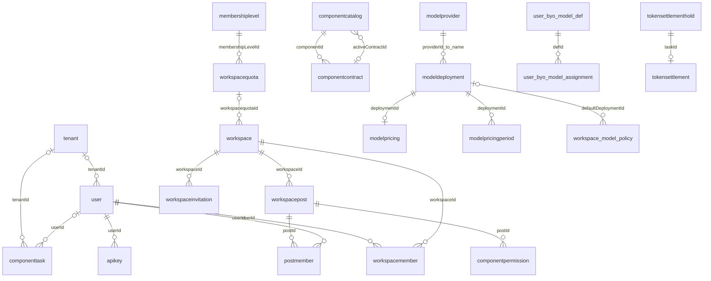

# 基于当前代码事实的架构逆向报告

取证日期：2026-11-05（Asia/Shanghai）  
Git HEAD：`761684be8d5661d6ed288f3b91d1fedfdc795a75`；**分析对象含工作区未提交修改，不等同于该提交或生产部署。**

## 1. 结论与证据边界

当前项目是 **Next.js App Router 全栈单体 + Prisma + MySQL**。不存在 `src/services`、`src/models`；服务逻辑主要在 `src/lib`，HTTP 入口在 `src/app/api`，Entity 定义在 `prisma/schema.prisma`。`src/app/api/studio/route.ts` 将执行入口转导出到同目录 `handler.ts`，不能只扫描 route 文件判断执行行为。[依赖声明](../../package.json)、[数据源](../../prisma/schema.prisma#L1)、[Studio 转导出](../../src/app/api/studio/route.ts#L1)。

本次提取 **90 个 model、47 条显式关系、4 个 enum、343 个路由文件、494 个显式 HTTP 方法导出**。Entity 是代码声明的数据库结构；本次没有连接数据库、核对迁移执行状态或抓取线上 DDL，因此不将其称为生产库实测结构。没有执行模型、支付、发信、发短信或业务 API；没有修改业务代码、价格、开关或数据库。

最需处理的发现：公开调试接口读取固定空间成员资料；平台鉴权在完整校验失败后可通过简化兜底重新放行；FREE 配额读取函数会覆写后台配置；加价率迁移判断会改变合法数值。前两项鉴权/费用行为中的兜底与费率问题已通过离线隔离复现，其他结论按源码路径、触发条件和待核实边界分别说明。

总纲与权限专题仅用于遵守任务边界，不作为实现证据。没有采用 README 或旧架构文档中的表、权限和价格作为事实来源。

配套证据：

- [完整字段字典、外键清单及全量 ER 图](entities.md)：全部标量列、关系字段、类型、可空性、默认值、唯一约束、索引、表/列映射和枚举。
- [完整 API 路由与鉴权线索](routes.md)：逐路由列出方法、中间件策略和源码定位，附 Studio action 清单。
- [数值常量定位附录](constants.md)：AST 提取的大写数值常量；关键硬编码和生效条件见本报告。
- [机器可读清单与 SHA-256](inventory.json)：核心输入文件的哈希、模型/关系/路由和当时工作区状态。
- [隔离复现结果](verification.json)、[取证脚本](extract.cjs)、[复现脚本](verify.cjs)。

## 2. 真实数据结构与关系

### 2.1 核心 ER 图：只画 Entity 显式关系

下图为便于阅读的业务核心子图；全量 90 实体图见附录。特别注意：`workspacequota.workspaceId` 虽然唯一，却**没有**指向 workspace 的 `@relation`；真正声明的 FK 是相反方向的 `workspace.workspacequotaId`，而且不是唯一字段。

其中 `|o` 表示父记录可不存在（子表 FK 可空）；`o{` 表示可有多条子记录。图中的关系只证明 schema 声明，不证明线上外键已经建立。

### 2.2 实体职责与关键约束

| 领域 | 实际 Entity 与结构事实 | 证据 |
|---|---|---|
| 身份/租户 | `user` 有字符串 role、UserStatus、会话/刷新令牌、强制下线时间、密码过期时间；`tenant` 是单独实体，不能与 workspace 混为一表 | [user/tenant](../../prisma/schema.prisma#L42) |
| 会话/风控 | `usersession`→`user_session`、`userdevice`、`loginhistory`、`stepuptoken`→`stepup_token`、`gatewayblacklist`→`gateway_blacklist`、`accountappeal`→`AccountAppeal` | [会话与风控定义](../../prisma/schema.prisma#L958) |
| 空间/成员 | `workspace` ownerId 仅标量；`workspacemember` 对 `(userId, workspaceId)` 唯一；成员含独立 BigInt 余额、月度配额/用量 | [空间/成员](../../prisma/schema.prisma#L673) |
| 岗位/组件授权 | `workspacepost`、`postmember`、`componentpermission`，另有标准岗位、图标、别名等实体；岗位和成员通过关联表相连 | [岗位](../../prisma/schema.prisma#L781) |
| 组件/合同 | `componentcatalog`→`component_catalog`，`componentcontract`→`component_contract`；组件有可空 activeContractId；合同有组件关系及版本唯一约束，删除使用 Restrict | [组件合同](../../prisma/schema.prisma#L1092) |
| 任务/内容 | `componenttask` 存 type/status/config/result 与可空 workspaceId；`asset`、`document`、`conversation`、`project` 等分别存在；资料版本/分享/评论/移除单也有独立 Entity | [任务](../../prisma/schema.prisma#L10)、[资料](../../prisma/schema.prisma#L152)、[治理](../../prisma/schema.prisma#L1886) |
| 钱包/分桶/总账 | `userwallet`（userId 唯一）、`pointgrant`、`pointledger`；余额/点数以 BigInt 为主；pointledger.idempotencyKey 可空但非空时唯一 | [账务](../../prisma/schema.prisma#L1260) |
| 订单/退款 | `membershiporder`、`tokenrechargeorder`、`refundrequest`、`refundrecovery`；退款申请 `(taskId,userId)` 唯一；失败恢复 `(taskId,consumeIdempotencyKey)` 唯一 | [会员订单](../../prisma/schema.prisma#L389)、[退款](../../prisma/schema.prisma#L1352)、[充值单](../../prisma/schema.prisma#L1837) |
| 模型/价格 | `modelprovider`、`modeldeployment`、`modelpricing`、`modelpricingperiod`、`modelcostobservation`、默认模型、禁用计划、空间策略、模型申请与成员偏好；deployment.providerId 引用的是 provider.name | [模型注册与价格](../../prisma/schema.prisma#L1413) |
| 用户自带模型 | `workspace_byo_model`、`user_byo_model_def`、`user_byo_model_assignment`，只有 assignment.defId 显式关联定义表，不代表其他 user/workspace ID 都有 FK | [BYO](../../prisma/schema.prisma#L1700) |
| Token 结算 | `tokensettlementhold`、`tokensettlement`、`tokensettlementrecovery`；hold 和 settlement 的 taskId 均唯一，settlement.taskId 引用 hold.taskId；价格快照为 Json | [结算](../../prisma/schema.prisma#L2054) |
| 配置/审计/通知 | `systemconfig`→`system_config` 与 `systemsetting`→`system_setting` **同时存在**；operationlog、通知、通知分组、系统文档历史等分别存储 | [配置](../../prisma/schema.prisma#L1081)、[设置](../../prisma/schema.prisma#L1229)、[审计](../../prisma/schema.prisma#L413) |

### 2.3 不应画成数据库外键的“业务联系”

以下字段虽然名称含 ID，但 Entity 没有对应 `@relation`：

- `workspace.ownerId`、`workspacequota.workspaceId`。
- `componenttask.workspaceId`、`componenttask.type`（后者在执行中承载组件标识），task 对 user/tenant 的关系才是显式 FK。
- `userwallet.userId`；`pointgrant` 的 userId/workspaceId；`pointledger` 的 grantId/taskId/userId/workspaceId。
- `tokensettlementhold` 的 taskId/userId/workspaceId；settlement 的 userId/workspaceId；recovery 的 taskId。
- `tokenrechargeorder` 的 workspaceId/applicantId/ledgerId；大部分资料治理 ID。

这些联系只能靠应用查询、事务、删除清理和对账维护。缺少 FK 不自动等于漏洞（保留历史可能是设计选择），但会增加孤儿数据、跨空间混用和删除遗漏风险。已声明的唯一约束仍有效，不能把“无 FK”误写成“完全无约束”。详见[完整字段和约束](entities.md)。

## 3. 实际 API 与鉴权

### 3.1 认证与授权是多层的，目录名不等于访问权限

1. **中间件预检**：`src/middleware.ts` 读取 Bearer 或 auth_token Cookie，JWT 验签后透传 x-user-id。它本身不执行完整用户状态/会话检查。`/api/auth/**`（me/touch 除外）、health、open、cron、支付 notify 等前缀直接放行，由路由负责认证；`/api/studio?action=catalog` 也放行。[公开前缀](../../src/middleware.ts#L10)、[预检](../../src/middleware.ts#L283)。
2. **用户完整校验**：`auth.validateUser` 重新验签，交叉核验 x-user-id，查真实用户；校验封禁、注销、维护、密码过期、sessionToken、强制下线、绝对超时、空闲超时。部分封禁到期分支会写 user，因此“执行鉴权”也不必然是只读操作。[实现](../../src/lib/auth.ts#L59)。
3. **平台授权**：`requirePlatformPermission` 最终调用 `requirePlatformAuth`。超级管理员放行；平台管理员检查后台 active/inactive 及权限包；多个权限参数是 **OR**，不是 AND。[平台守卫](../../src/lib/security.ts#L474)、[多权限封装](../../src/lib/security.ts#L880)。注意该守卫的失败兜底缺陷，见 F02。
4. **动态规则**：仅覆盖 `/api/admin/**`，按已启用规则的路径段边界与 HTTP 方法匹配，取最长前缀的一条。规则读取失败返回 503；没有规则/没有命中则继续下游，不能认为中间件统一阻止了所有普通用户。规则缓存 3 秒、上下文缓存 10 秒。[实现](../../src/middleware.ts#L95)、[匹配](../../src/middleware.ts#L165)。**规则和授权包是数据库配置，本轮没有读取，不能给出当前每名管理员的实际授权矩阵。**
5. **空间授权**：ownerId、workspacemember、postmember 和 operationlog 共同计算逻辑角色；再用权限键判定。业务接口还需要校验具体任务/资料归属、组件限制、空间只读状态。[角色计算](../../src/lib/security.ts#L604)、[空间权限](../../src/lib/security.ts#L765)。
6. **高风险操作**：部分入口使用数据库持久化的一次性 Step-up token（例如空间删除），不能推断所有写接口都已接入。[签发入口](../../src/app/api/auth/verify-password/route.ts#L18)、[删除入口](../../src/app/api/workspace/delete/route.ts#L1)。
7. **CSRF**：`withAuth` 包装会调用 assertCSRF；该函数对安全方法、无 Origin/Referer 的请求放行，其他请求按 host 校验。大量路由直接调用其他守卫；不能声称全局统一覆盖。[封装](../../src/lib/with-auth.ts#L57)、[CSRF](../../src/lib/csrf.ts#L16)。

### 3.2 哪些接口面向谁

下表给出代表性的**方法级**事实；完整 343 个路由、494 个 HTTP 导出见[API 附录](routes.md)。通配行仅描述路由家族，不替代各子接口检查。

| 实际入口 | 调用者与服务端校验 | 补充边界 |
|---|---|---|
| `GET /api/components`、`GET /api/studio?action=catalog` | 中间件允许匿名；具体目录展示由 handler 处理 | 公开目录不表示可以匿名执行 |
| `POST /api/auth/login`、`register` 等 | 中间件放行；各认证路由自校验 | 不能将整个 auth 前缀视为安全可信服务 |
| `GET /api/health/debug-test01` | 无路由级认证，health 前缀放行 | 暴露风险 F01 |
| `GET /api/auth/debug-superadmin` | 当前直接返回 404 | 不能凭文件名认定仍能调试登录 |
| `POST /api/auth/init-admin` | 用户表为空检查、密码强度；未校验 SETUP_TOKEN | 初始化权限与字段问题见 F07 |
| `GET /api/user/profile`、`/api/user/points` 等 | 普通登录用户入口，需结合各文件的用户校验和归属条件 | 平台管理员身份不应代替数据归属判断 |
| `GET /api/tasks` | 登录态；跨空间聚合逻辑在该路由 | task 查询不是全平台管理员列表 |
| `GET/POST/DELETE /api/studio` | 除 catalog 外先取完整登录身份；再按 action 校验空间、岗位、任务/资料归属 | 同一 URL 涵盖执行、资料审核、知识维护、任务归档等不同权限 |
| `POST /api/studio`，`action=simulate` | owner/成员关系 + `component:execute` + 组件限制 + 装配/启用 + 合同/模型/预算门禁 | 普通 MEMBER 在空间权限表中含执行权，不限平台管理员 |
| `DELETE /api/workspace/delete` | 登录 + ownerId 相等 + 只读限制 + Step-up 等 | 空间 ADMIN 也不能当作 OWNER 删除 |
| `/api/workspace/[id]/model-policy`、成员/配额/邀请等 | 空间管理入口；逐方法查空间管理权限/owner/member | URL 位于 workspace 不代表全体普通成员可写 |
| `/api/admin/model-providers`、`model-deployments`、`model-pricing` 等 | 平台管理员权限守卫；再受启用规则约束 | 具体读写权限键见路由源码 |
| `POST /api/admin/model-pricing/global-markup` | `system:manage` **或** `model:manage` **或** `billing:manage` | 任一权限可触发批量调价；scope 缺省为 all；见 F06 |
| `GET /api/admin/model-pricing/global-markup` | `system:manage` 或 `model:read` 或 `model:manage` 或 `billing:read` | 读写权限键并不完全相同 |
| `/api/admin/permissions` 等权限授予操作 | `requirePermissionGrantAuthority`，策略 allowedRoles 仅 SUPER_ADMIN，allowPermissionDelegation=false | 普通管理员拥有 permission:manage 也不能因此授予权限 |
| `GET /api/admin/posts/standard` | 代码仅要求登录，不要求平台管理员 | 刻意供企业装配使用，但返回全平台空间统计/提报，见 F08 |
| `POST/PATCH/DELETE /api/admin/posts/standard` | 写入分支使用平台权限守卫 | 不能用 GET 的开放策略推断写入也开放 |
| `GET /api/test-db` | 中间件需要有效 JWT；路由无额外角色/归属校验 | 普通登录用户可能获得固定账号申诉资料，见 F01 |
| `/api/open/v1/me`、`workspaces`、`components`、`tasks`、`tasks/[id]` | API Key，非会话 JWT；各路由继续做资源检查 | Key 的账号状态校验缺口见 F03 |
| `POST /api/open/v1/execute` | Key + Key 频率限制 + workspace 成员；依赖注入复用 runStudioPost | getUserId 被 Key 的 userId 替代，不再调用普通会话验证 |
| `POST /api/payments/notify/alipay` | 无登录态；调用 verifyNotify，成功交易再调用 fulfillPaidOrder | 已有验签/入账代码，不代表已验证生产支付闭环 |
| `POST /api/payments/notify/wechat` | 无登录态；调用验签/解密，再入账 | 同上；本轮未调用渠道 |
| `POST /api/cron/token-settlement-recovery` | CRON_SECRET 匹配 **或** 平台 system:manage/billing:manage | 每个 cron 路由各自校验，不能一概说全部只接受 secret |

以上入口的完整源码定位见[路由附录](routes.md)；尤其参考 [Open 执行](../../src/app/api/open/v1/execute/route.ts#L29)、[支付回调](../../src/app/api/payments/notify/alipay/route.ts#L16)、[Cron](../../src/app/api/cron/token-settlement-recovery/route.ts#L18)。

### 3.3 空间内角色的真实权限表

| 逻辑角色 | `requireWorkspacePermission` 的代码行为 |
|---|---|
| OWNER | 全部权限键返回 true |
| ADMIN | 除 `workspace:delete` 外所有键返回 true，包括未来/未知键 |
| COMPONENT_MANAGER | component 的 view/install/configure/execute/authorize/remove、task:view、workspace:view |
| KNOWLEDGE_MANAGER | knowledge 的 view/create/approve/delete、result:view、asset:view、workspace:view |
| MEMBER | workspace:view、component:view/execute、task:create/view、asset:upload、result:view、knowledge:create |
| VIEWER | workspace/component/task/asset/result/knowledge 的 view |

这是守卫函数返回值，不表示所有路由都使用了该守卫。岗位名称匹配优先于物理成员角色；找不到对应岗位时读取最新 `UPDATE_MEMBER_ROLE` 审计记录，再回退成员角色。权限状态依赖可变日志是结构风险：若日志被删、归档或记录格式错误，授权可能变化；建议专门持久化当前授权，审计保留历史，而不是直接改动现有数据。[实现](../../src/lib/security.ts#L604)。

## 4. 关键硬编码常量及生效条件

必须区分：**不可配置的固定规则**、**环境变量兜底**、**数据库可覆盖默认值**、**代码强制回写**。下表不是线上有效配置快照，也不把默认值当成负责人批准的现行售价。

| 项目 | 代码值与单位 | 生效条件/性质 | 证据 |
|---|---|---|---|
| 点/人民币 | 100 点/元；0.01 元/点；10,000 微元/点 | 固定换算；不等于模型 Token 固定换点 | [point-rate](../../src/lib/point-rate.ts#L29) |
| 估算中心微元/点 | 单独再写 `BigInt(10_000)` | 与上行重复硬编码，汇率变更容易漂移 | [pricing-center](../../src/lib/billing/pricing-center.ts#L109) |
| 全局加价 | 2000 bps，即 +20% | systemconfig 缺失、非法或读取异常时的默认值；模型价格模式/覆盖值还会影响实际计算 | [billing-config](../../src/lib/billing/billing-config.ts#L48) |
| BYOK 服务费 | 1500 bps，即 15% | 同上，不能据此推断所有 BYO 执行已收此费 | 同上 |
| 免费额度 | 3 个月、每月 100 点 | `billing.freeMonths/freePointsPerMonth` 默认；另有独立注册福利配置 | 同上 |
| 注册福利 | 默认开启、100 点/月、3 个月、月底清零；months 最大 36 | `platform.registerGift.*` 可覆盖，与 billing.free* 不是同一组键 | [register-gift-config](../../src/lib/register-gift-config.ts#L12) |
| FREE 会员额度 | 固定 100，包含 UPDATE 写库 | getMembershipTokenLimit(FREE) 会将不等于 100 的数据库配置覆写；不是普通兜底 | [quota-token](../../src/lib/quota-token.ts#L26) |
| 单任务最低收费 | 5 点 | billing.minPointsPerTask 可覆盖；应按执行分支看实际生效 | [billing-config](../../src/lib/billing/billing-config.ts#L48) |
| 退款人工阈值 | 50,000 分 = 500 元 | 配置默认，不证明所有退款入口都已使用该阈值 | 同上 |
| 预扣估算输入/输出 | 输入基准上界 4,000 tokens；无合同输出时 4,096 tokens | 输入 cap 实际取 max(4000, 历史校准输入)，不是模型上下文上限 | [computeDepositTokenBounds](../../src/lib/billing/pricing-center.ts#L74) |
| 模型调用限制 | 60 秒超时；60,000 字符输入；默认输出 2,000 tokens | MODEL_TIMEOUT_MS / MODEL_MAX_INPUT_CHARS / MODEL_MAX_OUTPUT_TOKENS 覆盖 | [model-adapter](../../src/lib/model-adapter.ts#L73) |
| 文本抽取/上传 | 60 秒；upload_doc 单文件 50 MiB | Studio handler 局部限制，合同/其他上传入口可能更严格 | [抽取](../../src/app/api/studio/handler.ts#L42)、[大小](../../src/app/api/studio/handler.ts#L4513) |
| BYO 字段与上下文 | label/providerName 128 字符、URL 2048、Key 4096、context 最大 10,000,000 tokens | 输入校验上界，不是所有部署可用上下文 | [MODEL_INPUT_LIMITS](../../src/lib/model-endpoint.ts) |
| 单价/加价上界 | model-pricing 单价 2,000,000,000 微元/百万 Token（2000 元）；MAX_MARKUP_BPS=100,000（+1000%） | BYO 输入校验单价上限另为 1,000,000,000 微元（1000 元），存在口径差异 | [model-pricing](../../src/lib/model-pricing.ts#L15)、[model-endpoint](../../src/lib/model-endpoint.ts) |
| 真实结算总开关 | production 无条件 false；非 production 读取 TEST_TOKEN_SETTLEMENT_ENABLED；测试可 override | billing.settlementMode OFF/WHITELIST/ALL 及白名单还需同时满足，不能把 mode=ALL 当成生产已启用 | [开关](../../src/lib/token-settlement-service.ts#L200)、[组件判定](../../src/lib/billing/billing-config.ts#L208) |
| 结算恢复 | 最大重试 3、默认租约 5 分钟；usage 安全上限 10^15 | 常量不是一次模型调用的 Token 预算；Cron 自有参数范围 | [恢复](../../src/lib/token-settlement-service.ts#L66)、[usage 上界](../../src/lib/token-settlement-service.ts#L145) |
| 会话 | 空闲 10 分钟、普通绝对期限默认 24 小时、rememberMe 7 天、access JWT 5 分钟 | 会话策略部分可读库；记住登录豁免空闲，仍检查绝对期限 | [session-constants](../../src/lib/session-constants.ts#L14)、[状态机](../../src/lib/auth.ts#L246) |
| 风控默认 | 登录失败 5 次、临时封禁 5 分钟、密码有效期 90 天、注销冷静期 7 天、Step-up 3 分钟 | 部分另有 systemconfig 配置，不是全部不可改 | [风控常量](../../src/lib/session-constants.ts#L79) |
| Open API 限流 | 30 次/Key/分钟；配置最大 10,000 | 进程内 Map，多实例不共享；当前执行端点调用了此限制，不应外推所有 Open 路由都有限流 | [open-api-rate-limit](../../src/lib/open-api-rate-limit.ts#L16)、[执行调用](../../src/app/api/open/v1/execute/route.ts#L48) |
| Schema 默认配额 | 存储 1,073,741,824 字节=1 GiB、API 次数 1000、enterpriseSlots=1 | 数据库插入默认；业务初始化/配置可能覆盖 | [workspacequota](../../prisma/schema.prisma#L757) |
| 无限额度 | BigInt(-1)，credit-service 也有 -1 标记 | 金额/点数的边界哨兵，转换为 Number 时需保留语义 | [quota-token](../../src/lib/quota-token.ts#L14)、[credit-service](../../src/lib/credit-service.ts#L32) |

没有从旧文档复制“输入 5/输出 30”等模型价格：实际 modelpricing/modelpricingperiod 是数据源，本轮没有查库，无法确认当前模型价。组件执行也不应概括成固定 `1 Token = 1 点`。完整常量定位见[附录](constants.md)，其中小写变量/分支魔数的机械漏项已明确说明。

## 5. 缺陷与可疑设计

P0 表示建议先封堵的暴露面；P1 表示影响权限、计费或数据一致性的高优先事项；P2 表示结构/运维风险。此分级不是线上渗透结论。

### F01 · P0：健康检查下的匿名数据读取，另有登录即可读的调试残留

**代码已确认。** `GET /api/health/debug-test01` 无认证，查询写死的两个空间 ID，返回 quota（含会员等级）和企业成员 id/name/email；middleware 对整个 health 前缀放行。它不是单纯健康状态。[接口](../../src/app/api/health/debug-test01/route.ts#L4)、[公开前缀](../../src/middleware.ts#L13)。

另一个 `GET /api/test-db` 会查询固定测试账号并返回其状态/封禁原因与完整申诉记录；中间件只要求 JWT，路由没有管理员或数据归属校验。[接口](../../src/app/api/test-db/route.ts#L4)。本报告不复写硬编码手机号与空间 ID；可直接定位源码。

影响条件：线上部署这些路由且对应数据存在，匿名访问者/任意登录用户可能读到不属于自己的信息。未发真实请求，未确认线上数据存在。建议删除或关闭这些调试入口；诊断输出最小化，并在服务端按权限与空间归属限制。

### F02 · P1：完整认证失败后，平台认证兜底重新放行

**源码与隔离复现确认。** `requirePlatformAuth` 对 validateUser 的任何失败，都尝试重新 JWT 验签，然后只要求用户仍为 active，随后进入管理员权限判定；不复核强制下线、会话挤线、空闲/绝对过期、密码到期等。[兜底分支](../../src/lib/security.ts#L487)、[完整校验](../../src/lib/auth.ts#L230)。

复现：stub 完整校验返回 FORCED_LOGOUT，stub JWT 验签成功、用户 active 且 SUPER_ADMIN，函数最终 authorized=true。[结果](verification.json)。这证明代码路径可达；不意味着任意未签名 Token 可用，也不意味着所有 admin 路由都能绕过：如果中间件命中的动态规则调用完整权限上下文并拒绝，会形成额外拦截。无匹配规则或不受 admin 规则覆盖的入口仍需关注，如允许平台权限兜底的 Cron。

建议只对“没有提取到凭证”统一补充凭证来源；一旦完整验证明确失败，应保持拒绝，不能退化为较弱身份检查。

### F03 · P1：API Key 校验未检查账号状态，Open 执行跳过会话身份函数

**代码路径确认，具体禁用场景尚未集成复测。** authenticateApiKey 只匹配前缀和 bcrypt hash，更新使用痕迹后返回 userId；没有查询 user.status。`open/v1/me` 也未读取 status；execute 将 getUserId 注入成固定 auth.userId，后续虽有空间/组件/费用校验，但不能替代账号封禁校验。[Key 鉴权](../../src/lib/api-key-auth.ts#L36)、[me](../../src/app/api/open/v1/me/route.ts#L14)、[注入](../../src/app/api/open/v1/execute/route.ts#L113)。

持有既有 Key 的被封禁/注销中账号可能继续读取或执行；实际结果取决于 Key 是否被其他管理流程删除、资源是否仍存在。建议在共享 Key 守卫检查账号业务可用状态，并明确 Key 的撤销/权限范围；API Key 无需套用浏览器空闲会话语义，但必须有独立的禁用边界。

### F04 · P1：读取会员额度时强制覆写 FREE=100

**代码确认。** getMembershipTokenLimit(FREE) 发现数据库值不是 100 就 UPDATE，更新失败也返回 100。这与文件声称“从库真实读取”相反。[函数](../../src/lib/quota-token.ts#L26)。`GET /api/user/workspace-hub/dashboard` 会调用它，因此普通读取页面也可能修改会员等级配置。[调用点](../../src/app/api/user/workspace-hub/dashboard/route.ts#L84)。

影响：后台将 FREE 改成 0、其他额度或 -1 后，读取动作可能撤回配置，且当前分支未写专门额度配置变更审计。建议将历史数据修复移到显式迁移/管理动作，正常读取尊重数据库值。

### F05 · P1：用数值大小猜测旧版费率，误改合法值且绕开范围回退

**离线纯函数复现确认。** parseBillingConfig 先允许 0..100000 bps，又将任意 `>10000` 的原始整数除以 10，无法区分旧乘数与合法新加价率。[实现](../../src/lib/billing/billing-config.ts#L145)。

| 写入 bps | 实际读取 bps | 问题 |
|---|---|---|
| 10000 | 10000 | +100% 正常 |
| 10001 | 1000 | 从 +100% 边界骤降到约 +10% |
| 20000 | 2000 | 合法 +200% 被当成 +20% |
| 100000 | 10000 | 合法 +1000% 被当成 +100% |
| 1000000 | 100000 | 原本越界应回退默认，却被后续分支重新赋值 |

后台 global-markup GET 也有相同推断，POST 却允许写入合法大值；若模型行显式值与全局继承路径并存，会出现同一设置在不同路径计算不同。[读写入口](../../src/app/api/admin/model-pricing/global-markup/route.ts#L18)。建议用配置版本/一次性迁移识别旧数据，不按数值区间猜测。

### F06 · P1：批量改价分多个事务提交，计数永远为零，审计可丢失

**代码确认。** global-markup POST 在一个事务中更新 modelpricing 与 periods，随后独立 upsert 全局配置两次；modelCount/periodCount 初始 0 后未赋 batch 的返回值。审计独立写且异常只打印日志。[入口](../../src/app/api/admin/model-pricing/global-markup/route.ts#L18)。

影响：中途异常可能留下“模型已改价但全局默认未改”的部分提交；成功响应及审计的改动行数为 0；审计失败仍可返回成功。默认 scope=all 还会覆盖全部独立模型设置。建议模型/时段/全局配置/强制审计同一事务，真实记录更新计数，批量范围显式传入。此项未执行真实改价。

### F07 · P1：初始化安全校验未绑定创建接口；Raw SQL 与 Entity 字段不一致

**代码确认，影响受空库条件限制。** `/auth/verify-setup-token` 校验环境 SETUP_TOKEN，但 `/auth/init-admin` 不消费该凭证，仅检查 user.count=0 后创建 SUPER_ADMIN；两个接口无服务端授权绑定，count 与 insert 也不是单次原子初始化。[验证接口](../../src/app/api/auth/verify-setup-token/route.ts#L5)、[创建接口](../../src/app/api/auth/init-admin/route.ts#L5)。

此外 Raw SQL 使用 `created_at, updated_at`，Entity user 字段却为未映射的 createdAt/updatedAt。如果实际库与当前 schema 一致，初始化将失败；若线上是旧列，则说明 schema 漂移，需查 DDL 才能确定。不能将这条入口宣称为已验证可成功的匿名超管接管。建议在创建端验证一次性初始化凭证、原子化抢占并通过 Prisma 字段写入。

### F08 · P1：标准岗位公共读取携带全平台空间信息

**代码确认，是否允许披露需业务裁决。** GET `/api/admin/posts/standard` 刻意只需登录，但返回 usedWorkspaces、usages、submissions 与全平台成员装配统计；computeStandardPostUsageStats 填入 workspaceId/name/type/memberCount，并未限制当前用户空间。[路由](../../src/app/api/admin/posts/standard/route.ts#L17)、[统计服务](../../src/lib/standard-posts.ts)。

公共岗位目录与跨租户使用明细是不同数据权限。建议普通用户只获取标准目录，运营统计/提报按平台权限或空间归属提供。若动态中间件恰好设置了更严规则，也可能额外限制；本轮未读取规则，不能确认线上普通用户实际响应。

### F09 · P2：配额双向关联不一致、大量业务 ID 无 FK

**Entity 结构确认。** `workspace.workspacequotaId` 与 `workspacequota.workspaceId` 是两条不互相约束的路径，前者还是可空、多 workspace 可指向同一 quota。代码 open/me 已明确改用后者正查，但不能据注释断言当前库一定存在 NULL。[Schema](../../prisma/schema.prisma#L673)、[查询实现](../../src/app/api/open/v1/me/route.ts#L47)。

另有多个余额载体 userwallet/workspacequota/workspacemember 与分桶/总账并存。应用事务和对账必须覆盖它们；本轮没有证明账本已经错账。建议先只读核对双路径与余额一致性，设计迁移前保留历史审计与回滚。

### F10 · P2：请求路径内自动执行 DDL

**代码确认。** ensureByoShareWithMembersColumn 会运行固定字符串 ALTER TABLE，user-byo-model 也导入这一机制。并非把 SQL 注入当成此问题，实际风险在于业务请求改表、应用账号需要 DDL 权限、多实例重复尝试与迁移证据脱节。[实现](../../src/lib/workspace-byo-model.ts)、[调用依赖](../../src/lib/user-byo-model.ts#L18)。建议由受控迁移完成，业务请求只检测缺列并给出明确运维错误。本轮未执行该 helper。

### F11 · P2：限流、只读守卫与角色定义的系统性边界

- Open API 使用进程内 Map，多副本可分别放行；它限制的是请求频次，不是模型并发或全局成本。高成本执行需核实共享计数与并发预算。[实现](../../src/lib/open-api-rate-limit.ts#L21)。
- 中间件空间只读查询失败会降级放行，且只识别 URL/查询参数中的空间 ID；请求体空间 ID 依赖各业务入口补守卫。账务/资源层已有独立守卫，不能仅凭此断言所有停用空间都能写入；需逐 action 验证。[中间件](../../src/middleware.ts#L233)、[业务守卫](../../src/lib/workspace-readonly-guard.ts#L28)。
- ADMIN 对所有未知 permissionKey 也返回 true；逻辑角色从岗位名与审计日志推导。新增敏感权限键会自动授予 ADMIN，而不必显式配置，值得业务确认。[权限判定](../../src/lib/security.ts#L765)。

### F12 · P2：遗留验证码入口只校验长度并返回成功

**接口行为确认，未找到前端调用，未证明可接管账号。** POST `/api/auth/verify-code` 接受任意长度为 6 的 code 即返回“验证码正确”，没有与服务器验证码比较；该前缀公开。[源码](../../src/app/api/auth/verify-code/route.ts#L3)。当前注册/邮箱/短信另有独立接口，不应推断它们全部使用此弱验证。建议删除弃用入口或接入真实验证，避免未来被错误复用。

## 6. 真实业务链路与文档纠偏依据

当前 Studio 的 `simulate` 不是“直接写 SUCCESS”的静态模拟：代码检查用户与空间权限、读取组件与合同，运行模型/输出构建，维护任务与扣费/退款/恢复路径；Open execute 也复用同一执行核心。[入口](../../src/app/api/studio/handler.ts#L2543)、[Open 复用](../../src/app/api/open/v1/execute/route.ts#L113)。这些是源码存在性证据，不等于本轮真实执行通过。

代码中 BYO 中央模型库、空间绑定、加密保存 Key、价格周期、真实支付通知/履约模块都已存在。不能继续笼统写成“完全未实现”，也不能由此宣称上线或商业闭环验收完成。[BYO](../../src/lib/user-byo-model.ts#L1)、[支付履约入口](../../src/app/api/payments/notify/wechat/route.ts#L47)。

生产真实 Token 结算入口仍被 `NODE_ENV === production` 硬关；默认灰度配置并不推翻该限制。后续更新 README/架构说明时，应分别描述“源码存在”“实际启用”“真实执行证据”“人工验收”，不要拿历史默认价或旧文档任务状态代替现行实现。本次不改写旧文档，以保留历史记录。

## 7. 验证记录、未完成项与下一关口

| 项目 | 本批结果 |
|---|---|
| 用户可见交付 | 本报告、全量 ER/字段字典、路由证据、常量证据及可复跑脚本；页面无变化 |
| 端到端覆盖 | 静态追踪身份→空间→执行→任务/账务入口，未进行真实模型/支付业务验收 |
| 数据/API | 90 实体、47 显式关系、343 路由、494 HTTP 导出；无业务写库 |
| 自动化证据 | AST/Schema 提取成功；纯函数费率边界与鉴权兜底隔离复现成功，见 verification.json |
| 验证方式 | 在项目根目录运行 `node docs/code-facts-2026-11-05/extract.cjs` 与 `node docs/code-facts-2026-11-05/verify.cjs`；仅读取源码、写本报告目录，依赖项目已安装 typescript |
| 未运行 | 项目全套测试、启动浏览器、真实 API 请求、线上 DDL/配置/权限包/余额对账、迁移状态检查 |
| 重要边界 | 路由附录的守卫是文件级线索，不是完整控制流证明；默认数值不是当前 DB 配置；未逐一证明所有 action 的安全性；输入文件哈希用于识别后续工作区漂移 |
| 成本/风险 | 无真实模型/支付/短信/邮件费用；保留既有工作区改动；发现项未修复 |
| 是否可发布 | 报告可供评审；本批没有提供应用可发布或生产就绪证明 |
| 下一关口 | 先修复/封堵 F01、F02、F03，再处理 F04–F08；之后以受控只读库核对 schema、规则启用、余额与价格，并对修复后的权限拒绝/费率边界做专项验证 |

本次验证脚本为报告证据，使用显式 stub，既没有导入运行真实应用依赖，也没有使用真实凭证。首次运行复现工具因隔离 process stub 缺少 cwd 中断，补齐后通过；最终结果已写入 verification.json。所有问题的修复、线上验证与业务裁决均不在本次只读逆向批次内。
