# Entity 结构证据附录

来源仅为 `prisma/schema.prisma`。这是代码声明，不是已部署数据库 DDL；未运行迁移或查询真实库。`?` 可空，`[]` 反向关系集合不落列。所有标量字段、默认值、映射与索引见下。

共 90 个 model、47 条拥有外键字段的显式关系、4 个 enum。

## 全量显式关系 ER 图

图中仅包含 Entity 声明的关系；未声明关系的 ID 绝不伪造为外键。

```mermaid
erDiagram
  componenttask
  tenant
  user
  apikey
  asset
  componentfavorite
  componentrating
  componentreview
  componentstats
  componentusage
  conversation
  document
  integration
  loginhistory
  membershipchangelog
  membershiplevel
  membershiporder
  operationlog
  project
  smscode
  systemdocument
  systemdocumenthistory
  systemdocumentfeedback
  upgradeapplication
  usernotification
  notification
  userpreference
  testimonial
  userfeedback
  demorequest
  workspace
  workspaceinvitation
  workspacemember
  workspacequota
  workspacepost
  postmember
  platformstandardpost
  posticonlibrary
  postalias
  postcodealias
  componentpermission
  projectrole
  apiusage
  userdevice
  workspacekickhistory
  accountappeal
  usersession
  gatewayblacklist
  stepuptoken
  knowledgecategory
  systemconfig
  componentcatalog
  componentcontract
  componentcategory
  webhooksubscription
  billingrecord
  systemsetting
  tokenpack
  userwallet
  pointgrant
  pointledger
  refundrecovery
  refundrequest
  modelprovider
  modeldeployment
  modeldisableschedule
  modelpricing
  modelpricingperiod
  modelcostobservation
  workspace_model_policy
  quotaapply
  platformdefaultmodel
  workspace_byo_model
  user_byo_model_def
  user_byo_model_assignment
  modelapplication
  workspace_member_model_preference
  registrylock
  tokenrechargeorder
  documentremoval
  assetpermission
  documentversion
  workspaceplan
  documentcomment
  documentshare
  notificationgroup
  notificationgroupmember
  tokensettlementhold
  tokensettlement
  tokensettlementrecovery
  tenant |o--o{ componenttask : "tenantId to id"
  user |o--o{ componenttask : "userId to id"
  tenant |o--o{ user : "tenantId to id"
  user ||--o{ apikey : "userId to id"
  user ||--o{ componentrating : "userId to id"
  componentreview |o--o{ componentreview : "parentId to id"
  user ||--o{ componentreview : "userId to id"
  user ||--o{ loginhistory : "userId to id"
  membershiplevel |o--o{ membershipchangelog : "levelId to id"
  user |o--o{ membershipchangelog : "operatorId to id"
  user ||--o{ membershipchangelog : "userId to id"
  membershiplevel ||--o{ membershiporder : "levelId to id"
  user ||--o{ membershiporder : "userId to id"
  user ||--o{ operationlog : "userId to id"
  user |o--o{ systemdocument : "authorId to id"
  systemdocument |o--o{ systemdocumenthistory : "documentId to id"
  user |o--o{ systemdocumenthistory : "editorId to id"
  user ||--o{ upgradeapplication : "userId to id"
  workspace |o--o{ upgradeapplication : "workspaceId to id"
  user ||--o| usernotification : "userId to id"
  user ||--o{ notification : "userId to id"
  user ||--o| userpreference : "userId to id"
  user |o--o{ userfeedback : "userId to id"
  workspacequota |o--o{ workspace : "workspacequotaId to id"
  workspace ||--o{ workspaceinvitation : "workspaceId to id"
  user ||--o{ workspacemember : "userId to id"
  workspace ||--o{ workspacemember : "workspaceId to id"
  membershiplevel ||--o{ workspacequota : "membershipLevelId to id"
  workspace ||--o{ workspacepost : "workspaceId to id"
  workspacepost ||--o{ postmember : "postId to id"
  user ||--o{ postmember : "userId to id"
  workspacepost ||--o{ componentpermission : "postId to id"
  user ||--o{ userdevice : "userId to id"
  user ||--o{ workspacekickhistory : "userId to id"
  user ||--o{ accountappeal : "userId to id"
  user ||--o{ usersession : "userId to id"
  user ||--o{ stepuptoken : "userId to id"
  componentcontract |o--o{ componentcatalog : "activeContractId to id"
  componentcatalog ||--o{ componentcontract : "componentId to id"
  modelprovider ||--o{ modeldeployment : "providerId to name"
  modeldeployment ||--o{ modeldisableschedule : "deploymentId to id"
  modeldeployment ||--o| modelpricing : "deploymentId to id"
  modeldeployment ||--o{ modelpricingperiod : "deploymentId to id"
  modeldeployment |o--o{ workspace_model_policy : "defaultDeploymentId to id"
  user_byo_model_def ||--o{ user_byo_model_assignment : "defId to id"
  notificationgroup ||--o{ notificationgroupmember : "groupId to id"
  tokensettlementhold ||--o| tokensettlement : "taskId to taskId"
```



## 外键与删除策略

| 子表 | 父表 | 字段 → 引用 | 可空 | 唯一 | onDelete |
|---|---|---|---|---|---|
| componenttask | tenant | tenantId → id | true | false | 未显式指定（由 Prisma 默认规则决定） |
| componenttask | user | userId → id | true | false | 未显式指定（由 Prisma 默认规则决定） |
| user | tenant | tenantId → id | true | false | 未显式指定（由 Prisma 默认规则决定） |
| apikey | user | userId → id | false | false | Cascade |
| componentrating | user | userId → id | false | false | Cascade |
| componentreview | componentreview | parentId → id | true | false | 未显式指定（由 Prisma 默认规则决定） |
| componentreview | user | userId → id | false | false | Cascade |
| loginhistory | user | userId → id | false | false | Cascade |
| membershipchangelog | membershiplevel | levelId → id | true | false | 未显式指定（由 Prisma 默认规则决定） |
| membershipchangelog | user | operatorId → id | true | false | 未显式指定（由 Prisma 默认规则决定） |
| membershipchangelog | user | userId → id | false | false | 未显式指定（由 Prisma 默认规则决定） |
| membershiporder | membershiplevel | levelId → id | false | false | 未显式指定（由 Prisma 默认规则决定） |
| membershiporder | user | userId → id | false | false | 未显式指定（由 Prisma 默认规则决定） |
| operationlog | user | userId → id | false | false | Cascade |
| systemdocument | user | authorId → id | true | false | 未显式指定（由 Prisma 默认规则决定） |
| systemdocumenthistory | systemdocument | documentId → id | true | false | SetNull |
| systemdocumenthistory | user | editorId → id | true | false | SetNull |
| upgradeapplication | user | userId → id | false | false | Cascade |
| upgradeapplication | workspace | workspaceId → id | true | false | Cascade |
| usernotification | user | userId → id | false | true | Cascade |
| notification | user | userId → id | false | false | Cascade |
| userpreference | user | userId → id | false | true | Cascade |
| userfeedback | user | userId → id | true | false | SetNull |
| workspace | workspacequota | workspacequotaId → id | true | false | 未显式指定（由 Prisma 默认规则决定） |
| workspaceinvitation | workspace | workspaceId → id | false | false | Cascade |
| workspacemember | user | userId → id | false | false | Cascade |
| workspacemember | workspace | workspaceId → id | false | false | Cascade |
| workspacequota | membershiplevel | membershipLevelId → id | false | false | 未显式指定（由 Prisma 默认规则决定） |
| workspacepost | workspace | workspaceId → id | false | false | Cascade |
| postmember | workspacepost | postId → id | false | false | Cascade |
| postmember | user | userId → id | false | false | Cascade |
| componentpermission | workspacepost | postId → id | false | false | Cascade |
| userdevice | user | userId → id | false | false | Cascade |
| workspacekickhistory | user | userId → id | false | false | Cascade |
| accountappeal | user | userId → id | false | false | Cascade |
| usersession | user | userId → id | false | false | Cascade |
| stepuptoken | user | userId → id | false | false | Cascade |
| componentcatalog | componentcontract | activeContractId → id | true | false | Restrict |
| componentcontract | componentcatalog | componentId → id | false | false | Restrict |
| modeldeployment | modelprovider | providerId → name | false | false | Restrict |
| modeldisableschedule | modeldeployment | deploymentId → id | false | false | Cascade |
| modelpricing | modeldeployment | deploymentId → id | false | true | Cascade |
| modelpricingperiod | modeldeployment | deploymentId → id | false | false | Cascade |
| workspace_model_policy | modeldeployment | defaultDeploymentId → id | true | false | Restrict |
| user_byo_model_assignment | user_byo_model_def | defId → id | false | false | Cascade |
| notificationgroupmember | notificationgroup | groupId → id | false | false | Cascade |
| tokensettlement | tokensettlementhold | taskId → taskId | false | true | Cascade |

## componenttask → componenttask

[prisma/schema.prisma:10](../../prisma/schema.prisma#L10)

| 字段 | 类型 | 种类 | 属性 |
|---|---|---|---|
| id | String | 标量列 | @id |
| name | String | 标量列 |  |
| description | String? | 标量列 |  |
| type | String | 标量列 |  |
| status | String | 标量列 | @default("pending") |
| progress | Int | 标量列 | @default(0) |
| config | Json? | 标量列 |  |
| result | Json? | 标量列 |  |
| userId | String? | 标量列 |  |
| tenantId | String? | 标量列 |  |
| workspaceId | String? | 标量列 | @map("workspace_id") |
| createdAt | DateTime | 标量列 | @default(now()) |
| updatedAt | DateTime | 标量列 | @updatedAt |
| completedAt | DateTime? | 标量列 |  |
| icon | String? | 标量列 |  |
| isPublished | Boolean | 标量列 | @default(false) |
| sortOrder | Int | 标量列 | @default(0) |
| tags | String? | 标量列 |  |
| usageCount | Int | 标量列 | @default(0) |
| tenant | tenant? | 关系（非独立列） | @relation(fields: [tenantId], references: [id], map: "ComponentTask_tenantId_fkey") |
| user | user? | 关系（非独立列） | @relation(fields: [userId], references: [id], map: "ComponentTask_userId_fkey") |

```prisma
@@index([status], map: "ComponentTask_status_idx")
@@index([isPublished], map: "ComponentTask_isPublished_idx")
@@index([type], map: "ComponentTask_type_idx")
@@index([sortOrder], map: "ComponentTask_sortOrder_idx")
@@index([tenantId], map: "ComponentTask_tenantId_idx")
@@index([userId], map: "ComponentTask_userId_idx")
@@index([workspaceId], map: "ComponentTask_workspaceId_idx")
```

## tenant → tenant

[prisma/schema.prisma:42](../../prisma/schema.prisma#L42)

| 字段 | 类型 | 种类 | 属性 |
|---|---|---|---|
| id | String | 标量列 | @id |
| name | String | 标量列 |  |
| description | String? | 标量列 |  |
| logo | String? | 标量列 |  |
| status | String | 标量列 | @default("active") |
| createdAt | DateTime | 标量列 | @default(now()) |
| updatedAt | DateTime | 标量列 |  |
| componenttask | componenttask[] | 关系（非独立列） |  |
| user | user[] | 关系（非独立列） |  |

```prisma
@@index([name], map: "Tenant_name_idx")
@@index([status], map: "Tenant_status_idx")
```

## user → user

[prisma/schema.prisma:57](../../prisma/schema.prisma#L57)

| 字段 | 类型 | 种类 | 属性 |
|---|---|---|---|
| id | String | 标量列 | @id @default(cuid()) |
| email | String? | 标量列 | @unique(map: "User_email_key") |
| name | String? | 标量列 |  |
| password | String | 标量列 |  |
| avatar | String? | 标量列 |  |
| role | String | 标量列 | @default("user") |
| tenantId | String? | 标量列 |  |
| createdAt | DateTime | 标量列 | @default(now()) |
| updatedAt | DateTime | 标量列 | @updatedAt |
| lastWorkspaceId | String? | 标量列 | @map("last_workspace_id") |
| lockedUntil | DateTime? | 标量列 |  |
| loginAttempts | Int | 标量列 | @default(0) |
| phone | String? | 标量列 | @unique(map: "User_phone_key") |
| qqUnionId | String? | 标量列 | @unique(map: "User_qqUnionId_key") |
| refreshToken | String? | 标量列 |  |
| refreshTokenPrev | String? | 标量列 | @map("refresh_token_prev") |
| refreshTokenExpiresAt | DateTime? | 标量列 |  |
| status | UserStatus | 标量列 | @default(active) |
| wechatUnionId | String? | 标量列 | @unique(map: "User_wechatUnionId_key") |
| membershipLevel | String | 标量列 | @default("FREE") |
| lastForcedLogoutAt | DateTime? | 标量列 | @map("last_forced_logout_at") |
| lastLoginAt | DateTime? | 标量列 | @map("last_login_at") |
| sessionExpiresAt | DateTime? | 标量列 | @map("session_expires_at") |
| sessionToken | String? | 标量列 | @map("session_token") |
| sessionRememberMe | Boolean | 标量列 | @default(false) @map("session_remember_me") |
| deletionRequestedAt | DateTime? | 标量列 | @map("deletion_requested_at") |
| isZombie | Boolean | 标量列 | @default(false) @map("is_zombie") |
| bannedUntil | DateTime? | 标量列 | @map("banned_until") |
| banReason | String? | 标量列 | @db.Text @map("ban_reason") |
| passwordChangedAt | DateTime? | 标量列 | @default(now()) @map("password_changed_at") |
| deviceLimit | Int | 标量列 | @default(3) @map("device_limit") |
| allowMultiDevice | Boolean | 标量列 | @default(true) @map("allow_multi_device") |
| lastActivityAt | DateTime? | 标量列 | @map("last_activity_at") |
| lastLoginIp | String? | 标量列 | @map("last_login_ip") |
| lastLoginRegion | String? | 标量列 | @map("last_login_region") |
| lastLoginDevice | String? | 标量列 | @map("last_login_device") |
| passwordExpireDate | DateTime? | 标量列 | @map("password_expire_date") |
| ssoProvider | String? | 标量列 | @map("sso_provider") |
| ssoOpenid | String? | 标量列 | @map("sso_openid") |
| bio | String? | 标量列 | @db.Text |
| apikey | apikey[] | 关系（非独立列） |  |
| componentrating | componentrating[] | 关系（非独立列） |  |
| componentreview | componentreview[] | 关系（非独立列） |  |
| componenttask | componenttask[] | 关系（非独立列） |  |
| loginhistory | loginhistory[] | 关系（非独立列） |  |
| membershipchangelog_membershipchangelog_operatorIdTouser | membershipchangelog[] | 关系（非独立列） | @relation("membershipchangelog_operatorIdTouser") |
| membershipchangelog_membershipchangelog_userIdTouser | membershipchangelog[] | 关系（非独立列） | @relation("membershipchangelog_userIdTouser") |
| membershiporder | membershiporder[] | 关系（非独立列） |  |
| operationlog | operationlog[] | 关系（非独立列） |  |
| postmember | postmember[] | 关系（非独立列） |  |
| systemdocument | systemdocument[] | 关系（非独立列） |  |
| systemdocumenthistory | systemdocumenthistory[] | 关系（非独立列） |  |
| upgradeapplication | upgradeapplication[] | 关系（非独立列） |  |
| userdevice | userdevice[] | 关系（非独立列） |  |
| workspacekickhistory | workspacekickhistory[] | 关系（非独立列） |  |
| accountappeal | accountappeal[] | 关系（非独立列） |  |
| userfeedback | userfeedback[] | 关系（非独立列） |  |
| tenant | tenant? | 关系（非独立列） | @relation(fields: [tenantId], references: [id], map: "User_tenantId_fkey") |
| usernotification | usernotification? | 关系（非独立列） |  |
| notification | notification[] | 关系（非独立列） |  |
| userpreference | userpreference? | 关系（非独立列） |  |
| usersession | usersession[] | 关系（非独立列） |  |
| stepuptoken | stepuptoken[] | 关系（非独立列） |  |
| workspacemember | workspacemember[] | 关系（非独立列） |  |

```prisma
@@index([email], map: "User_email_idx")
@@index([phone], map: "User_phone_idx")
@@index([tenantId], map: "User_tenantId_idx")
@@index([status], map: "User_status_idx")
@@index([role], map: "User_role_idx")
@@index([lastWorkspaceId], map: "User_lastWorkspaceId_idx")
@@index([deletionRequestedAt], map: "User_deletionRequestedAt_idx")
@@index([isZombie], map: "User_isZombie_idx")
```

## apikey → apikey

[prisma/schema.prisma:136](../../prisma/schema.prisma#L136)

| 字段 | 类型 | 种类 | 属性 |
|---|---|---|---|
| id | String | 标量列 | @id |
| userId | String | 标量列 |  |
| name | String | 标量列 |  |
| description | String? | 标量列 |  |
| keyHash | String | 标量列 |  |
| keyPrefix | String | 标量列 |  |
| lastUsedAt | DateTime? | 标量列 |  |
| createdAt | DateTime | 标量列 | @default(now()) |
| updatedAt | DateTime | 标量列 |  |
| user | user | 关系（非独立列） | @relation(fields: [userId], references: [id], onDelete: Cascade, map: "ApiKey_userId_fkey") |

```prisma
@@index([keyPrefix], map: "ApiKey_keyPrefix_idx")
@@index([userId], map: "ApiKey_userId_idx")
```

## asset → asset

[prisma/schema.prisma:152](../../prisma/schema.prisma#L152)

| 字段 | 类型 | 种类 | 属性 |
|---|---|---|---|
| id | String | 标量列 | @id |
| workspaceId | String | 标量列 |  |
| name | String | 标量列 |  |
| type | String | 标量列 |  |
| url | String? | 标量列 |  |
| metadata | Json? | 标量列 |  |
| status | String | 标量列 | @default("active") |
| createdAt | DateTime | 标量列 | @default(now()) |
| updatedAt | DateTime | 标量列 |  |

```prisma
@@index([type], map: "Asset_type_idx")
@@index([workspaceId], map: "Asset_workspaceId_idx")
```

## componentfavorite → componentfavorite

[prisma/schema.prisma:167](../../prisma/schema.prisma#L167)

| 字段 | 类型 | 种类 | 属性 |
|---|---|---|---|
| id | String | 标量列 | @id |
| userId | String | 标量列 |  |
| componentId | String | 标量列 |  |
| createdAt | DateTime | 标量列 | @default(now()) |

```prisma
@@unique([userId, componentId], map: "ComponentFavorite_userId_componentId_key")
@@index([componentId], map: "ComponentFavorite_componentId_idx")
@@index([userId], map: "ComponentFavorite_userId_idx")
```

## componentrating → componentrating

[prisma/schema.prisma:178](../../prisma/schema.prisma#L178)

| 字段 | 类型 | 种类 | 属性 |
|---|---|---|---|
| id | String | 标量列 | @id |
| userId | String | 标量列 |  |
| componentId | String | 标量列 |  |
| rating | Int | 标量列 |  |
| comment | String? | 标量列 |  |
| createdAt | DateTime | 标量列 | @default(now()) |
| updatedAt | DateTime | 标量列 |  |
| user | user | 关系（非独立列） | @relation(fields: [userId], references: [id], onDelete: Cascade, map: "ComponentRating_userId_fkey") |

```prisma
@@unique([userId, componentId], map: "ComponentRating_userId_componentId_key")
@@index([componentId], map: "ComponentRating_componentId_idx")
@@index([rating], map: "ComponentRating_rating_idx")
```

## componentreview → componentreview

[prisma/schema.prisma:193](../../prisma/schema.prisma#L193)

| 字段 | 类型 | 种类 | 属性 |
|---|---|---|---|
| id | String | 标量列 | @id |
| userId | String | 标量列 |  |
| componentId | String | 标量列 |  |
| parentId | String? | 标量列 |  |
| content | String | 标量列 |  |
| rating | Int? | 标量列 |  |
| status | String | 标量列 | @default("active") |
| createdAt | DateTime | 标量列 | @default(now()) |
| updatedAt | DateTime | 标量列 |  |
| componentreview | componentreview? | 关系（非独立列） | @relation("componentreviewTocomponentreview", fields: [parentId], references: [id], map: "ComponentReview_parentId_fkey") |
| other_componentreview | componentreview[] | 关系（非独立列） | @relation("componentreviewTocomponentreview") |
| user | user | 关系（非独立列） | @relation(fields: [userId], references: [id], onDelete: Cascade, map: "ComponentReview_userId_fkey") |

```prisma
@@index([componentId], map: "ComponentReview_componentId_idx")
@@index([parentId], map: "ComponentReview_parentId_idx")
@@index([status], map: "ComponentReview_status_idx")
@@index([userId], map: "ComponentReview_userId_fkey")
```

## componentstats → componentstats

[prisma/schema.prisma:213](../../prisma/schema.prisma#L213)

| 字段 | 类型 | 种类 | 属性 |
|---|---|---|---|
| id | String | 标量列 | @id |
| componentId | String | 标量列 | @unique(map: "ComponentStats_componentId_key") |
| totalUses | Int | 标量列 | @default(0) |
| totalFavorites | Int | 标量列 | @default(0) |
| averageRating | Float | 标量列 | @default(0) |
| ratingCount | Int | 标量列 | @default(0) |
| reviewCount | Int | 标量列 | @default(0) |
| dailyUses | Int | 标量列 | @default(0) |
| weeklyUses | Int | 标量列 | @default(0) |
| monthlyUses | Int | 标量列 | @default(0) |
| lastUsedAt | DateTime? | 标量列 |  |
| updatedAt | DateTime | 标量列 |  |

```prisma
@@index([averageRating], map: "ComponentStats_averageRating_idx")
@@index([componentId], map: "ComponentStats_componentId_idx")
@@index([totalUses], map: "ComponentStats_totalUses_idx")
```

## componentusage → componentusage

[prisma/schema.prisma:232](../../prisma/schema.prisma#L232)

| 字段 | 类型 | 种类 | 属性 |
|---|---|---|---|
| id | String | 标量列 | @id |
| userId | String | 标量列 |  |
| componentId | String | 标量列 |  |
| workspaceId | String? | 标量列 |  |
| usedAt | DateTime | 标量列 | @default(now()) |
| metadata | Json? | 标量列 |  |

```prisma
@@index([componentId], map: "ComponentUsage_componentId_idx")
@@index([usedAt], map: "ComponentUsage_usedAt_idx")
@@index([userId], map: "ComponentUsage_userId_idx")
```

## conversation → conversation

[prisma/schema.prisma:245](../../prisma/schema.prisma#L245)

| 字段 | 类型 | 种类 | 属性 |
|---|---|---|---|
| id | String | 标量列 | @id |
| workspaceId | String | 标量列 |  |
| userId | String | 标量列 |  |
| title | String? | 标量列 |  |
| messages | Json? | 标量列 |  |
| model | String? | 标量列 |  |
| status | String | 标量列 | @default("active") |
| createdAt | DateTime | 标量列 | @default(now()) |
| updatedAt | DateTime | 标量列 |  |

```prisma
@@index([userId], map: "Conversation_userId_idx")
@@index([workspaceId], map: "Conversation_workspaceId_idx")
```

## document → document

[prisma/schema.prisma:260](../../prisma/schema.prisma#L260)

| 字段 | 类型 | 种类 | 属性 |
|---|---|---|---|
| id | String | 标量列 | @id |
| workspaceId | String | 标量列 |  |
| title | String | 标量列 |  |
| content | String? | 标量列 | @db.Text |
| parentId | String? | 标量列 |  |
| type | String | 标量列 | @default("doc") |
| status | String | 标量列 | @default("active") |
| uploaderId | String? | 标量列 | @map("uploader_id") |
| visibility | String | 标量列 | @default("PUBLIC") @map("visibility") |
| reviewComment | String? | 标量列 | @map("review_comment") @db.Text |
| fileSize | Int? | 标量列 | @map("file_size") |
| fileExt | String? | 标量列 | @map("file_ext") @db.VarChar(32) |
| summary | String? | 标量列 | @db.Text |
| filePath | String? | 标量列 | @map("file_path") |
| mimeType | String? | 标量列 | @map("mime_type") @db.VarChar(128) |
| originalName | String? | 标量列 | @map("original_name") @db.VarChar(255) |
| category | String? | 标量列 |  |
| tags | Json? | 标量列 |  |
| createdAt | DateTime | 标量列 | @default(now()) |
| updatedAt | DateTime | 标量列 |  |

```prisma
@@index([parentId], map: "Document_parentId_idx")
@@index([status], map: "Document_status_idx")
@@index([workspaceId], map: "Document_workspaceId_idx")
```

## integration → integration

[prisma/schema.prisma:295](../../prisma/schema.prisma#L295)

| 字段 | 类型 | 种类 | 属性 |
|---|---|---|---|
| id | String | 标量列 | @id |
| workspaceId | String | 标量列 |  |
| provider | String | 标量列 |  |
| tokenHash | String | 标量列 |  |
| name | String? | 标量列 |  |
| configured | Boolean | 标量列 | @default(false) |
| createdAt | DateTime | 标量列 | @default(now()) |
| updatedAt | DateTime | 标量列 |  |

```prisma
@@unique([workspaceId, provider], map: "Integration_workspaceId_provider_key")
@@index([workspaceId], map: "Integration_workspaceId_idx")
```

## loginhistory → loginhistory

[prisma/schema.prisma:309](../../prisma/schema.prisma#L309)

| 字段 | 类型 | 种类 | 属性 |
|---|---|---|---|
| id | String | 标量列 | @id |
| userId | String | 标量列 |  |
| ipAddress | String? | 标量列 |  |
| userAgent | String? | 标量列 |  |
| location | String? | 标量列 |  |
| device | String? | 标量列 |  |
| loginAt | DateTime | 标量列 | @default(now()) |
| user | user | 关系（非独立列） | @relation(fields: [userId], references: [id], onDelete: Cascade, map: "LoginHistory_userId_fkey") |

```prisma
@@index([loginAt], map: "LoginHistory_loginAt_idx")
@@index([userId], map: "LoginHistory_userId_idx")
```

## membershipchangelog → membershipchangelog

[prisma/schema.prisma:323](../../prisma/schema.prisma#L323)

| 字段 | 类型 | 种类 | 属性 |
|---|---|---|---|
| id | String | 标量列 | @id |
| userId | String | 标量列 |  |
| levelId | String? | 标量列 |  |
| operatorId | String? | 标量列 |  |
| changeType | String | 标量列 |  |
| oldValue | Json? | 标量列 |  |
| newValue | Json | 标量列 |  |
| reason | String? | 标量列 |  |
| createdAt | DateTime | 标量列 | @default(now()) |
| membershiplevel | membershiplevel? | 关系（非独立列） | @relation(fields: [levelId], references: [id], map: "MembershipChangeLog_levelId_fkey") |
| user_membershipchangelog_operatorIdTouser | user? | 关系（非独立列） | @relation("membershipchangelog_operatorIdTouser", fields: [operatorId], references: [id], map: "MembershipChangeLog_operatorId_fkey") |
| user_membershipchangelog_userIdTouser | user | 关系（非独立列） | @relation("membershipchangelog_userIdTouser", fields: [userId], references: [id], map: "MembershipChangeLog_userId_fkey") |

```prisma
@@index([changeType], map: "MembershipChangeLog_changeType_idx")
@@index([createdAt], map: "MembershipChangeLog_createdAt_idx")
@@index([levelId], map: "MembershipChangeLog_levelId_fkey")
@@index([operatorId], map: "MembershipChangeLog_operatorId_idx")
@@index([userId], map: "MembershipChangeLog_userId_idx")
```

## membershiplevel → membershiplevel

[prisma/schema.prisma:344](../../prisma/schema.prisma#L344)

| 字段 | 类型 | 种类 | 属性 |
|---|---|---|---|
| id | String | 标量列 | @id |
| name | String | 标量列 | @unique(map: "MembershipLevel_name_key") |
| nameZh | String | 标量列 |  |
| icon | String? | 标量列 |  |
| color | String | 标量列 | @default("#94a3b8") |
| description | String? | 标量列 |  |
| maxPersonalWorkspaces | Int | 标量列 | @default(1) |
| maxEnterpriseWorkspaces | BigInt | 标量列 | @default(1) |
| maxComponents | BigInt | 标量列 | @default(100) |
| maxTeamSize | BigInt | 标量列 | @default(5) |
| maxStorage | BigInt | 标量列 | @default(1073741824) |
| maxApiCalls | BigInt | 标量列 | @default(1000) |
| tokenLimit | BigInt | 标量列 | @default(100) |
| maxConcurrency | Int | 标量列 | @default(1) |
| maxSingleFileBytes | BigInt | 标量列 | @default(0) |
| maxModelAllocations | Int | 标量列 | @default(0) |
| maxByoModels | Int | 标量列 | @default(0) |
| features | Json? | 标量列 |  |
| priceMonthly | Int | 标量列 | @default(0) |
| priceYearly | Int | 标量列 | @default(0) |
| tokenPackDiscount | Int | 标量列 | @default(0) |
| trialDays | Int | 标量列 | @default(0) |
| sortOrder | Int | 标量列 | @default(0) |
| isActive | Boolean | 标量列 | @default(true) |
| createdAt | DateTime | 标量列 | @default(now()) |
| updatedAt | DateTime | 标量列 |  |
| isPopular | Boolean | 标量列 | @default(false) |
| isRecommended | Boolean | 标量列 | @default(false) |
| membershipchangelog | membershipchangelog[] | 关系（非独立列） |  |
| membershiporder | membershiporder[] | 关系（非独立列） |  |
| workspacequota | workspacequota[] | 关系（非独立列） |  |

```prisma
@@index([isActive], map: "MembershipLevel_isActive_idx")
@@index([name], map: "MembershipLevel_name_idx")
@@index([sortOrder], map: "MembershipLevel_sortOrder_idx")
```

## membershiporder → membershiporder

[prisma/schema.prisma:389](../../prisma/schema.prisma#L389)

| 字段 | 类型 | 种类 | 属性 |
|---|---|---|---|
| id | String | 标量列 | @id |
| userId | String | 标量列 |  |
| levelId | String | 标量列 |  |
| orderType | String | 标量列 | @default("NEW") |
| paymentMethod | String? | 标量列 |  |
| amount | Int | 标量列 | @default(0) |
| currency | String | 标量列 | @default("CNY") |
| startDate | DateTime | 标量列 |  |
| endDate | DateTime | 标量列 |  |
| status | String | 标量列 | @default("PENDING") |
| transactionId | String? | 标量列 |  |
| metadata | Json? | 标量列 |  |
| createdAt | DateTime | 标量列 | @default(now()) |
| updatedAt | DateTime | 标量列 |  |
| membershiplevel | membershiplevel | 关系（非独立列） | @relation(fields: [levelId], references: [id], map: "MembershipOrder_levelId_fkey") |
| user | user | 关系（非独立列） | @relation(fields: [userId], references: [id], map: "MembershipOrder_userId_fkey") |

```prisma
@@index([createdAt], map: "MembershipOrder_createdAt_idx")
@@index([levelId], map: "MembershipOrder_levelId_idx")
@@index([status], map: "MembershipOrder_status_idx")
@@index([userId], map: "MembershipOrder_userId_idx")
```

## operationlog → operationlog

[prisma/schema.prisma:413](../../prisma/schema.prisma#L413)

| 字段 | 类型 | 种类 | 属性 |
|---|---|---|---|
| id | String | 标量列 | @id |
| userId | String | 标量列 |  |
| workspaceId | String? | 标量列 |  |
| action | String | 标量列 |  |
| resource | String? | 标量列 |  |
| details | Json? | 标量列 |  |
| ipAddress | String? | 标量列 |  |
| createdAt | DateTime | 标量列 | @default(now()) |
| user | user | 关系（非独立列） | @relation(fields: [userId], references: [id], onDelete: Cascade, map: "OperationLog_userId_fkey") |

```prisma
@@index([action], map: "OperationLog_action_idx")
@@index([userId], map: "OperationLog_userId_idx")
@@index([workspaceId], map: "OperationLog_workspaceId_idx")
```

## project → project

[prisma/schema.prisma:429](../../prisma/schema.prisma#L429)

| 字段 | 类型 | 种类 | 属性 |
|---|---|---|---|
| id | String | 标量列 | @id |
| workspaceId | String | 标量列 |  |
| name | String | 标量列 |  |
| description | String? | 标量列 |  |
| status | String | 标量列 | @default("active") |
| createdAt | DateTime | 标量列 | @default(now()) |
| updatedAt | DateTime | 标量列 |  |

```prisma
@@index([status], map: "Project_status_idx")
@@index([workspaceId], map: "Project_workspaceId_idx")
```

## smscode → smscode

[prisma/schema.prisma:442](../../prisma/schema.prisma#L442)

| 字段 | 类型 | 种类 | 属性 |
|---|---|---|---|
| id | String | 标量列 | @id |
| phone | String | 标量列 |  |
| code | String | 标量列 |  |
| type | String | 标量列 | @default("reset-password") |
| used | Boolean | 标量列 | @default(false) |
| usedAt | DateTime? | 标量列 |  |
| createdAt | DateTime | 标量列 | @default(now()) |

```prisma
@@index([code], map: "SmsCode_code_idx")
@@index([createdAt], map: "SmsCode_createdAt_idx")
@@index([phone], map: "SmsCode_phone_idx")
@@index([type], map: "SmsCode_type_idx")
@@index([used], map: "SmsCode_used_idx")
```

## systemdocument → systemdocument

[prisma/schema.prisma:458](../../prisma/schema.prisma#L458)

| 字段 | 类型 | 种类 | 属性 |
|---|---|---|---|
| id | String | 标量列 | @id |
| title | String | 标量列 |  |
| content | String? | 标量列 | @db.Text |
| category | String | 标量列 |  |
| tags | String? | 标量列 |  |
| summary | String? | 标量列 | @db.Text |
| codeSample | String? | 标量列 | @db.Text |
| relatedLink | String? | 标量列 |  |
| helpfulCount | Int | 标量列 | @default(0) |
| visibility | String | 标量列 | @default("PUBLIC") |
| isPublished | Boolean | 标量列 | @default(false) |
| sortOrder | Int | 标量列 | @default(0) |
| viewCount | Int | 标量列 | @default(0) |
| authorId | String? | 标量列 |  |
| createdAt | DateTime | 标量列 | @default(now()) |
| updatedAt | DateTime | 标量列 |  |
| user | user? | 关系（非独立列） | @relation(fields: [authorId], references: [id], map: "SystemDocument_authorId_fkey") |
| history | systemdocumenthistory[] | 关系（非独立列） |  |

```prisma
@@unique([title, category], map: "SystemDocument_title_category_key")
@@index([authorId], map: "SystemDocument_authorId_fkey")
@@index([category], map: "SystemDocument_category_idx")
@@index([createdAt], map: "SystemDocument_createdAt_idx")
@@index([isPublished], map: "SystemDocument_isPublished_idx")
@@index([sortOrder], map: "SystemDocument_sortOrder_idx")
```

## systemdocumenthistory → system_document_history

[prisma/schema.prisma:487](../../prisma/schema.prisma#L487)

| 字段 | 类型 | 种类 | 属性 |
|---|---|---|---|
| id | String | 标量列 | @id @default(cuid()) |
| documentId | String? | 标量列 | @map("document_id") |
| title | String | 标量列 |  |
| content | String? | 标量列 | @db.Text |
| category | String | 标量列 |  |
| tags | String? | 标量列 |  |
| summary | String? | 标量列 | @db.Text |
| codeSample | String? | 标量列 | @db.Text |
| relatedLink | String? | 标量列 |  |
| helpfulCount | Int | 标量列 | @default(0) |
| isPublished | Boolean | 标量列 | @default(false) |
| sortOrder | Int | 标量列 | @default(0) |
| editorId | String? | 标量列 | @map("editor_id") |
| note | String? | 标量列 | @map("note") |
| createdAt | DateTime | 标量列 | @default(now()) |
| document | systemdocument? | 关系（非独立列） | @relation(fields: [documentId], references: [id], onDelete: SetNull, map: "SystemDocumentHistory_documentId_fkey") |
| user | user? | 关系（非独立列） | @relation(fields: [editorId], references: [id], onDelete: SetNull, map: "SystemDocumentHistory_editorId_fkey") |

```prisma
@@index([documentId], map: "SystemDocumentHistory_documentId_idx")
@@index([createdAt], map: "SystemDocumentHistory_createdAt_idx")
@@map("system_document_history")
```

## systemdocumentfeedback → system_document_feedback

[prisma/schema.prisma:514](../../prisma/schema.prisma#L514)

| 字段 | 类型 | 种类 | 属性 |
|---|---|---|---|
| id | String | 标量列 | @id @default(cuid()) |
| documentId | String | 标量列 | @map("document_id") |
| userId | String | 标量列 |  |
| vote | String | 标量列 | @default("HELPFUL") |
| createdAt | DateTime | 标量列 | @default(now()) |
| updatedAt | DateTime | 标量列 | @updatedAt |

```prisma
@@unique([documentId, userId], map: "SystemDocumentFeedback_documentId_userId_key")
@@index([documentId], map: "SystemDocumentFeedback_documentId_idx")
@@index([userId], map: "SystemDocumentFeedback_userId_idx")
@@map("system_document_feedback")
```

## upgradeapplication → upgradeapplication

[prisma/schema.prisma:529](../../prisma/schema.prisma#L529)

| 字段 | 类型 | 种类 | 属性 |
|---|---|---|---|
| id | String | 标量列 | @id |
| workspaceId | String? | 标量列 |  |
| userId | String | 标量列 |  |
| companyName | String | 标量列 |  |
| contactName | String | 标量列 |  |
| contactPhone | String | 标量列 |  |
| phone | String? | 标量列 |  |
| description | String? | 标量列 | @db.Text |
| status | String | 标量列 | @default("PENDING") |
| adminRemark | String? | 标量列 | @db.Text |
| handledBy | String? | 标量列 |  |
| submittedAt | DateTime | 标量列 | @default(now()) |
| createdAt | DateTime | 标量列 | @default(now()) |
| updatedAt | DateTime | 标量列 |  |
| user | user | 关系（非独立列） | @relation(fields: [userId], references: [id], onDelete: Cascade, map: "UpgradeApplication_userId_fkey") |
| workspace | workspace? | 关系（非独立列） | @relation(fields: [workspaceId], references: [id], onDelete: Cascade, map: "UpgradeApplication_workspaceId_fkey") |

```prisma
@@index([status], map: "UpgradeApplication_status_idx")
@@index([userId], map: "UpgradeApplication_userId_fkey")
@@index([workspaceId], map: "UpgradeApplication_workspaceId_idx")
```

## usernotification → usernotification

[prisma/schema.prisma:552](../../prisma/schema.prisma#L552)

| 字段 | 类型 | 种类 | 属性 |
|---|---|---|---|
| id | String | 标量列 | @id |
| userId | String | 标量列 | @unique(map: "UserNotification_userId_key") |
| emailNotifications | Boolean | 标量列 | @default(true) |
| systemMessages | Boolean | 标量列 | @default(true) |
| projectUpdates | Boolean | 标量列 | @default(true) |
| commentMentions | Boolean | 标量列 | @default(true) |
| frequency | String | 标量列 | @default("REALTIME") |
| defaultsSeeded | Boolean | 标量列 | @default(false) |
| createdAt | DateTime | 标量列 | @default(now()) |
| updatedAt | DateTime | 标量列 |  |
| user | user | 关系（非独立列） | @relation(fields: [userId], references: [id], onDelete: Cascade, map: "UserNotification_userId_fkey") |

```prisma
@@index([userId], map: "UserNotification_userId_idx")
```

## notification → notification

[prisma/schema.prisma:570](../../prisma/schema.prisma#L570)

| 字段 | 类型 | 种类 | 属性 |
|---|---|---|---|
| id | String | 标量列 | @id |
| userId | String | 标量列 |  |
| title | String | 标量列 |  |
| content | String | 标量列 |  |
| type | String | 标量列 | @default("system") |
| popupOnLogin | Boolean | 标量列 | @default(false) |
| isRead | Boolean | 标量列 | @default(false) |
| link | String? | 标量列 |  |
| createdAt | DateTime | 标量列 | @default(now()) |
| user | user | 关系（非独立列） | @relation(fields: [userId], references: [id], onDelete: Cascade, map: "Notification_userId_fkey") |

```prisma
@@index([userId, createdAt], map: "Notification_userId_createdAt_idx")
```

## userpreference → userpreference

[prisma/schema.prisma:585](../../prisma/schema.prisma#L585)

| 字段 | 类型 | 种类 | 属性 |
|---|---|---|---|
| id | String | 标量列 | @id |
| userId | String | 标量列 | @unique(map: "UserPreference_userId_key") |
| aiEngine | String | 标量列 | @default("zhige") |
| systemPrompt | String? | 标量列 |  |
| defaultModel | String | 标量列 | @default("zhige-v3") |
| temperature | Float | 标量列 | @default(0.7) |
| modelTokenLimit | Int | 标量列 | @default(2000) @map("maxTokens") |
| topP | Float | 标量列 | @default(0.9) |
| frequencyPenalty | Float | 标量列 | @default(0) |
| presencePenalty | Float | 标量列 | @default(0) |
| twoFactorEnabled | Boolean | 标量列 | @default(false) |
| loginAlertEnabled | Boolean | 标量列 | @default(true) |
| uiSettings | Json? | 标量列 |  |
| createdAt | DateTime | 标量列 | @default(now()) |
| updatedAt | DateTime | 标量列 |  |
| user | user | 关系（非独立列） | @relation(fields: [userId], references: [id], onDelete: Cascade, map: "UserPreference_userId_fkey") |

```prisma
@@index([userId], map: "UserPreference_userId_idx")
```

## testimonial → testimonial

[prisma/schema.prisma:613](../../prisma/schema.prisma#L613)

| 字段 | 类型 | 种类 | 属性 |
|---|---|---|---|
| id | String | 标量列 | @id @default(cuid()) |
| groupNo | Int | 标量列 |  |
| category | String | 标量列 | @default("personal") |
| name | String | 标量列 |  |
| role | String? | 标量列 |  |
| org | String? | 标量列 |  |
| avatar | String? | 标量列 |  |
| rating | Int | 标量列 | @default(5) |
| content | String | 标量列 | @db.Text |
| tags | Json? | 标量列 |  |
| highlightLabel | String? | 标量列 |  |
| highlightValue | String? | 标量列 |  |
| sortOrder | Int | 标量列 | @default(0) |
| status | String | 标量列 | @default("active") |
| submitterId | String? | 标量列 |  |
| submittedAt | DateTime? | 标量列 |  |
| reviewNote | String? | 标量列 |  |
| createdAt | DateTime | 标量列 | @default(now()) |
| updatedAt | DateTime | 标量列 | @updatedAt |

```prisma
@@index([groupNo], map: "Testimonial_groupNo_idx")
@@index([status], map: "Testimonial_status_idx")
@@index([submitterId], map: "Testimonial_submitterId_idx")
```

## userfeedback → userfeedback

[prisma/schema.prisma:641](../../prisma/schema.prisma#L641)

| 字段 | 类型 | 种类 | 属性 |
|---|---|---|---|
| id | String | 标量列 | @id @default(cuid()) |
| userId | String? | 标量列 |  |
| type | String | 标量列 | @default("suggestion") |
| title | String | 标量列 |  |
| content | String | 标量列 | @db.Text |
| contact | String? | 标量列 |  |
| status | String | 标量列 | @default("pending") |
| createdAt | DateTime | 标量列 | @default(now()) |
| updatedAt | DateTime | 标量列 | @updatedAt |
| user | user? | 关系（非独立列） | @relation(fields: [userId], references: [id], onDelete: SetNull, map: "UserFeedback_userId_fkey") |

```prisma
@@index([userId], map: "UserFeedback_userId_idx")
@@index([status], map: "UserFeedback_status_idx")
@@index([createdAt], map: "UserFeedback_createdAt_idx")
```

## demorequest → demorequest

[prisma/schema.prisma:658](../../prisma/schema.prisma#L658)

| 字段 | 类型 | 种类 | 属性 |
|---|---|---|---|
| id | String | 标量列 | @id @default(cuid()) |
| name | String | 标量列 |  |
| email | String | 标量列 |  |
| company | String | 标量列 |  |
| phone | String? | 标量列 |  |
| requirements | String? | 标量列 | @db.Text |
| status | String | 标量列 | @default("pending") |
| createdAt | DateTime | 标量列 | @default(now()) |
| updatedAt | DateTime | 标量列 | @updatedAt |

```prisma
@@index([status])
@@index([createdAt])
```

## workspace → workspace

[prisma/schema.prisma:673](../../prisma/schema.prisma#L673)

| 字段 | 类型 | 种类 | 属性 |
|---|---|---|---|
| id | String | 标量列 | @id |
| name | String | 标量列 |  |
| type | workspace_type | 标量列 |  |
| ownerId | String | 标量列 |  |
| description | String? | 标量列 |  |
| logo | String? | 标量列 | @db.LongText |
| teamSize | String? | 标量列 |  |
| industry | String? | 标量列 |  |
| contactEmail | String? | 标量列 |  |
| contactPhone | String? | 标量列 |  |
| createdAt | DateTime | 标量列 | @default(now()) |
| updatedAt | DateTime | 标量列 |  |
| plan | String | 标量列 | @default("STANDARD") |
| quota | Json? | 标量列 |  |
| planStartedAt | DateTime? | 标量列 |  |
| planExpiresAt | DateTime? | 标量列 |  |
| planBillingCycle | String? | 标量列 |  |
| extraSeats | Int | 标量列 | @default(0) |
| status | String | 标量列 | @default("ACTIVE") |
| visibility | String | 标量列 | @default("PRIVATE") |
| lastActiveAt | DateTime? | 标量列 |  |
| workspacequotaId | String? | 标量列 |  |
| upgradeapplication | upgradeapplication[] | 关系（非独立列） |  |
| workspacequota | workspacequota? | 关系（非独立列） | @relation(fields: [workspacequotaId], references: [id]) |
| workspaceinvitation | workspaceinvitation[] | 关系（非独立列） |  |
| workspacemember | workspacemember[] | 关系（非独立列） |  |
| workspacepost | workspacepost[] | 关系（非独立列） |  |

```prisma
@@index([lastActiveAt], map: "Workspace_lastActiveAt_idx")
@@index([ownerId], map: "Workspace_ownerId_idx")
@@index([plan], map: "Workspace_plan_idx")
@@index([status], map: "Workspace_status_idx")
@@index([type], map: "Workspace_type_idx")
@@index([workspacequotaId], map: "workspace_workspacequotaId_fkey")
```

## workspaceinvitation → workspaceinvitation

[prisma/schema.prisma:714](../../prisma/schema.prisma#L714)

| 字段 | 类型 | 种类 | 属性 |
|---|---|---|---|
| id | String | 标量列 | @id |
| workspaceId | String | 标量列 |  |
| code | String | 标量列 | @unique(map: "WorkspaceInvitation_code_key") |
| createdBy | String | 标量列 |  |
| email | String? | 标量列 |  |
| role | workspaceinvitation_role | 标量列 | @default(MEMBER) |
| status | String | 标量列 | @default("PENDING") |
| expiresAt | DateTime? | 标量列 |  |
| usedAt | DateTime? | 标量列 |  |
| usedBy | String? | 标量列 |  |
| createdAt | DateTime | 标量列 | @default(now()) |
| updatedAt | DateTime | 标量列 |  |
| workspace | workspace | 关系（非独立列） | @relation(fields: [workspaceId], references: [id], onDelete: Cascade, map: "WorkspaceInvitation_workspaceId_fkey") |

```prisma
@@index([code], map: "WorkspaceInvitation_code_idx")
@@index([createdBy], map: "WorkspaceInvitation_createdBy_idx")
@@index([status], map: "WorkspaceInvitation_status_idx")
@@index([workspaceId], map: "WorkspaceInvitation_workspaceId_idx")
```

## workspacemember → workspacemember

[prisma/schema.prisma:735](../../prisma/schema.prisma#L735)

| 字段 | 类型 | 种类 | 属性 |
|---|---|---|---|
| id | String | 标量列 | @id |
| userId | String | 标量列 |  |
| workspaceId | String | 标量列 |  |
| role | workspacemember_role | 标量列 |  |
| monthlyTokenLimit | BigInt? | 标量列 |  |
| monthlyTokenUsed | BigInt | 标量列 | @default(0) |
| tokenBalance | BigInt | 标量列 | @default(0) |
| quotaResetAt | DateTime? | 标量列 |  |
| joinedAt | DateTime | 标量列 | @default(now()) |
| user | user | 关系（非独立列） | @relation(fields: [userId], references: [id], onDelete: Cascade, map: "WorkspaceMember_userId_fkey") |
| workspace | workspace | 关系（非独立列） | @relation(fields: [workspaceId], references: [id], onDelete: Cascade, map: "WorkspaceMember_workspaceId_fkey") |

```prisma
@@unique([userId, workspaceId], map: "WorkspaceMember_userId_workspaceId_key")
@@index([userId], map: "WorkspaceMember_userId_idx")
@@index([workspaceId], map: "WorkspaceMember_workspaceId_idx")
```

## workspacequota → workspacequota

[prisma/schema.prisma:757](../../prisma/schema.prisma#L757)

| 字段 | 类型 | 种类 | 属性 |
|---|---|---|---|
| id | String | 标量列 | @id |
| workspaceId | String | 标量列 | @unique |
| membershipLevelId | String | 标量列 |  |
| enterpriseSlots | BigInt | 标量列 | @default(1) |
| usedSlots | BigInt | 标量列 | @default(0) |
| tokenBalance | BigInt | 标量列 | @default(0) |
| poolLowThreshold | BigInt? | 标量列 |  |
| storageUsed | BigInt | 标量列 | @default(0) |
| storageLimit | BigInt | 标量列 | @default(1073741824) |
| apiCallsUsed | BigInt | 标量列 | @default(0) |
| apiCallsLimit | BigInt | 标量列 | @default(1000) |
| resetAt | DateTime? | 标量列 |  |
| createdAt | DateTime | 标量列 | @default(now()) |
| updatedAt | DateTime | 标量列 |  |
| workspace | workspace[] | 关系（非独立列） |  |
| membershiplevel | membershiplevel | 关系（非独立列） | @relation(fields: [membershipLevelId], references: [id], map: "WorkspaceQuota_membershipLevelId_fkey") |

```prisma
@@index([workspaceId], map: "WorkspaceQuota_workspaceId_idx")
@@index([membershipLevelId], map: "WorkspaceQuota_membershipLevelId_idx")
```

## workspacepost → workspacepost

[prisma/schema.prisma:781](../../prisma/schema.prisma#L781)

| 字段 | 类型 | 种类 | 属性 |
|---|---|---|---|
| id | String | 标量列 | @id |
| workspaceId | String | 标量列 |  |
| name | String | 标量列 |  |
| description | String? | 标量列 |  |
| color | String | 标量列 | @default("#64748b") |
| icon | String? | 标量列 |  |
| isDefault | Boolean | 标量列 | @default(false) |
| isSystem | Boolean | 标量列 | @default(false) |
| createdBy | String | 标量列 |  |
| createdAt | DateTime | 标量列 | @default(now()) |
| updatedAt | DateTime | 标量列 |  |
| componentpermission | componentpermission[] | 关系（非独立列） |  |
| postmember | postmember[] | 关系（非独立列） |  |
| workspace | workspace | 关系（非独立列） | @relation(fields: [workspaceId], references: [id], onDelete: Cascade, map: "WorkspacePost_workspaceId_fkey") |

```prisma
@@unique([workspaceId, name], map: "WorkspacePost_workspaceId_name_key")
@@index([workspaceId], map: "WorkspacePost_workspaceId_idx")
```

## postmember → postmember

[prisma/schema.prisma:801](../../prisma/schema.prisma#L801)

| 字段 | 类型 | 种类 | 属性 |
|---|---|---|---|
| id | String | 标量列 | @id |
| userId | String | 标量列 |  |
| postId | String | 标量列 |  |
| workspaceId | String | 标量列 |  |
| assignedAt | DateTime | 标量列 | @default(now()) |
| post | workspacepost | 关系（非独立列） | @relation(fields: [postId], references: [id], onDelete: Cascade, map: "PostMember_postId_fkey") |
| user | user | 关系（非独立列） | @relation(fields: [userId], references: [id], onDelete: Cascade, map: "PostMember_userId_fkey") |

```prisma
@@unique([userId, postId], map: "PostMember_userId_postId_key")
@@index([postId], map: "PostMember_postId_idx")
@@index([workspaceId], map: "PostMember_workspaceId_idx")
```

## platformstandardpost → platformstandardpost

[prisma/schema.prisma:817](../../prisma/schema.prisma#L817)

| 字段 | 类型 | 种类 | 属性 |
|---|---|---|---|
| id | String | 标量列 | @id |
| name | String | 标量列 | @unique |
| code | String | 标量列 |  |
| description | String? | 标量列 |  |
| color | String | 标量列 | @default("#3182ce") |
| icon | String? | 标量列 |  |
| status | String | 标量列 | @default("ACTIVE") |
| sortOrder | Int | 标量列 | @default(0) |
| isWorkspaceDefault | Boolean | 标量列 | @default(false) |
| isSystemReserved | Boolean | 标量列 | @default(false) |
| isPreset | Boolean | 标量列 | @default(false) |
| editable | Boolean | 标量列 | @default(true) |
| badge | String? | 标量列 |  |
| colorCls | String? | 标量列 |  |
| defaultAllowedComponentIds | Json? | 标量列 |  |
| createdAt | DateTime | 标量列 | @default(now()) |
| updatedAt | DateTime | 标量列 | @updatedAt |

```prisma
@@index([code], map: "PlatformStandardPost_code_idx")
@@index([sortOrder], map: "PlatformStandardPost_sortOrder_idx")
```

## posticonlibrary → posticonlibrary

[prisma/schema.prisma:849](../../prisma/schema.prisma#L849)

| 字段 | 类型 | 种类 | 属性 |
|---|---|---|---|
| id | String | 标量列 | @id |
| iconKey | String | 标量列 | @unique(map: "PostIconLibrary_iconKey_key") |
| name | String? | 标量列 |  |
| category | String | 标量列 | @default("general") |
| isActive | Boolean | 标量列 | @default(true) |
| sortOrder | Int | 标量列 | @default(0) |
| createdAt | DateTime | 标量列 | @default(now()) |
| updatedAt | DateTime | 标量列 | @updatedAt |

```prisma
@@index([category], map: "PostIconLibrary_category_idx")
@@index([sortOrder], map: "PostIconLibrary_sortOrder_idx")
```

## postalias → postalias

[prisma/schema.prisma:867](../../prisma/schema.prisma#L867)

| 字段 | 类型 | 种类 | 属性 |
|---|---|---|---|
| id | String | 标量列 | @id |
| postName | String | 标量列 |  |
| alias | String | 标量列 |  |
| createdAt | DateTime | 标量列 | @default(now()) |

```prisma
@@unique([postName, alias], map: "PostAlias_postName_alias_key")
@@index([postName], map: "PostAlias_postName_idx")
```

## postcodealias → postcodealias

[prisma/schema.prisma:878](../../prisma/schema.prisma#L878)

| 字段 | 类型 | 种类 | 属性 |
|---|---|---|---|
| id | String | 标量列 | @id |
| postCode | String | 标量列 |  |
| roleCode | String | 标量列 |  |
| createdAt | DateTime | 标量列 | @default(now()) |

```prisma
@@unique([postCode, roleCode], map: "PostCodeAlias_postCode_roleCode_key")
@@index([postCode], map: "PostCodeAlias_postCode_idx")
```

## componentpermission → componentpermission

[prisma/schema.prisma:888](../../prisma/schema.prisma#L888)

| 字段 | 类型 | 种类 | 属性 |
|---|---|---|---|
| id | String | 标量列 | @id |
| postId | String | 标量列 |  |
| componentId | String | 标量列 |  |
| canView | Boolean | 标量列 | @default(true) |
| canEdit | Boolean | 标量列 | @default(false) |
| canDelete | Boolean | 标量列 | @default(false) |
| canExecute | Boolean | 标量列 | @default(false) |
| createdAt | DateTime | 标量列 | @default(now()) |
| updatedAt | DateTime | 标量列 |  |
| post | workspacepost | 关系（非独立列） | @relation(fields: [postId], references: [id], onDelete: Cascade, map: "ComponentPermission_postId_fkey") |

```prisma
@@unique([postId, componentId], map: "ComponentPermission_postId_componentId_key")
@@index([postId], map: "ComponentPermission_postId_idx")
@@index([componentId], map: "ComponentPermission_componentId_idx")
```

## projectrole → projectrole

[prisma/schema.prisma:905](../../prisma/schema.prisma#L905)

| 字段 | 类型 | 种类 | 属性 |
|---|---|---|---|
| id | String | 标量列 | @id |
| projectId | String | 标量列 |  |
| userId | String | 标量列 |  |
| role | String | 标量列 |  |
| permissions | Json? | 标量列 |  |
| assignedAt | DateTime | 标量列 | @default(now()) |
| updatedAt | DateTime | 标量列 |  |

```prisma
@@unique([projectId, userId], map: "ProjectRole_projectId_userId_key")
@@index([projectId], map: "ProjectRole_projectId_idx")
@@index([userId], map: "ProjectRole_userId_idx")
```

## apiusage → apiusage

[prisma/schema.prisma:919](../../prisma/schema.prisma#L919)

| 字段 | 类型 | 种类 | 属性 |
|---|---|---|---|
| id | String | 标量列 | @id |
| userId | String | 标量列 |  |
| endpoint | String | 标量列 |  |
| method | String | 标量列 | @default("GET") |
| timestamp | DateTime | 标量列 | @default(now()) |
| responseCode | Int? | 标量列 |  |
| latencyMs | Int? | 标量列 |  |

```prisma
@@index([endpoint], map: "ApiUsage_endpoint_idx")
@@index([timestamp], map: "ApiUsage_timestamp_idx")
@@index([userId], map: "ApiUsage_userId_idx")
```

## userdevice → userdevice

[prisma/schema.prisma:958](../../prisma/schema.prisma#L958)

| 字段 | 类型 | 种类 | 属性 |
|---|---|---|---|
| id | String | 标量列 | @id @default(cuid()) |
| userId | String | 标量列 |  |
| deviceName | String | 标量列 |  |
| deviceType | String | 标量列 | @default("web") |
| browser | String? | 标量列 |  |
| os | String? | 标量列 |  |
| ipAddress | String? | 标量列 |  |
| lastActiveAt | DateTime | 标量列 | @default(now()) |
| lastAccessTime | DateTime | 标量列 | @default(now()) @map("last_access_time") |
| createdAt | DateTime | 标量列 | @default(now()) |
| isCurrent | Boolean | 标量列 | @default(false) |
| user | user | 关系（非独立列） | @relation(fields: [userId], references: [id], onDelete: Cascade, map: "UserDevice_userId_fkey") |

```prisma
@@index([userId], map: "UserDevice_userId_idx")
@@index([lastActiveAt], map: "UserDevice_lastActiveAt_idx")
```

## workspacekickhistory → workspacekickhistory

[prisma/schema.prisma:976](../../prisma/schema.prisma#L976)

| 字段 | 类型 | 种类 | 属性 |
|---|---|---|---|
| id | String | 标量列 | @id @default(cuid()) |
| workspaceId | String | 标量列 |  |
| workspaceName | String | 标量列 |  |
| userId | String | 标量列 |  |
| kickedBy | String | 标量列 |  |
| kickedByName | String? | 标量列 |  |
| reason | String? | 标量列 |  |
| createdAt | DateTime | 标量列 | @default(now()) |
| user | user | 关系（非独立列） | @relation(fields: [userId], references: [id], onDelete: Cascade, map: "WorkspaceKickHistory_userId_fkey") |

```prisma
@@index([workspaceId], map: "WorkspaceKickHistory_workspaceId_idx")
@@index([userId], map: "WorkspaceKickHistory_userId_idx")
@@index([createdAt], map: "WorkspaceKickHistory_createdAt_idx")
```

## accountappeal → AccountAppeal

[prisma/schema.prisma:992](../../prisma/schema.prisma#L992)

| 字段 | 类型 | 种类 | 属性 |
|---|---|---|---|
| id | String | 标量列 | @id |
| userId | String | 标量列 |  |
| userAccount | String | 标量列 |  |
| userName | String? | 标量列 |  |
| userPhone | String? | 标量列 |  |
| userEmail | String? | 标量列 |  |
| banReason | String? | 标量列 | @db.Text |
| appealReason | String | 标量列 | @db.Text |
| appealEvidence | String? | 标量列 | @db.Text |
| contactInfo | String? | 标量列 |  |
| status | String | 标量列 | @default("pending") |
| businessType | String? | 标量列 | @default("账号解封申诉") |
| adminId | String? | 标量列 |  |
| adminName | String? | 标量列 |  |
| adminComment | String? | 标量列 | @db.Text |
| processedAt | DateTime? | 标量列 |  |
| createdAt | DateTime | 标量列 |  |
| updatedAt | DateTime | 标量列 |  |
| user | user | 关系（非独立列） | @relation(fields: [userId], references: [id], onDelete: Cascade, map: "AccountAppeal_userId_fkey") |

```prisma
@@index([userId], map: "idx_userId")
@@index([status], map: "idx_status")
@@index([createdAt], map: "idx_createdAt")
@@map("AccountAppeal")
```

## usersession → user_session

[prisma/schema.prisma:1022](../../prisma/schema.prisma#L1022)

| 字段 | 类型 | 种类 | 属性 |
|---|---|---|---|
| id | String | 标量列 | @id @default(cuid()) |
| userId | String | 标量列 |  |
| deviceId | String | 标量列 |  |
| sessionToken | String | 标量列 | @unique @map("session_token") |
| refreshTokenHash | String | 标量列 | @map("refresh_token_hash") |
| absoluteExpireAt | DateTime | 标量列 | @map("absolute_expire_at") |
| idleExpireAt | DateTime | 标量列 | @map("idle_expire_at") |
| createdAt | DateTime | 标量列 | @default(now()) |
| updatedAt | DateTime | 标量列 | @updatedAt |
| user | user | 关系（非独立列） | @relation(fields: [userId], references: [id], onDelete: Cascade, map: "UserSession_userId_fkey") |

```prisma
@@index([userId], map: "UserSession_userId_idx")
@@index([sessionToken], map: "UserSession_sessionToken_idx")
@@index([absoluteExpireAt], map: "UserSession_absoluteExpireAt_idx")
@@map("user_session")
```

## gatewayblacklist → gateway_blacklist

[prisma/schema.prisma:1041](../../prisma/schema.prisma#L1041)

| 字段 | 类型 | 种类 | 属性 |
|---|---|---|---|
| id | String | 标量列 | @id @default(cuid()) |
| type | String | 标量列 |  |
| target | String | 标量列 |  |
| reason | String? | 标量列 |  |
| expireAt | DateTime | 标量列 | @map("expire_at") |
| createdAt | DateTime | 标量列 | @default(now()) |

```prisma
@@index([type, target], map: "GatewayBlacklist_type_target_idx")
@@index([expireAt], map: "GatewayBlacklist_expireAt_idx")
@@map("gateway_blacklist")
```

## stepuptoken → stepup_token

[prisma/schema.prisma:1055](../../prisma/schema.prisma#L1055)

| 字段 | 类型 | 种类 | 属性 |
|---|---|---|---|
| id | String | 标量列 | @id @default(cuid()) |
| userId | String | 标量列 |  |
| operation | String | 标量列 |  |
| code | String | 标量列 |  |
| expireAt | DateTime | 标量列 | @map("expire_at") |
| createdAt | DateTime | 标量列 | @default(now()) |
| user | user | 关系（非独立列） | @relation(fields: [userId], references: [id], onDelete: Cascade, map: "StepUpToken_userId_fkey") |

```prisma
@@index([userId, operation], map: "StepUpToken_userId_operation_idx")
@@index([expireAt], map: "StepUpToken_expireAt_idx")
@@map("stepup_token")
```

## knowledgecategory → knowledge_category

[prisma/schema.prisma:1072](../../prisma/schema.prisma#L1072)

| 字段 | 类型 | 种类 | 属性 |
|---|---|---|---|
| id | String | 标量列 | @id |
| name | String | 标量列 | @unique |
| creatorId | String | 标量列 |  |
| createdAt | DateTime | 标量列 | @default(now()) |

```prisma
@@map("knowledge_category")
```

## systemconfig → system_config

[prisma/schema.prisma:1081](../../prisma/schema.prisma#L1081)

| 字段 | 类型 | 种类 | 属性 |
|---|---|---|---|
| key | String | 标量列 | @id |
| value | String? | 标量列 | @db.MediumText |
| updatedAt | DateTime | 标量列 | @updatedAt |

```prisma
@@map("system_config")
```

## componentcatalog → component_catalog

[prisma/schema.prisma:1092](../../prisma/schema.prisma#L1092)

| 字段 | 类型 | 种类 | 属性 |
|---|---|---|---|
| id | String | 标量列 | @id |
| name | String | 标量列 |  |
| description | String | 标量列 |  |
| category | String | 标量列 |  |
| icon | String | 标量列 |  |
| tags | Json | 标量列 |  |
| isPremium | Boolean | 标量列 | @default(false) |
| estimatedModelTokens | Int | 标量列 | @default(0) @map("estimatedTokens") |
| costModelDeploymentId | String? | 标量列 | @map("cost_model_deployment_id") |
| estimatedInputTokens | Int | 标量列 | @default(4000) @map("estimated_input_tokens") |
| estimatedOutputTokens | Int | 标量列 | @default(2000) @map("estimated_output_tokens") |
| costFloorPoints | Int? | 标量列 | @map("cost_floor_points") |
| pricingComplexity | String? | 标量列 | @map("pricing_complexity") |
| previewData | Json | 标量列 |  |
| businessTags | Json? | 标量列 |  |
| inputMode | String | 标量列 | @default("text") |
| accept | String? | 标量列 |  |
| hint | String? | 标量列 |  |
| detail | Json? | 标量列 |  |
| isDefault | Boolean | 标量列 | @default(false) |
| contract | String? | 标量列 |  |
| keywords | Json? | 标量列 |  |
| sortOrder | Int | 标量列 | @default(0) |
| isPublished | Boolean | 标量列 | @default(true) |
| usageCount | Int | 标量列 | @default(0) |
| createdAt | DateTime | 标量列 | @default(now()) |
| updatedAt | DateTime | 标量列 | @updatedAt |
| activeContractId | String? | 标量列 | @map("active_contract_id") |
| activeContract | componentcontract? | 关系（非独立列） | @relation("ActiveContractForCatalog", fields: [activeContractId], references: [id], onDelete: Restrict, onUpdate: Restrict, map: "ComponentCatalog_activeContractId_fkey") |
| contracts | componentcontract[] | 关系（非独立列） | @relation("ComponentToContracts") |

```prisma
@@index([activeContractId], map: "ComponentCatalog_activeContractId_idx")
@@index([category], map: "ComponentCatalog_category_idx")
@@index([isPublished], map: "ComponentCatalog_isPublished_idx")
@@index([sortOrder], map: "ComponentCatalog_sortOrder_idx")
@@map("component_catalog")
```

## componentcontract → component_contract

[prisma/schema.prisma:1141](../../prisma/schema.prisma#L1141)

| 字段 | 类型 | 种类 | 属性 |
|---|---|---|---|
| id | String | 标量列 | @id @default(cuid()) |
| componentId | String | 标量列 | @map("component_id") |
| contractVersion | String | 标量列 | @map("contract_version") |
| lifecycle | String | 标量列 | @default("DRAFT") |
| description | String? | 标量列 | @db.Text |
| contract | Json | 标量列 |  |
| publishedAt | DateTime? | 标量列 | @map("published_at") |
| publishedBy | String? | 标量列 | @map("published_by") |
| createdAt | DateTime | 标量列 | @default(now()) @map("created_at") |
| updatedAt | DateTime | 标量列 | @updatedAt @map("updated_at") |
| component | componentcatalog | 关系（非独立列） | @relation("ComponentToContracts", fields: [componentId], references: [id], onDelete: Restrict, map: "ComponentContract_componentId_fkey") |
| activeForCatalogs | componentcatalog[] | 关系（非独立列） | @relation("ActiveContractForCatalog") |

```prisma
@@unique([componentId, contractVersion], map: "ComponentContract_componentId_contractVersion_key")
@@index([componentId, lifecycle], map: "ComponentContract_componentId_lifecycle_idx")
@@map("component_contract")
```

## componentcategory → component_category

[prisma/schema.prisma:1162](../../prisma/schema.prisma#L1162)

| 字段 | 类型 | 种类 | 属性 |
|---|---|---|---|
| key | String | 标量列 | @id |
| name | String | 标量列 |  |
| color | String | 标量列 |  |
| range | String | 标量列 |  |
| sortOrder | Int | 标量列 | @default(0) |
| isActive | Boolean | 标量列 | @default(true) |
| createdAt | DateTime | 标量列 | @default(now()) |
| updatedAt | DateTime | 标量列 | @default(now()) @updatedAt |

```prisma
@@index([isActive], map: "ComponentCategory_isActive_idx")
@@map("component_category")
```

## webhooksubscription → webhooksubscription

[prisma/schema.prisma:1178](../../prisma/schema.prisma#L1178)

| 字段 | 类型 | 种类 | 属性 |
|---|---|---|---|
| id | String | 标量列 | @id @default(uuid()) |
| userId | String | 标量列 |  |
| url | String | 标量列 |  |
| secret | String | 标量列 |  |
| events | Json | 标量列 |  |
| active | Boolean | 标量列 | @default(true) |
| successRate | String | 标量列 | @default("100%") |
| lastTriggered | DateTime? | 标量列 |  |
| createdAt | DateTime | 标量列 | @default(now()) |
| updatedAt | DateTime | 标量列 | @updatedAt |

```prisma
@@index([userId], map: "Webhook_userId_idx")
@@index([active], map: "Webhook_active_idx")
@@map("webhooksubscription")
```

## billingrecord → billing_record

[prisma/schema.prisma:1197](../../prisma/schema.prisma#L1197)

| 字段 | 类型 | 种类 | 属性 |
|---|---|---|---|
| id | String | 标量列 | @id |
| userId | String | 标量列 |  |
| workspaceId | String? | 标量列 |  |
| type | String | 标量列 |  |
| title | String | 标量列 |  |
| amount | Int | 标量列 | @default(0) |
| currency | String | 标量列 | @default("CNY") |
| status | String | 标量列 | @default("SUCCESS") |
| expiresAt | DateTime? | 标量列 |  |
| channel | String? | 标量列 |  |
| referenceId | String? | 标量列 |  |
| invoiceUrl | String? | 标量列 |  |
| metadata | Json? | 标量列 |  |
| createdAt | DateTime | 标量列 | @default(now()) |
| updatedAt | DateTime | 标量列 | @updatedAt |

```prisma
@@index([userId], map: "BillingRecord_userId_idx")
@@index([workspaceId], map: "BillingRecord_workspaceId_idx")
@@index([status], map: "BillingRecord_status_idx")
@@index([createdAt], map: "BillingRecord_createdAt_idx")
@@map("billing_record")
```

## systemsetting → system_setting

[prisma/schema.prisma:1229](../../prisma/schema.prisma#L1229)

| 字段 | 类型 | 种类 | 属性 |
|---|---|---|---|
| id | String | 标量列 | @id @default(cuid()) |
| key | String | 标量列 | @unique(map: "SystemSetting_key_key") |
| value | String | 标量列 | @db.Text |
| description | String? | 标量列 |  |
| createdAt | DateTime | 标量列 | @default(now()) |
| updatedAt | DateTime | 标量列 | @updatedAt |

```prisma
@@map("system_setting")
```

## tokenpack → tokenpack

[prisma/schema.prisma:1240](../../prisma/schema.prisma#L1240)

| 字段 | 类型 | 种类 | 属性 |
|---|---|---|---|
| id | String | 标量列 | @id |
| name | String | 标量列 |  |
| points | BigInt | 标量列 |  |
| price | Float | 标量列 |  |
| icon | String? | 标量列 | @default("⚡") |
| color | String? | 标量列 | @default("#3182ce") |
| description | String? | 标量列 |  |
| isPopular | Boolean | 标量列 | @default(false) |
| isActive | Boolean | 标量列 | @default(true) |
| sortOrder | Int | 标量列 | @default(0) |
| createdAt | DateTime | 标量列 | @default(now()) |
| updatedAt | DateTime | 标量列 | @updatedAt |

```prisma
@@index([isActive], map: "TokenPack_isActive_idx")
@@index([sortOrder], map: "TokenPack_sortOrder_idx")
```

## userwallet → userwallet

[prisma/schema.prisma:1260](../../prisma/schema.prisma#L1260)

| 字段 | 类型 | 种类 | 属性 |
|---|---|---|---|
| id | String | 标量列 | @id |
| userId | String | 标量列 | @unique(map: "UserWallet_userId_key") |
| balance | BigInt | 标量列 | @default(0) |
| createdAt | DateTime | 标量列 | @default(now()) |
| updatedAt | DateTime | 标量列 | @updatedAt |

```prisma
@@index([userId], map: "UserWallet_userId_idx")
```

## pointgrant → pointgrant

[prisma/schema.prisma:1273](../../prisma/schema.prisma#L1273)

| 字段 | 类型 | 种类 | 属性 |
|---|---|---|---|
| id | String | 标量列 | @id |
| scope | String | 标量列 |  |
| userId | String? | 标量列 |  |
| workspaceId | String? | 标量列 |  |
| points | BigInt | 标量列 |  |
| remaining | BigInt | 标量列 |  |
| sourceType | String | 标量列 |  |
| sourceId | String? | 标量列 |  |
| expiresAt | DateTime? | 标量列 |  |
| status | String | 标量列 | @default("ACTIVE") |
| operatorId | String? | 标量列 |  |
| title | String? | 标量列 |  |
| remark | String? | 标量列 | @db.Text |
| createdAt | DateTime | 标量列 | @default(now()) |
| updatedAt | DateTime | 标量列 | @updatedAt |

```prisma
@@index([userId, status], map: "PointGrant_userId_status_idx")
@@index([workspaceId, status], map: "PointGrant_workspaceId_status_idx")
@@index([status, expiresAt], map: "PointGrant_status_expiresAt_idx")
```

## pointledger → pointledger

[prisma/schema.prisma:1304](../../prisma/schema.prisma#L1304)

| 字段 | 类型 | 种类 | 属性 |
|---|---|---|---|
| id | String | 标量列 | @id |
| direction | String | 标量列 |  |
| type | String | 标量列 |  |
| scope | String | 标量列 |  |
| userId | String? | 标量列 |  |
| userEmail | String? | 标量列 |  |
| workspaceId | String? | 标量列 |  |
| workspaceName | String? | 标量列 |  |
| workspaceType | String? | 标量列 |  |
| operatorId | String? | 标量列 |  |
| points | BigInt | 标量列 |  |
| balanceAfter | BigInt | 标量列 | @default(0) |
| amountCents | Int | 标量列 | @default(0) |
| paymentMethod | String? | 标量列 |  |
| orderNo | String? | 标量列 |  |
| grantId | String? | 标量列 |  |
| componentId | String? | 标量列 |  |
| componentName | String? | 标量列 |  |
| taskId | String? | 标量列 |  |
| title | String | 标量列 |  |
| remark | String? | 标量列 | @db.Text |
| idempotencyKey | String? | 标量列 | @unique(map: "PointLedger_idempotencyKey_key") |
| createdAt | DateTime | 标量列 | @default(now()) |

```prisma
@@index([userId, createdAt], map: "PointLedger_userId_createdAt_idx")
@@index([workspaceId, createdAt], map: "PointLedger_workspaceId_createdAt_idx")
@@index([type], map: "PointLedger_type_idx")
@@index([direction], map: "PointLedger_direction_idx")
@@index([createdAt], map: "PointLedger_createdAt_idx")
```

## refundrecovery → refundrecovery

[prisma/schema.prisma:1352](../../prisma/schema.prisma#L1352)

| 字段 | 类型 | 种类 | 属性 |
|---|---|---|---|
| id | String | 标量列 | @id |
| taskId | String | 标量列 |  |
| userId | String | 标量列 |  |
| workspaceId | String | 标量列 |  |
| consumeIdempotencyKey | String | 标量列 |  |
| consumeLedgerIds | Json | 标量列 |  |
| details | Json | 标量列 |  |
| points | BigInt | 标量列 | @default(0) |
| monthlyUsedRollback | BigInt | 标量列 | @default(0) |
| status | String | 标量列 | @default("PENDING") |
| retryCount | Int | 标量列 | @default(0) |
| lastError | String? | 标量列 | @db.Text |
| processingStartedAt | DateTime? | 标量列 |  |
| leaseUntil | DateTime? | 标量列 |  |
| claimToken | String? | 标量列 | @unique(map: "RefundRecovery_claimToken_key") |
| createdAt | DateTime | 标量列 | @default(now()) |
| updatedAt | DateTime | 标量列 | @updatedAt |

```prisma
@@unique([taskId, consumeIdempotencyKey], map: "RefundRecovery_taskId_key_key")
@@index([status], map: "RefundRecovery_status_idx")
@@index([userId], map: "RefundRecovery_userId_idx")
```

## refundrequest → refundrequest

[prisma/schema.prisma:1386](../../prisma/schema.prisma#L1386)

| 字段 | 类型 | 种类 | 属性 |
|---|---|---|---|
| id | String | 标量列 | @id |
| taskId | String | 标量列 |  |
| userId | String | 标量列 |  |
| workspaceId | String? | 标量列 |  |
| componentId | String? | 标量列 |  |
| points | Int | 标量列 | @default(0) |
| reason | String | 标量列 | @db.Text |
| status | String | 标量列 | @default("PENDING") |
| adminId | String? | 标量列 |  |
| adminRemark | String? | 标量列 | @db.Text |
| refundLedgerId | String? | 标量列 |  |
| createdAt | DateTime | 标量列 | @default(now()) |
| resolvedAt | DateTime? | 标量列 |  |

```prisma
@@unique([taskId, userId], map: "RefundRequest_taskId_userId_key")
@@index([status, createdAt], map: "RefundRequest_status_createdAt_idx")
@@index([userId, createdAt], map: "RefundRequest_userId_createdAt_idx")
```

## modelprovider → modelprovider

[prisma/schema.prisma:1413](../../prisma/schema.prisma#L1413)

| 字段 | 类型 | 种类 | 属性 |
|---|---|---|---|
| id | String | 标量列 | @id |
| name | String | 标量列 | @unique(map: "ModelProvider_name_key") |
| protocol | String | 标量列 | @default("OPENAI_COMPATIBLE") |
| baseUrl | String | 标量列 | @db.Text |
| apiKeyEnv | String | 标量列 | @default("MODEL_API_KEY") |
| apiKeyCipher | String? | 标量列 | @db.Text |
| enabled | Boolean | 标量列 | @default(true) |
| sortOrder | Int | 标量列 | @default(0) |
| createdAt | DateTime | 标量列 | @default(now()) |
| updatedAt | DateTime | 标量列 | @updatedAt |
| health | String | 标量列 | @default("unknown") |
| lastTestedAt | DateTime? | 标量列 |  |
| deployments | modeldeployment[] | 关系（非独立列） |  |

```prisma
@@index([enabled], map: "ModelProvider_enabled_idx")
```

## modeldeployment → modeldeployment

[prisma/schema.prisma:1441](../../prisma/schema.prisma#L1441)

| 字段 | 类型 | 种类 | 属性 |
|---|---|---|---|
| id | String | 标量列 | @id |
| providerId | String | 标量列 |  |
| modelId | String | 标量列 |  |
| upstreamModel | String | 标量列 |  |
| displayName | String | 标量列 | @default("") |
| contextLimit | Int | 标量列 | @default(32000) |
| capabilities | Json | 标量列 | @default("[]") |
| enabled | Boolean | 标量列 | @default(true) |
| createdAt | DateTime | 标量列 | @default(now()) |
| updatedAt | DateTime | 标量列 | @updatedAt |
| health | String | 标量列 | @default("unknown") |
| lastTestedAt | DateTime? | 标量列 |  |
| pricing | modelpricing? | 关系（非独立列） |  |
| periods | modelpricingperiod[] | 关系（非独立列） |  |
| provider | modelprovider | 关系（非独立列） | @relation(fields: [providerId], references: [name], onDelete: Restrict, onUpdate: Restrict, map: "ModelDeployment_providerId_fkey") |
| defaultInPolicies | workspace_model_policy[] | 关系（非独立列） |  |
| disableSchedules | modeldisableschedule[] | 关系（非独立列） |  |

```prisma
@@unique([providerId, modelId], map: "ModelDeployment_providerId_modelId_key")
@@index([providerId], map: "ModelDeployment_providerId_idx")
@@index([enabled], map: "ModelDeployment_enabled_idx")
```

## modeldisableschedule → modeldisableschedule

[prisma/schema.prisma:1482](../../prisma/schema.prisma#L1482)

| 字段 | 类型 | 种类 | 属性 |
|---|---|---|---|
| id | String | 标量列 | @id @default(uuid()) |
| deploymentId | String | 标量列 |  |
| effectiveAt | DateTime | 标量列 |  |
| replacementDeploymentId | String? | 标量列 |  |
| reason | String? | 标量列 |  |
| status | String | 标量列 | @default("PENDING") |
| createdBy | String? | 标量列 |  |
| createdAt | DateTime | 标量列 | @default(now()) |
| processedAt | DateTime? | 标量列 |  |
| impact | Json? | 标量列 |  |
| deployment | modeldeployment | 关系（非独立列） | @relation(fields: [deploymentId], references: [id], onDelete: Cascade, map: "ModelDisableSchedule_deploymentId_fkey") |

```prisma
@@index([status, effectiveAt], map: "ModelDisableSchedule_status_effectiveAt_idx")
```

## modelpricing → modelpricing

[prisma/schema.prisma:1508](../../prisma/schema.prisma#L1508)

| 字段 | 类型 | 种类 | 属性 |
|---|---|---|---|
| id | String | 标量列 | @id |
| deploymentId | String | 标量列 | @unique(map: "ModelPricing_deploymentId_key") |
| currency | String | 标量列 | @default("CNY") |
| deployment | modeldeployment | 关系（非独立列） | @relation(fields: [deploymentId], references: [id], onDelete: Cascade, map: "ModelPricing_deploymentId_fkey") |
| costInputMicrosPerMillion | Int? | 标量列 |  |
| costOutputMicrosPerMillion | Int? | 标量列 |  |
| costCacheReadMicrosPerMillion | Int? | 标量列 |  |
| costCacheWriteMicrosPerMillion | Int? | 标量列 |  |
| priceInputMicrosPerMillion | Int? | 标量列 |  |
| priceOutputMicrosPerMillion | Int? | 标量列 |  |
| priceCacheReadMicrosPerMillion | Int? | 标量列 |  |
| priceCacheWriteMicrosPerMillion | Int? | 标量列 |  |
| priceSource | String | 标量列 | @default("UNVERIFIED") |
| priceStatus | String | 标量列 | @default("UNCONFIGURED") |
| priceOrigin | String | 标量列 | @default("PLATFORM") |
| markupRateBps | Int? | 标量列 |  |
| priceVersion | Int | 标量列 | @default(1) |
| effectiveFrom | DateTime? | 标量列 |  |
| rules | Json? | 标量列 |  |
| updatedBy | String? | 标量列 |  |
| createdAt | DateTime | 标量列 | @default(now()) |
| updatedAt | DateTime | 标量列 | @updatedAt |

```prisma

```

## modelpricingperiod → modelpricingperiod

[prisma/schema.prisma:1557](../../prisma/schema.prisma#L1557)

| 字段 | 类型 | 种类 | 属性 |
|---|---|---|---|
| id | String | 标量列 | @id @default(uuid()) |
| deploymentId | String | 标量列 |  |
| deployment | modeldeployment | 关系（非独立列） | @relation(fields: [deploymentId], references: [id], onDelete: Cascade, map: "ModelPricingPeriod_deploymentId_fkey") |
| name | String | 标量列 |  |
| kind | String | 标量列 | @default("CUSTOM") |
| enabled | Boolean | 标量列 | @default(true) |
| priority | Int | 标量列 | @default(0) |
| weekdays | String? | 标量列 |  |
| startTime | String? | 标量列 |  |
| endTime | String? | 标量列 |  |
| startDate | DateTime? | 标量列 |  |
| endDate | DateTime? | 标量列 |  |
| costInputMicrosPerMillion | Int? | 标量列 |  |
| costOutputMicrosPerMillion | Int? | 标量列 |  |
| costCacheReadMicrosPerMillion | Int? | 标量列 |  |
| costCacheWriteMicrosPerMillion | Int? | 标量列 |  |
| priceInputMicrosPerMillion | Int? | 标量列 |  |
| priceOutputMicrosPerMillion | Int? | 标量列 |  |
| priceCacheReadMicrosPerMillion | Int? | 标量列 |  |
| priceCacheWriteMicrosPerMillion | Int? | 标量列 |  |
| priceSource | String | 标量列 | @default("UNVERIFIED") |
| priceStatus | String | 标量列 | @default("UNCONFIGURED") |
| markupRateBps | Int? | 标量列 |  |
| priceVersion | Int | 标量列 | @default(1) |
| effectiveFrom | DateTime? | 标量列 |  |
| createdAt | DateTime | 标量列 | @default(now()) |
| updatedAt | DateTime | 标量列 | @updatedAt |

```prisma
@@index([deploymentId])
```

## modelcostobservation → modelcostobservation

[prisma/schema.prisma:1607](../../prisma/schema.prisma#L1607)

| 字段 | 类型 | 种类 | 属性 |
|---|---|---|---|
| id | String | 标量列 | @id |
| providerId | String | 标量列 |  |
| modelId | String | 标量列 |  |
| metric | String | 标量列 | @default("OBSERVED_BLENDED_COST") |
| currency | String | 标量列 | @default("USD") |
| totalTokens | Int | 标量列 |  |
| inputTokens | Int | 标量列 |  |
| outputTokens | Int | 标量列 |  |
| cacheTokens | Int | 标量列 |  |
| nonCacheTokens | Int | 标量列 |  |
| requestCount | Int | 标量列 |  |
| totalCostMicrosUsd | Int | 标量列 |  |
| effectiveCostPerMillionMicrosUsd | Int | 标量列 |  |
| nonCacheCostPerMillionMicrosUsd | Int | 标量列 |  |
| note | String? | 标量列 | @db.Text |
| createdAt | DateTime | 标量列 | @default(now()) |

```prisma
@@index([providerId, modelId], map: "ModelCostObservation_provider_model_idx")
```

## workspace_model_policy → workspace_model_policy

[prisma/schema.prisma:1633](../../prisma/schema.prisma#L1633)

| 字段 | 类型 | 种类 | 属性 |
|---|---|---|---|
| id | String | 标量列 | @id |
| workspaceId | String | 标量列 | @unique(map: "WorkspaceModelPolicy_workspaceId_key") |
| defaultDeploymentId | String? | 标量列 |  |
| allowedDeploymentIds | Json | 标量列 | @default("[]") |
| disabledDeploymentIds | Json | 标量列 | @default("[]") |
| defaultDeployment | modeldeployment? | 关系（非独立列） | @relation(fields: [defaultDeploymentId], references: [id], onDelete: Restrict, onUpdate: Restrict, map: "WorkspaceModelPolicy_defaultDeploymentId_fkey") |
| createdAt | DateTime | 标量列 | @default(now()) |
| updatedAt | DateTime | 标量列 | @updatedAt |

```prisma

```

## quotaapply → quotaapply

[prisma/schema.prisma:1651](../../prisma/schema.prisma#L1651)

| 字段 | 类型 | 种类 | 属性 |
|---|---|---|---|
| id | String | 标量列 | @id @default(uuid()) |
| workspaceId | String | 标量列 |  |
| userId | String | 标量列 |  |
| applyPoints | BigInt | 标量列 |  |
| reason | String? | 标量列 | @db.Text |
| status | String | 标量列 | @default("PENDING") |
| adminId | String? | 标量列 |  |
| approvedPoints | BigInt? | 标量列 |  |
| adminRemark | String? | 标量列 | @db.Text |
| ledgerId | String? | 标量列 |  |
| createdAt | DateTime | 标量列 | @default(now()) |
| updatedAt | DateTime | 标量列 | @updatedAt |

```prisma
@@index([status, createdAt], map: "QuotaApply_status_createdAt_idx")
@@index([workspaceId, status], map: "QuotaApply_workspaceId_status_idx")
```

## platformdefaultmodel → platformdefaultmodel

[prisma/schema.prisma:1679](../../prisma/schema.prisma#L1679)

| 字段 | 类型 | 种类 | 属性 |
|---|---|---|---|
| id | String | 标量列 | @id @default(uuid()) |
| deploymentId | String | 标量列 |  |
| kind | String | 标量列 | @default("FREE") |
| sortOrder | Int | 标量列 | @default(0) |
| enabled | Boolean | 标量列 | @default(true) |
| createdAt | DateTime | 标量列 | @default(now()) |
| updatedAt | DateTime | 标量列 | @updatedAt |

```prisma
@@unique([deploymentId, kind], map: "PlatformDefaultModel_deploymentId_kind_key")
@@index([kind, enabled], map: "PlatformDefaultModel_kind_enabled_idx")
```

## workspace_byo_model → workspace_byo_model

[prisma/schema.prisma:1700](../../prisma/schema.prisma#L1700)

| 字段 | 类型 | 种类 | 属性 |
|---|---|---|---|
| id | String | 标量列 | @id @default(uuid()) |
| workspaceId | String | 标量列 | @unique(map: "WorkspaceByoModel_workspaceId_key") |
| label | String | 标量列 |  |
| providerName | String | 标量列 | @default("") |
| protocol | String | 标量列 | @default("OPENAI_COMPATIBLE") |
| baseUrl | String | 标量列 | @db.Text |
| apiKeyCipher | String | 标量列 | @db.Text |
| capabilities | Json | 标量列 | @default("[]") |
| contextLimit | Int | 标量列 | @default(32000) |
| enabled | Boolean | 标量列 | @default(true) |
| shareWithMembers | Boolean | 标量列 | @default(true) |
| priceInputMicrosPerMillion | Int? | 标量列 |  |
| priceOutputMicrosPerMillion | Int? | 标量列 |  |
| priceStatus | String | 标量列 | @default("UNCONFIGURED") |
| createdAt | DateTime | 标量列 | @default(now()) |
| updatedAt | DateTime | 标量列 | @updatedAt |

```prisma
@@index([workspaceId], map: "WorkspaceByoModel_workspaceId_idx")
```

## user_byo_model_def → user_byo_model_def

[prisma/schema.prisma:1736](../../prisma/schema.prisma#L1736)

| 字段 | 类型 | 种类 | 属性 |
|---|---|---|---|
| id | String | 标量列 | @id @default(uuid()) |
| ownerUserId | String | 标量列 |  |
| label | String | 标量列 |  |
| providerName | String | 标量列 | @default("") |
| protocol | String | 标量列 | @default("OPENAI_COMPATIBLE") |
| baseUrl | String | 标量列 | @db.Text |
| apiKeyCipher | String | 标量列 | @db.Text |
| capabilities | Json | 标量列 | @default("[]") |
| contextLimit | Int | 标量列 | @default(32000) |
| priceInputMicrosPerMillion | Int? | 标量列 |  |
| priceOutputMicrosPerMillion | Int? | 标量列 |  |
| priceStatus | String | 标量列 | @default("UNCONFIGURED") |
| createdAt | DateTime | 标量列 | @default(now()) |
| updatedAt | DateTime | 标量列 | @updatedAt |
| assignments | user_byo_model_assignment[] | 关系（非独立列） |  |

```prisma
@@index([ownerUserId], map: "UserByoModelDef_ownerUserId_idx")
```

## user_byo_model_assignment → user_byo_model_assignment

[prisma/schema.prisma:1768](../../prisma/schema.prisma#L1768)

| 字段 | 类型 | 种类 | 属性 |
|---|---|---|---|
| id | String | 标量列 | @id @default(uuid()) |
| defId | String | 标量列 |  |
| workspaceId | String | 标量列 |  |
| enabled | Boolean | 标量列 | @default(true) |
| shareWithMembers | Boolean | 标量列 | @default(true) |
| createdAt | DateTime | 标量列 | @default(now()) |
| updatedAt | DateTime | 标量列 | @updatedAt |
| def | user_byo_model_def | 关系（非独立列） | @relation(fields: [defId], references: [id], onDelete: Cascade) |

```prisma
@@unique([defId, workspaceId], map: "UserByoAssignment_def_workspace_key")
@@index([workspaceId], map: "UserByoAssignment_workspaceId_idx")
@@index([defId], map: "UserByoAssignment_defId_idx")
```

## modelapplication → modelapplication

[prisma/schema.prisma:1791](../../prisma/schema.prisma#L1791)

| 字段 | 类型 | 种类 | 属性 |
|---|---|---|---|
| id | String | 标量列 | @id @default(uuid()) |
| workspaceId | String | 标量列 |  |
| applicantId | String | 标量列 |  |
| applicantName | String? | 标量列 |  |
| deploymentId | String | 标量列 |  |
| modelLabel | String? | 标量列 |  |
| providerName | String? | 标量列 |  |
| reason | String? | 标量列 | @db.Text |
| status | String | 标量列 | @default("PENDING") |
| reviewerId | String? | 标量列 |  |
| reviewerName | String? | 标量列 |  |
| rejectReason | String? | 标量列 | @db.Text |
| reviewedAt | DateTime? | 标量列 |  |
| createdAt | DateTime | 标量列 | @default(now()) |
| updatedAt | DateTime | 标量列 | @updatedAt |

```prisma
@@index([workspaceId], map: "ModelApplication_workspaceId_idx")
@@index([applicantId], map: "ModelApplication_applicantId_idx")
@@index([status], map: "ModelApplication_status_idx")
```

## workspace_member_model_preference → workspace_member_model_preference

[prisma/schema.prisma:1815](../../prisma/schema.prisma#L1815)

| 字段 | 类型 | 种类 | 属性 |
|---|---|---|---|
| id | String | 标量列 | @id @default(uuid()) |
| workspaceId | String | 标量列 |  |
| userId | String | 标量列 |  |
| deploymentId | String | 标量列 |  |
| isAuto | Boolean | 标量列 | @default(false) |
| createdAt | DateTime | 标量列 | @default(now()) |
| updatedAt | DateTime | 标量列 | @updatedAt |

```prisma
@@unique([workspaceId, userId], map: "WSMemberModelPref_workspace_user_key")
@@index([workspaceId], map: "WSMemberModelPref_workspaceId_idx")
@@index([userId], map: "WSMemberModelPref_userId_idx")
```

## registrylock → registrylock

[prisma/schema.prisma:1832](../../prisma/schema.prisma#L1832)

| 字段 | 类型 | 种类 | 属性 |
|---|---|---|---|
| id | String | 标量列 | @id |
| createdAt | DateTime | 标量列 | @default(now()) |

```prisma

```

## tokenrechargeorder → tokenrechargeorder

[prisma/schema.prisma:1837](../../prisma/schema.prisma#L1837)

| 字段 | 类型 | 种类 | 属性 |
|---|---|---|---|
| id | String | 标量列 | @id |
| orderNo | String | 标量列 | @unique(map: "TokenRechargeOrder_orderNo_key") |
| workspaceId | String | 标量列 |  |
| workspaceName | String? | 标量列 |  |
| scope | String | 标量列 |  |
| applicantId | String | 标量列 |  |
| applicantName | String? | 标量列 |  |
| packId | String? | 标量列 |  |
| packName | String? | 标量列 |  |
| points | BigInt | 标量列 |  |
| amountCents | Int | 标量列 | @default(0) |
| paymentMethod | String | 标量列 | @default("OFFLINE_BANK") |
| invoiceTitle | String? | 标量列 |  |
| taxNo | String? | 标量列 |  |
| bankName | String? | 标量列 |  |
| bankAccount | String? | 标量列 |  |
| voucherUrl | String? | 标量列 |  |
| remark | String? | 标量列 | @db.Text |
| status | String | 标量列 | @default("PENDING") |
| reviewerId | String? | 标量列 |  |
| reviewerName | String? | 标量列 |  |
| reviewNote | String? | 标量列 | @db.Text |
| reviewedAt | DateTime? | 标量列 |  |
| paidAt | DateTime? | 标量列 |  |
| ledgerId | String? | 标量列 |  |
| createdAt | DateTime | 标量列 | @default(now()) |
| updatedAt | DateTime | 标量列 | @updatedAt |

```prisma
@@index([workspaceId, status], map: "TokenRechargeOrder_workspaceId_status_idx")
@@index([applicantId], map: "TokenRechargeOrder_applicantId_idx")
@@index([status, createdAt], map: "TokenRechargeOrder_status_createdAt_idx")
```

## documentremoval → documentremoval

[prisma/schema.prisma:1886](../../prisma/schema.prisma#L1886)

| 字段 | 类型 | 种类 | 属性 |
|---|---|---|---|
| id | String | 标量列 | @id |
| documentId | String | 标量列 |  |
| workspaceId | String | 标量列 |  |
| titleSnapshot | String | 标量列 |  |
| uploaderId | String? | 标量列 |  |
| removedBy | String | 标量列 |  |
| reasonCode | String | 标量列 |  |
| reasonDetail | String? | 标量列 | @db.Text |
| status | String | 标量列 | @default("APPROVED") |
| rejectReason | String? | 标量列 | @db.Text |
| notifiedCount | Int | 标量列 | @default(0) |
| removedAt | DateTime | 标量列 | @default(now()) |
| restoredAt | DateTime? | 标量列 |  |
| restoredBy | String? | 标量列 |  |
| confirmedAt | DateTime? | 标量列 |  |
| confirmedBy | String? | 标量列 |  |
| restoreRequestedAt | DateTime? | 标量列 |  |
| restoreRequestMessage | String? | 标量列 | @db.Text |

```prisma
@@index([workspaceId, removedAt], map: "DocumentRemoval_workspaceId_removedAt_idx")
@@index([documentId], map: "DocumentRemoval_documentId_idx")
@@index([workspaceId, status], map: "DocumentRemoval_workspaceId_status_idx")
@@index([workspaceId, confirmedAt], map: "DocumentRemoval_workspaceId_confirmedAt_idx")
```

## assetpermission → assetpermission

[prisma/schema.prisma:1917](../../prisma/schema.prisma#L1917)

| 字段 | 类型 | 种类 | 属性 |
|---|---|---|---|
| id | String | 标量列 | @id |
| workspaceId | String | 标量列 |  |
| userId | String? | 标量列 |  |
| roleScope | String? | 标量列 |  |
| positionCode | String? | 标量列 |  |
| canView | Boolean | 标量列 | @default(true) |
| canUpload | Boolean | 标量列 | @default(false) |
| canEdit | Boolean | 标量列 | @default(false) |
| canDelete | Boolean | 标量列 | @default(false) |
| canShare | Boolean | 标量列 | @default(false) |
| canComment | Boolean | 标量列 | @default(true) |
| canManageVersion | Boolean | 标量列 | @default(false) |
| grantedBy | String | 标量列 |  |
| createdAt | DateTime | 标量列 | @default(now()) |
| updatedAt | DateTime | 标量列 | @updatedAt |

```prisma
@@index([workspaceId], map: "AssetPermission_workspaceId_idx")
@@index([workspaceId, userId], map: "AssetPermission_workspaceId_userId_idx")
```

## documentversion → documentversion

[prisma/schema.prisma:1939](../../prisma/schema.prisma#L1939)

| 字段 | 类型 | 种类 | 属性 |
|---|---|---|---|
| id | String | 标量列 | @id |
| documentId | String | 标量列 |  |
| versionNo | Int | 标量列 |  |
| title | String | 标量列 |  |
| content | String | 标量列 | @db.Text |
| changeNote | String? | 标量列 |  |
| createdBy | String | 标量列 |  |
| createdAt | DateTime | 标量列 | @default(now()) |

```prisma
@@unique([documentId, versionNo], map: "DocumentVersion_documentId_versionNo_key")
@@index([documentId, createdAt], map: "DocumentVersion_documentId_createdAt_idx")
```

## workspaceplan → workspaceplan

[prisma/schema.prisma:1954](../../prisma/schema.prisma#L1954)

| 字段 | 类型 | 种类 | 属性 |
|---|---|---|---|
| id | String | 标量列 | @id @default(cuid()) |
| key | String | 标量列 | @unique |
| name | String | 标量列 |  |
| description | String | 标量列 |  |
| priceMonthly | Int | 标量列 | @default(0) |
| priceYearly | Int | 标量列 | @default(0) |
| maxComponents | Int | 标量列 | @default(0) |
| maxMembers | Int | 标量列 | @default(0) |
| maxStorage | Int | 标量列 | @default(0) |
| maxApiCalls | Int | 标量列 | @default(0) |
| tokenLimit | Int | 标量列 | @default(0) |
| maxConcurrency | Int | 标量列 | @default(0) |
| maxSingleFileBytes | BigInt | 标量列 | @default(0) |
| maxModelAllocations | Int | 标量列 | @default(0) |
| maxByoModels | Int | 标量列 | @default(0) |
| trialGift | Json? | 标量列 |  |
| features | Json? | 标量列 |  |
| sortOrder | Int | 标量列 | @default(0) |
| purchasable | Boolean | 标量列 | @default(true) |
| isActive | Boolean | 标量列 | @default(true) |
| createdAt | DateTime | 标量列 | @default(now()) |
| updatedAt | DateTime | 标量列 | @updatedAt |

```prisma
@@index([sortOrder], map: "WorkspacePlan_sortOrder_idx")
@@index([isActive], map: "WorkspacePlan_isActive_idx")
```

## documentcomment → documentcomment

[prisma/schema.prisma:1989](../../prisma/schema.prisma#L1989)

| 字段 | 类型 | 种类 | 属性 |
|---|---|---|---|
| id | String | 标量列 | @id |
| documentId | String | 标量列 |  |
| workspaceId | String | 标量列 |  |
| userId | String | 标量列 |  |
| userName | String? | 标量列 |  |
| content | String | 标量列 | @db.Text |
| parentId | String? | 标量列 |  |
| createdAt | DateTime | 标量列 | @default(now()) |

```prisma
@@index([documentId, createdAt], map: "DocumentComment_documentId_createdAt_idx")
@@index([workspaceId], map: "DocumentComment_workspaceId_idx")
```

## documentshare → documentshare

[prisma/schema.prisma:2004](../../prisma/schema.prisma#L2004)

| 字段 | 类型 | 种类 | 属性 |
|---|---|---|---|
| id | String | 标量列 | @id |
| documentId | String | 标量列 |  |
| workspaceId | String | 标量列 |  |
| token | String | 标量列 | @unique |
| permission | String | 标量列 | @default("view") |
| expiresAt | DateTime? | 标量列 |  |
| accessCount | Int | 标量列 | @default(0) |
| revokedAt | DateTime? | 标量列 |  |
| createdBy | String | 标量列 |  |
| createdAt | DateTime | 标量列 | @default(now()) |

```prisma
@@index([documentId], map: "DocumentShare_documentId_idx")
@@index([workspaceId], map: "DocumentShare_workspaceId_idx")
```

## notificationgroup → notificationgroup

[prisma/schema.prisma:2023](../../prisma/schema.prisma#L2023)

| 字段 | 类型 | 种类 | 属性 |
|---|---|---|---|
| id | String | 标量列 | @id @default(cuid()) |
| name | String | 标量列 |  |
| type | String | 标量列 | @default("custom") |
| roleKey | String? | 标量列 |  |
| description | String? | 标量列 |  |
| createdBy | String? | 标量列 |  |
| createdAt | DateTime | 标量列 | @default(now()) |
| updatedAt | DateTime | 标量列 | @updatedAt |
| members | notificationgroupmember[] | 关系（非独立列） |  |

```prisma
@@index([type], map: "NotificationGroup_type_idx")
@@index([roleKey], map: "NotificationGroup_roleKey_idx")
```

## notificationgroupmember → notificationgroupmember

[prisma/schema.prisma:2040](../../prisma/schema.prisma#L2040)

| 字段 | 类型 | 种类 | 属性 |
|---|---|---|---|
| id | String | 标量列 | @id @default(cuid()) |
| groupId | String | 标量列 |  |
| userId | String | 标量列 |  |
| action | String | 标量列 | @default("include") |
| createdAt | DateTime | 标量列 | @default(now()) |
| group | notificationgroup | 关系（非独立列） | @relation(fields: [groupId], references: [id], onDelete: Cascade, map: "NotificationGroupMember_groupId_fkey") |

```prisma
@@unique([groupId, userId], map: "NotificationGroupMember_groupId_userId_key")
@@index([groupId], map: "NotificationGroupMember_groupId_idx")
@@index([userId], map: "NotificationGroupMember_userId_idx")
```

## tokensettlementhold → tokensettlementhold

[prisma/schema.prisma:2054](../../prisma/schema.prisma#L2054)

| 字段 | 类型 | 种类 | 属性 |
|---|---|---|---|
| id | String | 标量列 | @id |
| taskId | String | 标量列 | @unique(map: "TokenSettlementHold_taskId_key") |
| userId | String | 标量列 |  |
| workspaceId | String | 标量列 |  |
| holdPoints | BigInt | 标量列 |  |
| monthlyTokenUsedIncremented | BigInt | 标量列 | @default(0) |
| status | String | 标量列 | @default("HELD") |
| idempotencyKey | String | 标量列 | @unique(map: "TokenSettlementHold_idempotencyKey_key") |
| holdDetails | Json | 标量列 |  |
| expiresAt | DateTime | 标量列 |  |
| statusChangedAt | DateTime | 标量列 | @default(now()) |
| createdAt | DateTime | 标量列 | @default(now()) |
| updatedAt | DateTime | 标量列 | @updatedAt |
| tokensettlement | tokensettlement? | 关系（非独立列） |  |

```prisma
@@index([userId, status], map: "TokenSettlementHold_userId_status_idx")
@@index([workspaceId, status], map: "TokenSettlementHold_workspaceId_status_idx")
@@index([status, expiresAt], map: "TokenSettlementHold_status_expiresAt_idx")
```

## tokensettlement → tokensettlement

[prisma/schema.prisma:2076](../../prisma/schema.prisma#L2076)

| 字段 | 类型 | 种类 | 属性 |
|---|---|---|---|
| id | String | 标量列 | @id |
| taskId | String | 标量列 | @unique(map: "TokenSettlement_taskId_key") |
| userId | String | 标量列 |  |
| workspaceId | String | 标量列 |  |
| status | String | 标量列 | @default("HOLD") |
| holdPoints | BigInt | 标量列 |  |
| monthlyTokenUsedIncremented | BigInt | 标量列 | @default(0) |
| actualPricePoints | BigInt | 标量列 | @default(0) |
| releasedPoints | BigInt | 标量列 | @default(0) |
| supplementPoints | BigInt | 标量列 | @default(0) |
| inputTokens | BigInt | 标量列 | @default(0) |
| outputTokens | BigInt | 标量列 | @default(0) |
| cacheReadTokens | BigInt | 标量列 | @default(0) |
| cacheWriteTokens | BigInt | 标量列 | @default(0) |
| costMicros | BigInt? | 标量列 |  |
| userPriceMicros | BigInt? | 标量列 |  |
| pricingSnapshot | Json | 标量列 |  |
| settlementVersion | Int | 标量列 | @default(1) |
| errorCode | String? | 标量列 |  |
| auditMessage | String? | 标量列 | @db.Text |
| settledAt | DateTime? | 标量列 |  |
| releasedAt | DateTime? | 标量列 |  |
| createdAt | DateTime | 标量列 | @default(now()) |
| updatedAt | DateTime | 标量列 | @updatedAt |
| tokensettlementhold | tokensettlementhold | 关系（非独立列） | @relation(fields: [taskId], references: [taskId], onDelete: Cascade, map: "TokenSettlement_taskId_fkey") |

```prisma
@@index([userId, createdAt], map: "TokenSettlement_userId_createdAt_idx")
@@index([workspaceId, createdAt], map: "TokenSettlement_workspaceId_createdAt_idx")
@@index([status], map: "TokenSettlement_status_idx")
```

## tokensettlementrecovery → tokensettlementrecovery

[prisma/schema.prisma:2109](../../prisma/schema.prisma#L2109)

| 字段 | 类型 | 种类 | 属性 |
|---|---|---|---|
| id | String | 标量列 | @id |
| taskId | String | 标量列 | @unique(map: "TokenSettlementRecovery_taskId_key") |
| userId | String | 标量列 |  |
| workspaceId | String | 标量列 |  |
| status | String | 标量列 | @default("PENDING") |
| recoveryType | String | 标量列 |  |
| retryCount | Int | 标量列 | @default(0) |
| lastError | String? | 标量列 | @db.Text |
| usage | Json? | 标量列 |  |
| pricingSnapshot | Json? | 标量列 |  |
| settlementVersion | Int? | 标量列 |  |
| processingStartedAt | DateTime? | 标量列 |  |
| leaseUntil | DateTime? | 标量列 |  |
| claimToken | String? | 标量列 | @unique(map: "TokenSettlementRecovery_claimToken_key") |
| createdAt | DateTime | 标量列 | @default(now()) |
| updatedAt | DateTime | 标量列 | @updatedAt |

```prisma
@@index([status, leaseUntil], map: "TokenSettlementRecovery_status_leaseUntil_idx")
@@index([userId], map: "TokenSettlementRecovery_userId_idx")
```

## 枚举

```prisma
enum UserStatus {
  active
  inactive
  banned
  deleted
  deleting
}

enum workspace_type {
  PERSONAL
  ENTERPRISE
}

enum workspacemember_role {
  OWNER
  ADMIN
  MEMBER
}

enum workspaceinvitation_role {
  OWNER
  ADMIN
  MEMBER
}
```
