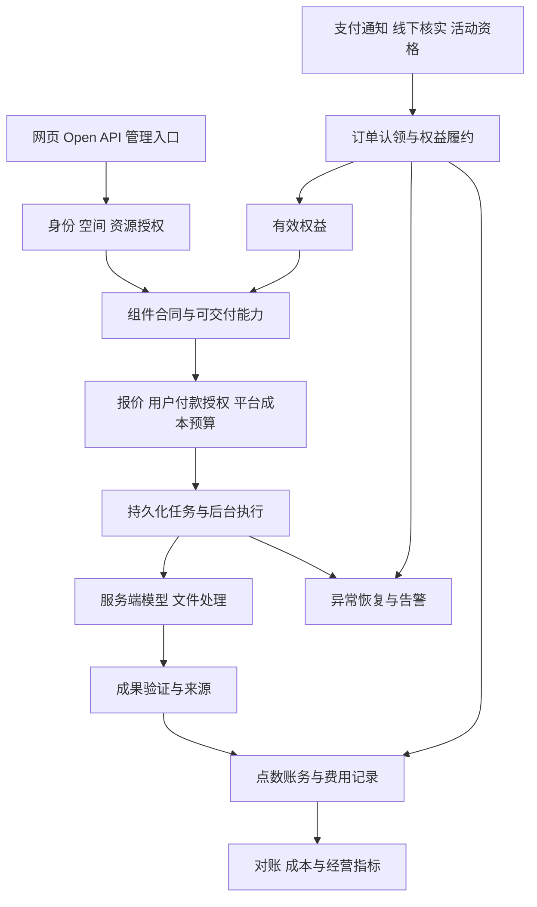

# 知阁·舟坊：产品、业务、商业与费用安全综合审核及重构方案

日期：2026-11-05（Asia/Shanghai）  
状态：**待负责人审核的方案，不是实施授权或上线验收记录。**  
范围：用户首次理解与使用、任务价值与留存、个人/企业权益、运营/财务后台、模型与文件资源、交易/余额/退款/费用控制、分期重构与验收。

## 1. 总体判断

项目已经形成 Next.js + Prisma/MySQL 的全栈业务基础，具有空间、岗位、组件合同、真实模型执行、任务、资料、知识、账务和支付模块。建议保留这些资产，做有边界的分期重构。

**目前不应把它认定为适合直接扩大付费使用量的完整商业产品。** 本轮补查发现：部分入口不经收款就变更收费权益；会员额度补齐存在重复增加余额快照；席位通知有并发重复发放；企业池回收不减少原分桶；人工退款可把企业消费变成个人钱包额度。页面表达也有承诺与能力证据不一致、首次使用概念过多的问题。

对用户，应形成“看懂用途→尝试真实工作→获得可核查成果→继续复用或协作→愿意付费”的过程。对平台，应形成“确认可交付与可收费→受预算控制地执行→核对成本和收入→恢复异常→有证据后扩大规模”的过程。

业务目标不是强行提高访问次数；低频业务应按自身周期衡量复用。也不能用涨价、减少退款或拒绝导出掩盖交付问题。需要争取的是**用户认可的有效成果，以及足以支撑持续服务的收入**。

### 1.1 本轮证据与限制

- 继承并补充[上一轮架构逆向报告](../code-facts-2026-11-05/REPORT.md)，不改写历史快照。
- 本轮读取首页、定价、注册/登录、空间中枢、组件入口、经营统计及交易/权益/账务/模型/文件处理核心代码。
- [费用和权益入口线索与源码哈希](source-evidence.json)：501 个输入文件哈希，其中 33 个 API 文件命中本轮费用/权益相关符号。命中包括 import/helper，不等于完整控制流审计；没有命中也不等于没有成本。
- [离线复现](verification.json)：5 个隔离场景使用当前真实函数，认证、持久化和通知使用 stub；其中会员场景同时加载真实 upgrade handler 与真实 grantPoints。
- [模块覆盖与后续验收矩阵](COVERAGE-AND-ACCEPTANCE.md)：逐模块列明已观察范围、需求落点、未完成验证，防止将全方位设计审核误当全量上线验收。
- 未连接数据库，未读取环境密钥，未调用业务 API、模型、支付、邮件或短信；未核对真实部署配置、收款账单和实际损失。
- 页面按源码审阅；未进行浏览器渲染、可用性测试或真实客户访谈。首次使用和流失判断是待验证的设计判断，不是已测转化率。
- 无法保证“绝不存在任何费用漏洞”或“必然盈利”。可验收的是明确范围内的性质、攻击/故障场景、成本预算和发布门槛，之后持续监测。

## 2. 对照成熟产品实践：采用哪些原则

这里的“大厂理念”落实为可检查的行为，不代表照搬大型组织的基础设施或商业价格。

| 一手实践 | 本项目的适用原则 | 具体落点 |
|---|---|---|
| [Microsoft 人机交互指南](https://www.microsoft.com/en-us/research/project/guidelines-for-human-ai-interaction/)覆盖首次、持续、出错和长期交互 | 清楚表达能力，允许纠错，降低错误后的恢复成本 | 场景说明、材料预检、结果来源、重试/退款说明 |
| [Google HEART 研究](https://research.google/pubs/measuring-the-user-experience-on-a-large-scale-user-centered-metrics-for-web-applications/)将产品目标映射到用户体验指标 | 除访问量外，衡量完成任务、持续使用与满意度 | 首次有效成果、重复有效使用、结果采用/反馈 |
| [AWS SaaS Lens](https://docs.aws.amazon.com/wellarchitected/latest/saas-lens/general-design-principles.html)强调租户隔离、自动开通、按租户观察使用和成本 | 企业边界一致，新增客户不同比例增加人工维护 | 企业资金/资料隔离、开通状态、租户成本视图 |
| [Stripe Webhooks](https://docs.stripe.com/webhooks)明确事件可能重复、乱序 | 回调不是唯一一次且有序到达的指令 | 验签、事件去重、业务权益唯一发放、异常恢复 |
| [Stripe 幂等请求](https://docs.stripe.com/api/idempotent_requests)说明重试识别与参数一致性 | 同一用户意图安全重试，改变请求参数不能冒用原键 | 订单/任务幂等键、请求摘要、唯一业务凭证 |

上述仅为设计参考，不是要求接入 AWS 或 Stripe，也不替代当前微信/支付宝的渠道验收。

## 3. 用户侧现状：为什么可能看不懂、用不顺或不回来

| 编号 | 代码或设计事实 | 可能影响 | 建议 |
|---|---|---|---|
| U01 | Hero 主标题“重塑软件工程：全链路效能操作系统”，并写死“60+”“300%” | 用户仍不清楚自己提交什么、得到什么；数字承诺缺少本轮证据 | 主标题先说明用户工作与成果；组件数由可公开服务状态统计；效率数字只展示有测量依据的案例 |
| U02 | Hero 点击建议用 setTimeout 切换固定预览；输入提交进入 studio 搜索 | 用户可能以为当前输入已被分析，实际只是切换演示或搜索 | 永久标注“示例预览”；真实开始按钮明确进入材料提交，保留用户意图 |
| U03 | CTA 写“7天免费试用、专属架构师1v1”；后台另有按月赠点、新空间赠点和等级试用字段 | 免费承诺不易统一，人工支持可能变成不可控成本 | 各活动有独立规则与预算；支持服务按能力/套餐声明，不对全部用户无条件承诺 |
| U04 | 定价同时展示个人会员、企业套餐、加油包、装配/调用等多个额度维度 | 用户难以判断“我要完成一次工作究竟买哪个” | 个人看任务使用；企业看协作与治理；用量费用统一解释；技术额度放详细说明 |
| U05 | 注册后再登录；登录时又尝试创建个人空间；studio 缺空间时跳中枢 | 流程有重复准备与中断可能，具体发生率待测 | 账户/空间准备统一幂等处理；保留原场景，完成登录后回到原任务 |
| U06 | 中枢包含推荐装配、空间、企业池、开发辅助；快捷工具是 API/Webhooks | 面向首次用户的下一步不够集中 | 新用户以“完成第一项工作”为主；老用户以继续任务、复用模板和待审核为主 |
| U07 | 页面有“百倍效能”“解锁全部组件/离线运行时算力”等表达 | 发布目录数量与实际可交付能力可能被混淆 | 营销、组件页、合同门禁和模型就绪度共同控制展示；未验收场景清楚标明状态 |
| U08 | 后台 analytics 将登录记录去重视作活跃，任务条数视作使用 | 长会话用户可能被漏算，失败和重复任务也可能算增长 | 单列登录、有效使用、成果采用、付费和复用；按 cohort 与业务周期统计 |

证据：[Hero](../../src/components/HeroSection.tsx#L65)、[CTA](../../src/components/CTA.tsx#L42)、[定价](../../src/app/pricing/page.tsx#L769)、[注册](../../src/app/api/auth/register/route.ts#L44)、[登录](../../src/app/auth/login/page.tsx#L958)、[studio](../../src/app/studio/page.tsx#L139)、[中枢](../../src/app/workspace-hub/page.tsx#L727)、[统计](../../src/app/api/admin/analytics/route.ts#L10)。

## 4. 费用和权益问题：比增加用户量更先处理

### 4.1 新增的重要发现

P0 表示必须在扩大真实费用暴露前处理；P1 表示相关收费/企业功能开放前处理。级别是本项目建议的发布优先级，不是第三方漏洞评级。

| 编号/优先级 | 事实与触发条件 | 影响与证据级别 | 重构要求 |
|---|---|---|---|
| F01/P0 | POST membership/upgrade 仅要求有效用户与可升级等级，直接更新会员、创建 SUCCESS 订单/账单；没有网关收款或模拟环境隔离 | 离线真实 handler 复现：不提供付款凭据也升级并产生成功账单；线上需满足等级数据条件 | 正常自助入口只创建待支付订单；收费权益只能由验证后的支付事实或有审批的赠送/人工授予生效 |
| F02/P0 | membership/upgrade 先将 quota 余额补到等级额度，再调用 grantPoints 发同一增量；后者再次递增余额 | 真实 handler + grantPoints 隔离复现：原0、目标100，余额快照200，分桶仅100。证明不一致，不等于已证明额外100在所有路径都能花 | 一次账务原语同时建桶、余额与流水；业务层禁止先改余额再“补流水” |
| F03/P0 | POST workspace/upgrade-plan 的 owner 检查后直接开套餐、配额和 SUCCESS 账单，无支付确认 | 静态确认；已有 workspace/upgrade 的收费分支走 PENDING 支付，说明正确入口之外仍有旧绕行路径 | 统一购买履约；旧接口停止直接授予收费权益，前端隐藏按钮不能代替后端关闭 |
| F04/P0 | create-enterprise 接收 plan，检查套餐 active/purchasable 与账号空间名额后，直接按该 plan 建空间/配额并可能发 trialGift；没有验证该目标套餐已购买 | 静态确认；受账号名额、目标配置与套餐价格条件限制。零价格合法开通和付费套餐绕行必须区分 | 新建免费空间只能得到明确的免费权益；付费套餐绑定已付订单或已授权权益凭证，不能将 purchasable 当成 purchased |
| F05/P0 | fulfillPaidOrder 在事务前读 PENDING；席位分支无条件 increment，订单 update 使用事务外 billingModel | 可控并发隔离复现：同一购买2席位的订单被两次处理，最终加4席位；即使事务回调串行也发生 | 订单认领/业务唯一权益凭证 + 同一事务里的权益和订单更新；所有购买分支分别验证并发与崩溃 |
| F06/P0 | recycleEnterprisePool 递减空间快照、增加个人钱包并建新桶，但不扣来源桶；接口允许 OWNER/ADMIN 回收到调用者个人钱包 | 隔离复现原企业桶100保留、目标钱包新桶100，桶总额200而快照合计100。赠送/付费来源与期限也丢失；线上二次花费未验证 | 按来源桶迁移，守恒且保留限制；企业资产转个人须单独授权，不能仅凭“成员管理员”默认允许 |
| F07/P1 | 人工退款批准统一 grantPoints(scope=WALLET,userId=申请人)，申请只汇总本人 CONSUME，未扣除自动已退款金额 | 静态确认：可能将企业支出/赠送点转成个人通用额度，或自动退过后又批准一次；需审批才产生这项影响 | 所有退款共享同一可退余额，按付款来源退回；任务退款总额不超过净实扣；状态冲突不能多次裁决 |
| F08/P0条件性 | production 未配置 PAYMENT_MODE 已按 REAL，但显式 mock 仍返回 MOCK，模拟确认实际调用 grantPoints | production+mock 离线复现。未读取真实环境，不能声称线上正处于mock | 公网生产禁止模拟资金进入可消费真实资源的账本；联调使用独立库/凭证/额度，启动检查失败即拒绝相关能力 |
| F09/P0 | GET system/maintenance?action=emergency_disable 会 setMaintenanceMode(false)，该前缀公开 | 静态确认公开写配置；用户可影响运营停止措施 | 公开查询严格只读；紧急开关单独管理员写入口、再验证、强审计；并与费用暂停开关区分 |
| F10/P1条件性 | subscription-expire 仅在 CRON_SECRET 存在时验证，缺失时没有 production 特判；cron 前缀公开 | 静态确认；若生产漏配，匿名可触发扫描、降级。另有可选直接清零余额分支 | 调度入口缺凭证一律拒绝；到期由请求时权益判定兜底；余额到期按来源账务原语处理，不直接清零 |
| F11/P1 | Studio 平台模型兼容路径按固定点数收费，成本底线不足只告警，另有“超过定价2倍”才拒绝 | 静态确认；有成本防护但不保证正收益。成本不完整时校验还可能失效 | 折扣后的收入基础与保守执行成本比较；不满足授权利润/补贴预算就不开始调用 |
| F12/P1 | BYOK_OFFICIAL multiplier=10000+服务费bps | 离线确认15%配置产生115%基础价格；客户是否已另付供应商费用、当前生效路径需核实 | 明确平台收的是服务费还是代付采购费，不能文案15%而按115%解释不清 |
| F13/P1 | 存储 quota 缺失或limit<=0时放行；校验与累加分离；删除采用读后绝对回写且吞掉记账错误 | 静态确认并发/缺配置可能超配额或统计漂移；0 与 -1 混同 | 明确0=不可用或未配置，-1=明确特批；原子预留空间，失败释放，定期与物理对象对账 |
| F14/P1 | 文件解析使用 Promise.race 超时返回，没看到被超时的解析任务被终止；Map 计数单实例有效 | 静态确认该超时本身不取消后台工作；底层进程实际退出尚未验证 | 可取消/隔离解析执行、页数/解压/CPU/内存限制；实例间共享并发与预算 |
| F15/P1 | send-sms 当前 TODO真实供应商，但仍返回已发送并输出验证码；send-email实际SMTP，验证码与执行限流多为内存 | 静态确认，不能把当前短信接口说成已经产生短信供应商费用；接通后存在滥用面 | 短信未接通应诚实阻断；接通前做目标/IP/账号/平台发送预算；验证码不进入常规日志 |
| F16/P1 | legacy quota/recharge 以 order:read 或 system:manage 授权直接入账，新单号每次生成；人工退款也接受 order:read | 静态确认，不是任何普通用户都可直充；但读权限被用于资金写操作，未强制匹配收款凭证 | 独立入账/退款权限、收款凭证唯一关联、必要审批和稳定幂等；用户与管理员域分别校验 |

具体证据：

- F01/F02：[会员升级](../../src/app/api/membership/upgrade/route.ts#L23)、[额度补齐](../../src/app/api/membership/upgrade/route.ts#L99)、[真实 grantPoints](../../src/lib/credit-service.ts#L210)。
- F03：[套餐直开](../../src/app/api/workspace/upgrade-plan/route.ts#L282)；F04：[企业创建](../../src/app/api/workspace/create-enterprise/route.ts#L102)。
- F05：[支付履约](../../src/lib/payment/fulfill.ts#L46)、[模拟确认的同类分支](../../src/app/api/payments/mock/confirm/route.ts#L1)。
- F06：[来源桶回收实现](../../src/lib/credit-service.ts#L1887)、[调用者钱包目标](../../src/app/api/workspace/quota/recycle/route.ts#L54)。
- F07：[退款申请](../../src/app/api/user/refund-requests/route.ts#L209)、[退款裁决](../../src/app/api/admin/refund-requests/[id]/resolve/route.ts#L23)。
- F08：[支付模式](../../src/lib/payment-gateway.ts#L27)；F09：[维护查询写配置](../../src/app/api/system/maintenance/route.ts#L110)；F10：[到期任务](../../src/app/api/cron/workspace-subscription-expire/route.ts#L20)。
- F11：[固定扣点](../../src/app/api/studio/handler.ts#L2821)、[成本警告](../../src/app/api/studio/handler.ts#L3570)、[成本底线](../../src/lib/component-cost-floor.ts#L30)。
- F12：[BYOK费率](../../src/lib/billing/pricing-center.ts#L148)；F13：[存储](../../src/lib/storage-quota.ts#L25)；F14：[解析](../../src/app/api/studio/extract-text/route.ts#L82)。
- F15：[短信](../../src/app/api/auth/send-sms/route.ts#L31)、[邮件](../../src/app/api/auth/send-email-code/route.ts#L41)；F16：[直充](../../src/app/api/workspace/quota/recharge/route.ts#L32)。

### 4.2 上一轮发现仍需纳入，不以新发现替代

完整身份失败后平台鉴权弱兜底、API Key 未检查账号业务状态、公开调试资料、FREE额度读时回写100、费率按数值大小误转换、批量调价不原子且审计计数错误、初始化校验未绑定、标准岗位跨空间统计、业务请求改表、配额双路径关系等，详见[冻结报告F01–F12](../code-facts-2026-11-05/REPORT.md)。本轮未修复这些项，也没有假定其他未提交改动已消除它们。

### 4.3 尚待专门验证的费用面

支付回调需强制完整的金额/币种/渠道/商户/应用/订单归属/交易号验证，不能只验证签名后就信任所有业务字段；当前履约对金额为null跳过比较，微信解析侧也没有完整商户/应用字段检查，须按真实渠道规范补验证。支付宝签名不等于当前代码已强制所有关键字段存在。这里不宣称已复现伪造支付。

取消订单与付款同时发生、过期后真实到账、升级中套餐改价、购买席位后原套餐到期、并发创建空间绕过数量限制、会员到期是否全面回收权益、邀请失效与Key撤销、多步模型的实际调用/失败/重试成本、企业创建后删除重建刷赠送、模型测试与提示词润色的成本归属，也都需要专项检查。

测试连接不是零成本：管理端模型测试已有真实最小调用，用户自带模型测试也可发送请求。已有小输出限制应保留，仍需调用预算、权限和计量。更换自带模型测试地址时复用旧密钥的行为，须核实密钥是否可能发到未授权目标；不进行实际外发测试。

## 5. 产品重构：用户第一眼能理解并开始

### 5.1 产品定位与首页

建议对外定位先用：“帮助研发人员和团队，把已有材料整理成可检查、可复用的工作成果。”最终文字依首批已验收场景调整。

首页按以下顺序组织：

1. **给谁、解决什么、产出什么。** 不让用户先理解操作系统、组件编号、装配矩阵。
2. **少数清晰场景。** 场景卡说明输入、输出、范围和费用入口；只展示可公开且有验收证据的场景。
3. **真实成果示例。** 使用授权/脱敏材料，永久标明示例；不将固定动画伪装成分析当前输入。
4. **一个主要行动。** “开始处理我的材料”；次要行动“查看示例成果”；企业咨询独立为次级入口。
5. **能力与数据说明。** 支持什么文件、材料发往哪里、费用如何产生、失败如何处理。
6. **可信证据。** 已验证客户案例、测量方法或安全能力；没有证据就不写300%、百倍、全部可用、专人服务等承诺。

组件名称可在专业目录保留，用户主流程优先使用业务任务名称。搜索普通文字只是寻找场景时，要明确表示“搜索”，不能让用户误认为已开始模型处理。

建议验收：让5名不熟悉产品且符合目标画像的人独立查看首页，至少4人能用自己的话回答“我能拿它做什么、要提交什么、得到什么、下一步点哪里”。这是建议的可用性验收设计，不是已测结论；不据此保证商业转化。

### 5.2 新用户流程

- 个人空间准备由统一服务幂等完成，不让注册、登录和不同页面各自推导一套规则；不为页面改动新增无必要的空间。
- 会员购买、团队配置和岗位装配不应成为个人首次完成任务的前置学习负担。
- 企业上下文明确：正在为哪个企业工作、谁付款、资料对谁可见。邀请员工进入企业不能默认要求先买个人会员。
- 来源意图在登录跳转后保留。对尚未上传的文件不声称已保存；敏感材料临时保存要有明确期限和权限。
- 免费预检是产品体验建议，不代表OCR/复杂解析无限免费。高成本预检必须受单独预算和限额控制。

### 5.3 任务页与结果页

任务开始前只集中回答：材料合格吗、会得到什么、资料接收范围是什么、由谁付款、费用多少/最多多少。模型和复杂参数放专业设置，仍由服务端校验。

任务中显示真实状态，不虚构进度或承诺无法验证的完成时间；关页可继续查询。结果页展示成果、来源、需人工复核处、使用的版本及费用；提供保存、导出、按同一模板继续工作。缺少有效成果不能显示成功。

留存来自用户认可的工作积累：个人模板、项目资料版本、后续差异分析、团队审核与知识复用。每项高成本后续动作重新明确费用；查看或下载已有成果原则上不应再次触发模型收费。重复请求只有在权限、材料版本、模板/模型版本与有效期一致时才能复用，不得跨企业泄露数据。

## 6. 商业模式：可选方向与利润约束

建议采用“个人任务使用＋企业协作治理订阅＋资源使用费用”的候选结构，但不预设价格，也不自动执行商业开关。

| 产品层 | 收费对应的价值 | 不应出现的设计 |
|---|---|---|
| 个人真实体验 | 在限定材料与成本内获得一次有用成果 | 大量赠点却做不完一次工作，或无限反复免费调用 |
| 个人付费使用 | 清楚范围内的成果交付、复用与项目历史 | 个人必须购买企业管理套餐才能继续简单任务 |
| 企业订阅 | 多人协作、成员治理、审核、权限、组织知识与管理能力 | 将基础身份安全当作额外付费解锁，或无上限昂贵调用 |
| 使用费用 | 模型、文件处理及约定的资源消耗 | 用“调用次数不限”暗示所有真实成本资源不限 |
| 自带模型 | 平台实际提供的协作、处理和服务价值 | 平台未代付模型却不清楚地重复收完整采购费 |
| 定制服务 | 单独约定交付范围、验收、支持与维护 | 普通低价套餐无限人工支持或无范围定制 |

### 6.1 简化会员与空间的购买关系

当前会员决定账号级权益、空间套餐决定团队级权益，可以有这种分工，但同一价值不应要求用户重复购买两层才能使用。

建议：个人使用能力绑定个人；企业套餐归企业付款与组织，不永久依赖创建者的个人会员。企业成员是否有个人会员不影响其已授权企业功能。个人会员仅提供明确的个人价值，不把“购买创建资格”与“购买企业套餐”变成难理解的双重门槛。

席位、存储、调用、执行次数、并发、模型额度分别说明单位和来源；基础额度+增购怎么组合、多个权益是否取最大或相加必须逐项确定。不能用一条通用max规则处理所有额度，也不能永远保留历史最大值导致到期权益不收回。

### 6.2 经营测算口径

每个收费场景先做成本卡：模型输入/输出/缓存、多步调用、失败与重试、文件/OCR、存储/下载、支付及必要直接服务成本。未知成本标未知，不按0。

经营分析可按下式检查，正式财务收入确认及税务处理由财务负责人确定：

> 一次交付的贡献额 = 对应实际服务收入 − 为这次交付产生的可变成本。

> 期间经营结果 = 期间服务收入 − 可变交付成本 − 免费体验/推广投入 − 固定运营开支。

同一费用不能同时计入可变成本与固定开支。充值是收款事实，尚未消费的余额对应后续服务义务，不能简单全部当成已赚利润。赠送点不产生收款；折扣点必须保留实际购买价和来源，不用固定面值伪造利润。

售价下限可用“保守估计的直接成本÷(1−目标贡献率)”辅助审查，其中目标贡献率、风险准备和利润目标待批准。公式不是保证盈利：还要验证需求、固定支出、退款率和推广成本。

### 6.3 固定价与用量价

首批对用户保留简单、可理解的收费。固定价只覆盖明确材料规模、质量与输出范围；超出范围重新报价或拆分。内部准确计量成本。用量计费只有在负责人批准、服务端结算与真实验证通过后启用；生产当前真实Token结算硬关闭不得为了重构自行解除。

报价绑定用户、空间、付款账户、组件/合同版本、输入摘要、允许模型策略、执行范围、价格/优惠版本与有效期。用户修改材料、模型或执行范围后重新报价。确认后不能因后台改价随意改变已授权收费；供应商成本突变应按服务承诺停止新增未履约订单、提供重新确认/退款方案，并计入风险准备，不能向用户秘密补扣。

### 6.4 免费、优惠与获客

保留明确标记的低成本示例；新用户真实体验应足以验证价值，但有用户/活动/平台预算。注册赠送、新空间赠送、套餐赠送、推荐奖励不能各自孤立叠加；同一活动资格按批准的账号/组织规则认领，不以删除重建空间重置资格。风险识别要支持申诉，不只按IP封禁整家企业。

优惠在发布前模拟折扣后收入与重度/普通使用成本；大额活动和高风险改价需审核。推荐奖励建议以有效付费及适用退款观察结果为条件、有总额上限，不能无限按注册发放。

投放先小批观察首次有效成果、回访、付费和可归因成本；样本小或使用周期长时标明不确定性，不用未经证据支持的终身价值放大投放。若负责人不接受阶段性整体亏损，则免费和投放不能依赖假定的未来收入，固定支出也必须纳入当期资源安排。

## 7. 费用安全目标设计：统一事实、守恒、可恢复

### 7.1 三类事实分别保存

1. **钱：**订单应付、渠道确认、交易号、退款和对账。
2. **权益：**套餐、席位、存储等服务资格及有效期；赠送权益有单独审批来源。
3. **点数与成本：**发放桶、消费、预留、退款、到期、转账，以及供应商实际用量/成本。

它们用稳定业务ID关联，不能把一条SUCCESS账单同时当作钱已到、权益已发和任务已完成的证明。

### 7.2 必须验收的业务不变量

- 同一支付交易不得支撑多个独立订单入账；同一订单的同一权益只发一次。去重事件ID之外，还要约束业务订单与权益类型。
- 没有验证支付/审批/活动资格，不发收费权益或可消费点数。
- 席位、订阅和点数分别实现幂等；不能把充值有唯一流水理解成所有权益都安全。
- 余额快照与有效来源桶的可用/冻结金额按定义一致；成员额度若是分账账户，守恒核对要包含成员账户。
- 转账只改变归属，不创造总可用额；保留付费/赠送限制和到期信息。
- 自动退款、人工退款和结算释放共享可退额度；释放预留不能再被当成一次新的付款退款。
- 退款回到真实付款来源，企业资源不得因员工提出申请转成其个人资产。商业补偿另建经审批的补偿事实。
- 所有金额/点数在边界检查安全整数与最大值，核心计算使用整数/BigInt，不混用未验证Number、Float与分/元。
- 高风险写操作有独立权限、原因、必要再验证与不可静默丢失的审计；只读权限不能发放资金。
- 同一个幂等键必须绑定相同请求摘要；更改账户、点数或内容后不能命中旧成功结果。

### 7.3 支付与履约状态

建议分别表达支付PENDING/PAID/CANCELLED/EXPIRED/REFUNDING/REFUNDED，以及权益PENDING/PROVISIONING/ACTIVE/FAILED_RECOVERABLE等状态；最终字段名依现有模型最小改动确定。

通知先验签并核对订单事实，持久化去重/收款记录；权益发放与状态推进使用事务内认领/锁和唯一凭证。同库修改使用同一transaction client。跨系统副作用使用可重试的持久化待办，网络“只能调用一次”不可作为正确性前提。

本地超时与“渠道后来确实收款”可以同时发生。此时保留收款事实，进入补发/退款/人工队列；不能只返回拒绝等待渠道无休止重试。取消与支付交错同样处理。用户查询只读，不再触发补权益。

### 7.4 成本预算与执行

每次产生费用前检查账号、企业、能力、授权、付款账户和平台成本预算。预算要原子预留，包含正在执行但尚未结算的工作；只看余额和每分钟次数不够。

平台至少有：单任务最高授权、用户/企业限额、组件/模型并发、平台日/月费用预算、免费活动总预算、管理测试预算、短信邮件预算、存储与下载策略。具体数值从真实供应商账单和质量样本测算后批准。

任务流程：创建稳定任务→成本/用户资金分别预留→投递后台执行→记录供应商调用意图/尝试→验证成果→完成费用与结果→通知。超时未知时先核实供应商/任务状态，不能盲重试。一个业务任务可以有多个attempt，每次外部成本都记录；免费重试次数同样消耗平台预算。

会员/管理员权益里的“不限量”与供应商支出必须分开。即使账号有无限席位/调用资格，或点数以-1表示无限，也不能豁免平台成本预算和供应商真实资源上限；管理员内部测试也需要归入内部成本。

保留Studio和Open共用执行核心；提示词润色、模型测试、提取/OCR、后台批量操作也纳入同一成本观察与各自策略。模型失败后用户退款不表示供应商退款，这部分损耗必须纳入成本与熔断判断。基础设施或供应商支持的硬限额作为额外防线，不把有延迟的账单告警当作实时硬限额。

## 8. 企业与管理员侧重构

### 8.1 企业组织

- 企业是资料、任务、订阅和企业资金的业务归属；员工个人账号只是访问主体。
- 企业任务明确默认付款方。个人自费必须明确同意，界面显示成果仍归哪个空间，不把个人付款自动理解为个人私有资料。
- 成员月预算是使用上限；若成员余额表示实际划拨，则必须是有出入记录的账户转账，两者不能混用。
- 员工离职后撤销空间权限、授权Key及分享访问，保留企业历史成果、审计与账务；不能删除企业资产或自动收走个人资金。
- OWNER转移、企业关闭、退款到企业、余额迁移分别制定规则。企业管理员不能仅因可管理成员就把企业钱转到自己钱包。
- 套餐到期保留已购余额和历史成果的规则须明确；按来源处理赠送到期，不能用套餐到期直接清零全部余额。
- 超员/超存储时限制新增或按批准策略只读，提供续费/整理/导出入口，不能直接删除客户资料。
- 账号安全、租户隔离和正确计费是基础要求，不能作为高价套餐才能获得的安全条件。

### 8.2 平台后台

建议在保留现有入口兼容的基础上，按工作职责组织：

| 区域 | 管理员日常要完成什么 |
|---|---|
| 客户与使用 | 找到客户卡在哪一步、哪些企业需要支持 |
| 产品与交付 | 管组件合同/能力/验收/发布，不只统计目录数量 |
| 订单与财务处理 | 支付异常、权益失败、可退余额、线下收款核实和对账 |
| 模型与资源 | 健康、价格、容量、成本预算、测试额度和密钥生命周期 |
| 权限与安全 | 管理职责、授权、账号风险、企业隔离与高风险审计 |
| 经营分析 | 有效成果、留存/付费、折扣/免费成本、各租户及组件贡献 |

看订单、退款审批、人工入账、调价和授予权限分别授权。按风险采用独立审批，首期不必所有操作都双人审批；高金额、批量、越权授予或可提现/转移的操作应更严格。审计属于高风险变更必需证据，失败时不能默默成功。告警/通知可以异步，不应与已提交事实混淆。

恢复中心按“待处理原因、责任人、重试次数、金额/权益、下一步”展示，不要求运营直接改库。恢复动作仍走原业务服务并检查幂等。

## 9. 技术架构：保留单体，收拢关键规则

继续使用当前Next.js与MySQL；不因“大厂”概念直接拆微服务、换框架或重做全站UI。先在现有代码边界内明确服务职责：

建议的逻辑记录包括报价、支付事件/交易、权益发放凭证、资金转移、可退余额、成本预留、执行尝试、可靠待办和使用事件。优先确认现有表能否承载，不直接批准全部新表。原componenttask/pointledger/pointgrant、合同和模型注册表继续保留；无证据的旧成功记录不回填成真实收款。

`estimatedModelTokens`在当前平台固定收费路径实际承载固定扣点数，而不是实际模型Token。新增清晰语义和版本适配时必须区分“任务售价点数”“估算用量”“供应商真实usage”；历史账单按原版本解释，不能只重命名导致金额口径变化。

空间与quota双路径先只读核对；仅在映射明确后迁移为统一关联。费用/权益操作禁止业务请求顺手ALTER TABLE。并发/队列/共享计数需要可靠基础设施时单独批准运行成本；先复用现有数据库能力，确有需要再选共享计数或队列服务。

## 10. 增长、留存与利润的共同仪表盘

建议核心观察量：**用户认可并在后续工作中复用的有效成果**。来源必须可追溯，用户反馈与自动结构通过分开；不能把下载一次自动视为满意。

| 目标 | 事件与指标 | 防止误读 |
|---|---|---|
| 看懂价值 | 场景浏览→开始真实任务 | 不把示例切换当成执行成功 |
| 首次价值 | 初次提交→材料通过→首个有效成果，耗时与阻断原因 | 不把注册数当完成使用 |
| 交付质量 | 有效结果、失败/退款、重试原因、结果反馈 | 技术成功不等于业务认可 |
| 持续使用 | 同一批用户/企业在适用周期重复完成任务、复用模板/资料 | 同日刷新和重试去重；低频场景不强求DAU |
| 付费意愿 | 真实已付、有效消费、再次购买、续费 | 排除模拟、赠送、内部测试与人工补录伪收入 |
| 获客效率 | 渠道投入、免费成本、有效付费客户、观察期回收 | 标明样本与归因不确定性，不虚构LTV |
| 服务收益 | 按组件/企业/模型/渠道看收入基础、直接成本、贡献 | 付费/赠送/折扣分开，不用点数面值替代实收 |
| 运营安全 | 已收未履约、净扣已退冲突、重复权益、未知成本、对账差异 | 处理中的时差差异单列；不能为对平账直接抹余额 |

业务事件建议包含：actor、workspace、component、contractVersion、task/attempt、quote/order、channel、result/charge状态、reason、timestamp与version。避免把原始文件、验证码、密钥、敏感正文放进增长埋点。先做必要事件，不强行引入昂贵的外部分析平台。

实验一次只改变一个主要因素；质量、退款和单位成本作为护栏。任何提高转化却增加未经批准费用或损害交付的实验都不能扩大。具体指标目标基于第一批数据再定，本方案不编造转化率、利润率和市场价格。

## 11. 分期重构方案与停止条件

每一行是一个阶段，实施时还要拆成单一边界批次；不能把此表当作一次性批准所有数据库写入、模型费用或商业开关。

| 阶段 | 用户流程目标/范围 | 预计涉及的现有入口与边界 | 交付与验收证据 | 停止条件 |
|---|---|---|---|---|
| R0 费用和权限止损 | 未付款不能得到收费权益；安全暂停不被绕过 | membership/upgrade、workspace/upgrade-plan、create-enterprise、payment模式、maintenance、cron；上一轮鉴权/调试/费率项逐批处理 | 成功/拒绝测试，旧入口直接调用拒绝，无模拟资金流入真实账本；不启用真实收费 | 现有赠送/人工授权规则不明、发现真实错账、需生产写入时停止受影响工作并报告 |
| R1 资金与权益守恒 | 一笔钱只发一次，退款/转移不会创造或改变归属 | fulfill/mock confirm、credit-service、recycle、refund申请/裁决、会员补齐 | 并发/崩溃测试；相同订单唯一发放；来源桶/快照/流水一致；未解释差异归队列 | 历史归属/来源无法重建，不自动清零或自动补钱 |
| R2 预算与可靠交付 | 同一任务安全重试，有可控成本 | studio/Open共用核心、润色、模型测试、文件解析、共享限流、报价/成本记录 | 预算原子预留、超限无外部调用、已执行未知状态不盲重试、重启恢复、用户清楚费用状态 | 供应商成本/能力无证据、需要付费调用未获批、超预算时停止 |
| R3 首次价值 | 从首页场景进入首个有效成果 | Hero/CTA/pricing、register/login、workspace-hub、studio、composer/result | 首次使用可用性测试；无虚假承诺；保留原意图；选定场景真实业务验收 | 场景能力未通过不能用演示代替，也不能为页面好看发布未就绪能力 |
| R4 企业持续使用 | 预算、资料、成员离职、套餐到期正确 | workspace成员/岗位/资产/知识、subscription-expire、entitlement、账务中心 | 企业完整样本；无跨租户读取/退款转私；到期不误删资产；退订后查询导出按规则可用 | 数据归属、余额处理、续费/退款政策未确定，暂停相关变更 |
| R5 经营验证与扩展 | 有证据地扩大使用与推广 | analytics、finance、活动配置、可发布组件和运营恢复 | 真实收款/消费/成本对账，小范围试用/付费/回访数据，预算内推广 | 未知成本、关键差异、质量恶化或回收证据不足则不扩大投入 |

不指定未经测量的上线日期。下一步实施先选择R0中的一个明确纵切，例如“会员购买只创建待支付订单，未付款不生效”，把页面、API、权益与错误状态一起完成，再验收。只封住后端同时让页面引导用户走不通，也不能称完整交付。

## 12. 必须通过的费用验收场景

| 场景 | 必须保持的结果 |
|---|---|
| 同一支付通知重复/乱序/并发 | 收款事实可重复核实，权益只一次；旧事件不能倒退状态 |
| 履约中数据库回滚/进程退出/通知失败 | 不出现不可追踪部分提交；可安全恢复，通知失败不重复发钱 |
| 取消与支付交错；超时后真付款 | 保留渠道收款并有明确补发/退款处理；不永久“已付未到账” |
| 改订单金额、账户、套餐、折扣或重用幂等键 | 服务端拒绝与原报价/订单不一致的输入 |
| 未付款直接调用旧接口/换客户端/用Key | 得不到收费权益；不靠前端隐藏保护 |
| 企业支付、赠送支付、混合支付后退款 | 净实扣约束与原来源恢复；不转成个人可任意使用资金 |
| 自动已退后再申请人工退；批准/驳回/撤销并发 | 可退总额不超净扣；唯一裁决与凭证 |
| 企业回收/成员划拨并发 | 总额守恒、来源桶扣减、无负余额，保留期限和来源限制 |
| 赠送活动多账号/删空间重建/重复提交 | 资格和预算都限制；合法同企业多人有合理申诉 |
| 成本缺失/价格变化/昂贵模型/超长文件/输出失控 | 执行前阻断或重新授权；运行时有实际资源限制，不把告警当硬停止 |
| 多实例限流/同时启动多任务 | 共享额度和预算正确；包含在途成本 |
| 模型超时但供应商可能已完成 | 不盲目重复产生费用，记录attempt和未知状态 |
| 解析超时/压缩炸弹/并发上传/删除失败 | 工作进程可终止，配额不超发，文件与DB可对账 |
| 生产模拟配置/调度密钥缺失 | 相关能力拒绝启动/请求；不能悄悄开放 |
| 管理员测试模型/批量调价/人工入账 | 专门权限、预算、凭证和审计；读权限不允许写钱 |
| 封禁、注销、离职、Key撤销、跨企业访问 | 所有入口一致拒绝，退款与历史查询按批准例外处理 |

静态和stub通过后仍需：隔离数据库事务/唯一约束测试、并发测试、浏览器流程、供应商沙箱对账，以及获批的最小真实调用与人工业务验收。真实费用测试必须先说明预算、范围与清理/保留证据策略。测试沙箱不能留下可消耗真实资源的假余额。

## 13. 历史数据与发布策略

1. 先对当前订单/权益/账本做只读盘点，区分真实渠道、模拟、人工补录、赠送与未知来源；保留证据，不将历史SUCCESS一律视作已收款。
2. 对不一致记录建立差异清单与责任人；缺少付款/来源证据时禁止自动补发、扣回、删除或按猜测回填。
3. 新规则版本化，新订单和新任务先走受控小范围；历史任务、合同快照与账单继续按发生时事实解释。
4. 使用渐进迁移：新增必要记录→观察核对→切换唯一写入口→停止旧写入→稳定后再清理兼容。不是长期两套账并行写。
5. 高风险迁移要有备份、模拟演练、校验与回滚；回滚代码不能撤销已经确认的外部收款，应继续按恢复流程履约。
6. 对已有客户公布收费/赠送/到期规则变更的适用时间，不追溯秘密加价。按批准规则处理已购权益与未消费余额。

## 14. 负责人需要批准的决策

| 决策 | 建议方向 | 未决定会阻塞什么 |
|---|---|---|
| 首批客户与场景 | 先验证少数研发人员/团队的明确交付任务；以现有能力验收筛选，不按编号推定 | 首页定位、组件名单、试用流程 |
| 商业结构 | 个人任务使用、企业协作治理订阅、明确使用成本 | 定价页、购买关系与权益 |
| 收费方式 | 固定价必须绑定范围；实际用量计费单独批准 | 报价、成本门禁、账单 |
| 利润与成本政策 | 成本完整、付费正常使用有正贡献；免费/推广另设批准预算 | 售价底线、优惠、放量 |
| 前期投入承受度 | 是否允许有限前期投入；绝对不接受期间亏损时按可确认收入安排开支 | 获客节奏、支持承诺、固定支出 |
| 免费规则 | 完成有价值工作所需的受限体验，活动/用户/平台三层预算 | 赠送额度、资格与期限 |
| 企业资金归属 | 企业付款默认留企业；转个人另定授权及限制 | 回收、退款、离职与关闭 |
| 自带模型 | 平台服务费与客户供应商账单清晰区分，资料接收范围明确 | BYOK收费、降级/切换 |
| 售后规则 | 技术失败原路恢复；主观争议与商业补偿独立审批 | 可退额度、退款入口、服务承诺 |
| 到期/续费 | 订阅能力到期、购买点数和资料保留分开处理 | 降级、超额、席位与数据导出 |
| 运营与服务 | 谁负责支付/退款/模型故障及响应范围 | 支持页面与上线责任 |
| 首批实施范围 | 先批准单批R0止损，随后R1守恒 | 具体IDE任务或实现 |

批准总体方向不等于批准真实支付、定价、生产写库、清理历史余额、解除结算开关或产生模型费用。具体数值与上线条件另行列入对应批次。

## 15. 本批交付状态

| 项目 | 状态 |
|---|---|
| 目标流程 | 全面设计审查，提出用户价值、持续付费、企业管理与费用安全的统一重构方案 |
| 用户可见变化 | 无线上页面变化；交付本方案与复现/证据文件 |
| 后端/数据影响 | 未修改业务代码或数据库；仅新增本报告目录 |
| 验证 | 5项离线隔离场景通过，见verification.json；源码哈希与费用入口线索已保存 |
| 未完成 | 生产DDL/账单/配置核对、真实成本测算、浏览器/真实用户验证、渠道与数据库并发测试、问题修复 |
| 成本/风险 | 无真实付费调用；不能认定线上已损失，也不能认定没有损失 |
| 是否可扩大商业发布 | 当前证据不足；应先关闭/修复相关费用和权限缺口并通过专项验收 |
| 下一关口 | 负责人审核商业边界和首批止损范围，再生成有具体文件、验收、账务影响与停止条件的实施任务 |

复跑命令（项目根目录，依赖本地已安装typescript）：`node docs/product-business-review-2026-11-05/verify.cjs`。脚本只加载源码到隔离VM并使用stub依赖，向本报告目录写证据；不连接真实数据库或外部服务。
