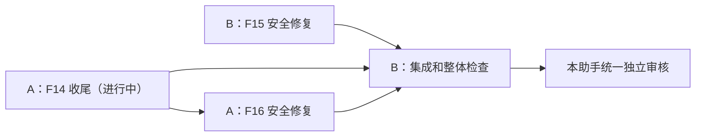

# 两个 IDE、四批交付，最终统一审核

这是原修复方案的开发排程，未增加新的产品阶段。当前正在开发的 IDE 记为 A；第二个 IDE 记为 B。用户本次要求允许后续安全修复在隔离范围内并行实现、集中送审，调整了此前逐批等独立审核再开发的顺序；**没有提前关闭 F14，也没有授权上线、真实迁移、真实收发消息、付款或改价格。**

| 批次 | 执行者 | 原方案对应 | 何时开始 | 交付位置 |
| --- | --- | --- | --- | --- |
| 1 / A1 | A | 正在执行的 F14 / R0-K1 收尾 | 继续现有任务，不重启、不重复开发 | docs/reviews/R0-K1-fix-report.md + 本目录 deliverables/A1/ |
| 2 / B1 | B | F15 验证码和发送成本保护 | 可与 A1 同时进行 | 本目录 deliverables/B1/ |
| 3 / A2 | A | F16 人工入账入口与专用权限/凭证保护 | A1 本地交付定格并停止写入后 | 本目录 deliverables/A2/ |
| 4 / B2 | B | 前三批集成与原要求的整体检查 | A1、B1、A2 全部定格后 | 本目录 deliverables/B2/ |

四份指令分别为 01-A-F14.md、02-B-F15.md、03-A-F16.md、04-B-INTEGRATION.md；都必须先读 COMMON-RULES.md。第一份是当前任务的交付/协作补充，不撤销现有完整收尾指令。

**现在只需：A 继续第1批，B 开始第2批。** 可以将第3、第4批也提前放入各自 IDE 的任务队列，但必须等文件交接条件满足再写代码。同一个 IDE 不并行执行自己的两份指令。

四批是三项原修复工作加一次集成检查，不是新增 F17。原 F07 人工退点暂停、F01–F13 已验收业务规则保持。F15/F16 的旧报告只作线索：已修复部分直接保留，不能按旧风险重复造功能。

若共享同一个项目目录，严格按 COMMON-RULES.md 的文件归属执行；若在不同副本开发，起点必须包含当前未提交/未跟踪的项目源码，不能只从旧 master/HEAD 重建。禁止复制 .env/密钥或用 git reset/clean 覆盖现有工作。

任务状态见 HANDOFF-REGISTER.md：当前只生成可转发指令，不伪称已向外部 IDE 发消息或收到接单。开发者自检结束只能记“已交付待审核”；本助手回到同一最终版本核验后才记“已验收”。不建立自动催办/后台监控。

最后把 B2 的 final-report.md 和 final-manifest.json 交回本聊天；附全部三项交付路径和未完成项。本助手将按 F14/F15/F16 分项给结论，有失败只退回对应原项，不重新扩大范围。
